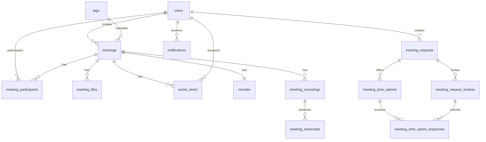

# Database Schema

Date: 2026-06-03

This document summarizes the PostgreSQL database schema for the DOST Meeting Management system.
The complete executable schema is maintained in `server/db/migrations/`.

## Entity Relationship Overview

## Core Tables

| Table                  | Purpose                                      | Key fields / constraints                                                                                                                                                                  |
| ---------------------- | -------------------------------------------- | ----------------------------------------------------------------------------------------------------------------------------------------------------------------------------------------- |
| `users`                | Authenticated staff accounts.                | `id`, `name`, unique `email`, `password_hash`, `role`, `department`, `created_at`.                                                                                                        |
| `meetings`             | Confirmed meeting records.                   | `id`, `title`, `starts_at`, `ends_at`, `timezone_name`, `status`, `created_by`, optional `tag_id`; `ends_at > starts_at`; status is `scheduled`, `completed`, `cancelled`, or `archived`. |
| `meeting_participants` | Meeting membership and meeting-scoped role.  | Composite primary key `(meeting_id, user_id)`; role is `organizer`, `attendee`, or `optional`; RSVP status was removed from the final schema.                                             |
| `meeting_files`        | Uploaded meeting materials.                  | `meeting_id`, `uploaded_by`, `file_name`, `mime_type`, `size_bytes`, `bucket_name`, unique `object_key`; 50 MB file-size limit.                                                           |
| `action_items`         | Tasks linked to meetings and users.          | `meeting_id`, `assignee_id`, `created_by`, `status`, `priority`, `source`; status is `todo`, `in_progress`, `blocked`, `completed`, or `cancelled`.                                       |
| `tags`                 | Meeting repository classifications.          | Unique `name`; meetings reference `tag_id`.                                                                                                                                               |
| `minutes`              | Dedicated one-to-one meeting minutes record. | Unique `meeting_id`, `content`, `key_discussions`, `decisions`, `facilitator_id`, `recorder_id`, `status`, `version`, optional `generated_from_transcript_id`.                            |
| `meeting_recordings`   | Meeting recording metadata.                  | `meeting_id`, `uploaded_by`, `file_name`, `mime_type`, `size_bytes`, `bucket_name`, unique `object_key`, `status`, `archived_at`; one active recording per meeting.                       |
| `meeting_transcripts`  | Scaffolded transcript records.               | `meeting_id`, optional `recording_id`, `source_file_id`, `created_by`, `status`, `transcript_text`, `segments`, `duration_seconds`, `error_message`.                                      |
| `notifications`        | Persisted in-app notifications.              | `recipient_user_id`, `type`, `entity_type`, `entity_id`, `title`, `detail`, `event_at`, `read_at`, `archived_at`, optional idempotency key.                                               |

## Scheduling Request Tables

| Table                           | Purpose                                             | Key fields / constraints                                                                                                                                                                                                   |
| ------------------------------- | --------------------------------------------------- | -------------------------------------------------------------------------------------------------------------------------------------------------------------------------------------------------------------------------- |
| `meeting_requests`              | Scheduling request before a meeting is confirmed.   | `title`, `duration_minutes`, `timezone_name`, `response_deadline`, `status`, `created_by`, optional `confirmed_meeting_id`; status is `draft`, `collecting_availability`, `ready_to_confirm`, `confirmed`, or `cancelled`. |
| `meeting_time_options`          | Candidate times offered for a meeting request.      | `meeting_request_id`, `starts_at`, `ends_at`, `sort_order`, `is_selected`; `ends_at > starts_at`; one selected option per request.                                                                                         |
| `meeting_request_invitees`      | Invitees asked to respond to a scheduling request.  | `meeting_request_id`, optional `user_id`, `email`, `name`, `response_status`, `invited_at`, `responded_at`; unique `(meeting_request_id, email)`.                                                                          |
| `meeting_time_option_responses` | Invitee availability responses for candidate times. | `time_option_id`, `invitee_id`, `is_available`; unique `(time_option_id, invitee_id)`.                                                                                                                                     |

## Important Indexes

| Area                               | Index examples                                                                                                                                                       | Reason                                                                               |
| ---------------------------------- | -------------------------------------------------------------------------------------------------------------------------------------------------------------------- | ------------------------------------------------------------------------------------ |
| Meetings                           | `meetings_starts_at_idx`, `meetings_status_idx`, `meetings_created_by_idx`, `meetings_tag_id_idx`                                                                    | Supports dashboard, repository filtering, ownership, and tag filtering.              |
| Participants                       | `meeting_participants_user_idx`, `meeting_participants_user_id_idx`                                                                                                  | Supports meeting access checks and user-specific meeting lists.                      |
| Files                              | `meeting_files_meeting_idx`, `meeting_files_uploaded_by_idx`, `meeting_files_file_name_tsv_idx`                                                                      | Supports file listing, ownership, and uploaded file-name search.                     |
| Action items                       | `action_items_meeting_idx`, `action_items_assignee_idx`, `action_items_status_idx`                                                                                   | Supports meeting tasks, user task lists, and status filtering.                       |
| Meeting requests                   | `meeting_requests_created_by_idx`, `meeting_requests_status_idx`, `meeting_time_options_request_idx`, `meeting_request_invitees_request_idx`                         | Supports host scheduling workflows and invitee response workflows.                   |
| Notifications                      | `notifications_user_feed_idx`, `notifications_user_unread_latest_idx`, `notifications_entity_idx`, `notifications_idempotency_key_idx`                               | Supports notification feed, unread summary, entity lookup, and duplicate prevention. |
| Recordings / transcripts / minutes | `meeting_recordings_one_active_per_meeting_idx`, `meeting_recordings_status_idx`, `meeting_transcripts_recording_id_idx`, `minutes_generated_from_transcript_id_idx` | Supports recording-to-minutes workflow scaffolding.                                  |

## Migration Files

| Migration                                        | Summary                                                                             |
| ------------------------------------------------ | ----------------------------------------------------------------------------------- |
| `0001_create_users.sql`                          | Creates staff user accounts.                                                        |
| `0002_create_meetings.sql`                       | Creates meetings and meeting status/date indexes.                                   |
| `0003_create_meeting_participants.sql`           | Creates meeting participant membership table.                                       |
| `0004_create_meeting_files.sql`                  | Creates uploaded meeting material metadata.                                         |
| `0005_create_action_items.sql`                   | Creates meeting action items.                                                       |
| `0006_add_archived_to_meetings_status.sql`       | Adds archived meeting status support.                                               |
| `0007_create_meeting_transcripts.sql`            | Creates transcript scaffold table.                                                  |
| `0008_create_meeting_recordings.sql`             | Creates recording metadata table.                                                   |
| `0009_create_meeting_summaries.sql`              | Historical summary table; later removed by workflow simplification.                 |
| `0010_create_minutes.sql`                        | Creates dedicated meeting minutes table.                                            |
| `0011_add_search_and_fk_status_indexes.sql`      | Adds search, foreign-key, and status indexes.                                       |
| `0012_add_meeting_notes_fields.sql`              | Adds meeting agenda/objective fields.                                               |
| `0013_create_tags_and_meeting_tag.sql`           | Creates tags and links meetings to tags.                                            |
| `0014_add_meeting_minutes_field.sql`             | Historical meeting-level minutes field.                                             |
| `0015_drop_meeting_minutes_from_meetings.sql`    | Moves minutes into the dedicated minutes table.                                     |
| `0016_move_meeting_roles_to_minutes.sql`         | Moves facilitator/recorder roles into minutes.                                      |
| `0017_create_meeting_requests.sql`               | Creates scheduling request, time option, invitee, and availability response tables. |
| `0018_drop_participant_rsvp.sql`                 | Removes RSVP from participant membership.                                           |
| `0019_create_notifications.sql`                  | Creates notification feed table and indexes.                                        |
| `0020_add_bucket_name_to_meeting_files.sql`      | Adds object-storage bucket metadata to meeting files.                               |
| `0021_default_meeting_files_bucket.sql`          | Sets default meeting files bucket.                                                  |
| `0022_recording_minutes_workflow_scaffold.sql`   | Adds recording/minutes workflow fields and active-recording constraint.             |
| `0023_simplify_meeting_statuses.sql`             | Simplifies meeting status values.                                                   |
| `0024_add_meeting_file_name_full_text_index.sql` | Adds full-text search index for uploaded file names.                                |

## Integrity Rules

- UUID primary keys are used for main entities.
- Foreign keys enforce user, meeting, participant, request, invitee, recording, transcript, and minutes relationships.
- Check constraints enforce valid status, priority, size, duration, and timestamp rules.
- Unique constraints prevent duplicate users, duplicate invitees per request, duplicate availability responses, and multiple selected time options.
- A partial unique index enforces only one active recording per meeting.
