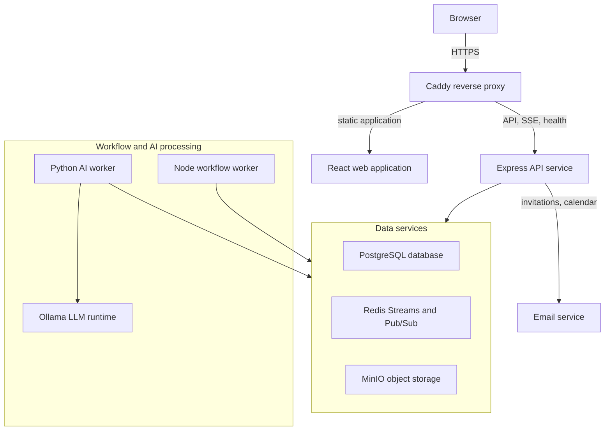
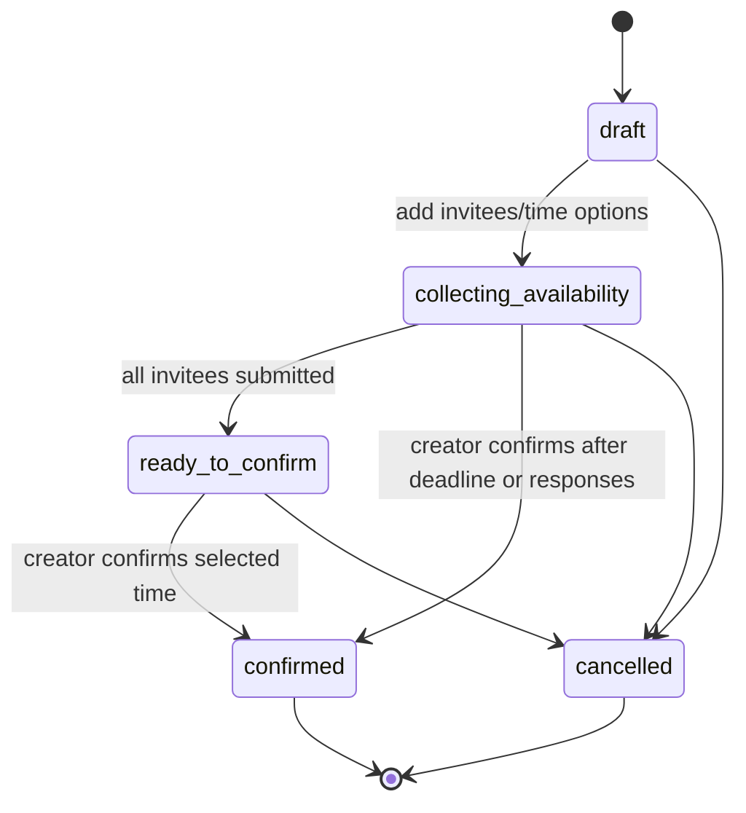
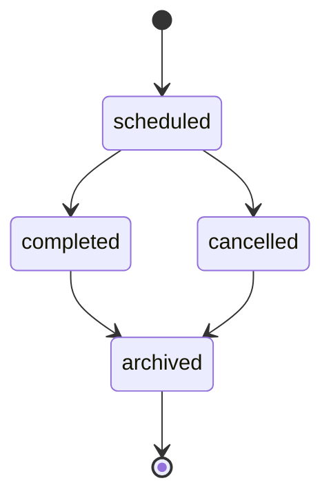
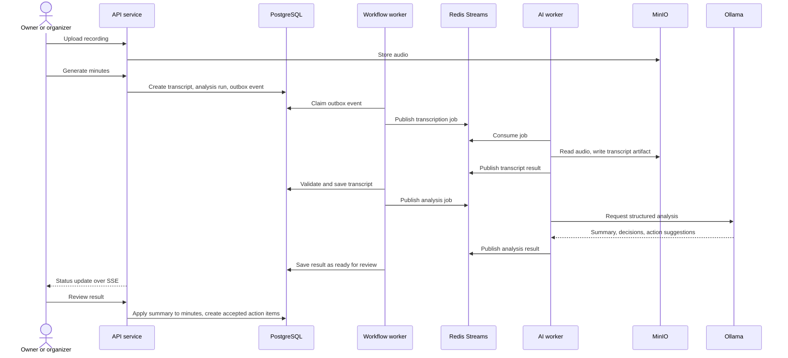
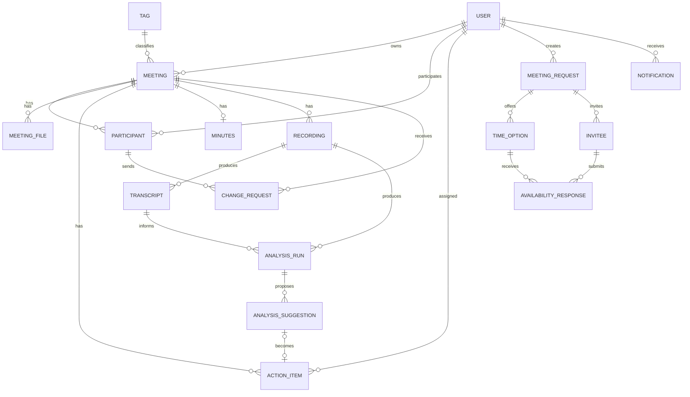

# DOST Meeting Management Technical Specification

Last updated: 2026-09-29

## 1. Purpose

DOST Meeting Management is a web application for scheduling meetings, collecting invitee
availability, confirming meeting times, managing materials and recordings, maintaining minutes,
tracking action items, and turning recordings into reviewable AI-generated summaries and action
items.

This specification is written for client review. It describes delivered behavior, security,
non-functional requirements, assumptions, deployment expectations, and planned extensions.

### 1.1 Feature Status Flags

| Flag                   | Meaning                                                                    |
| ---------------------- | -------------------------------------------------------------------------- |
| `[Implemented]`        | Available in the current application and included in the delivered scope.  |
| `[Scaffolded]`         | Foundation exists, but the full user-facing workflow is not yet delivered. |
| `[Semester 2 Planned]` | Planned for Semester 2; not part of the current delivery scope.            |
| `[Future Enhancement]` | Potential improvement outside the confirmed delivery scope.                |
| `[Proposed]`           | Target or policy suggested for client confirmation; not yet agreed.        |

## 2. Users and Roles

### 2.1 User Types

| User type        | Description                                       | Main goals                                                                         |
| ---------------- | ------------------------------------------------- | ---------------------------------------------------------------------------------- |
| Staff user       | DOST staff member with an email/password account. | View dashboard, join meetings, submit availability, complete action items.         |
| Meeting owner    | Person responsible for a meeting.                 | Schedule, confirm, and manage the meeting and its records.                         |
| Organizer        | Participant with the organizer role.              | Help manage participants, files, recordings, and minutes.                          |
| Attendee         | Participant with the attendee or optional role.   | View meeting records, contribute files and action items, request meeting changes.  |
| Administrator    | Staff member with the `admin` account role.       | Manage accounts and roles; view and manage all meetings; use the app as any staff. |
| IT administrator | Client infrastructure operator.                   | Configure environments, operate deployments, monitor health.                       |

### 2.2 Role Model

| Level   | Roles                                        | Scope                                                                                               |
| ------- | -------------------------------------------- | --------------------------------------------------------------------------------------------------- |
| Account | `staff` (default), `admin`                   | Whole system. Admin can do everything staff can, plus manage accounts and view/manage all meetings. |
| Meeting | `owner`, `organizer`, `attendee`, `optional` | One meeting. The owner is always an organizer. Meeting roles are assigned per meeting.              |

A person can hold different meeting roles in different meetings. Permissions combine both levels
(see section 7.2).

## 3. System Architecture

### 3.1 High-Level Architecture

Caddy is the only public entrypoint. The browser loads the React application from Caddy and sends
same-origin API requests to it; Caddy forwards them to the private API service.

### 3.2 System Components

| Component            | Technology                     | Status          | Responsibility                                                        |
| -------------------- | ------------------------------ | --------------- | --------------------------------------------------------------------- |
| Web application      | React single-page application  | `[Implemented]` | Dashboard, meetings, scheduling, minutes, files, action items, admin. |
| API service          | Node.js and Express            | `[Implemented]` | Business rules, authorization, validation, workflow transitions, SSE. |
| Node workflow worker | Node.js worker runtime         | `[Implemented]` | Dispatches workflow outbox events and persists AI results.            |
| Python AI worker     | Python, Whisper, Redis Streams | `[Implemented]` | Transcribes recordings; generates summaries and action suggestions.   |
| Ollama               | Private local LLM runtime      | `[Implemented]` | Structured analysis of completed transcripts.                         |
| Database             | PostgreSQL                     | `[Implemented]` | Authoritative business data and workflow state.                       |
| Object storage       | MinIO                          | `[Implemented]` | Meeting files, recordings, and AI artifacts.                          |
| Redis                | Redis Streams and Pub/Sub      | `[Implemented]` | AI commands and results; workflow-status invalidations.               |
| Reverse proxy        | Caddy                          | `[Implemented]` | TLS, static delivery, API routing, SSE.                               |

### 3.3 Application Modules

| Module                        | Status          | Summary                                                                            |
| ----------------------------- | --------------- | ---------------------------------------------------------------------------------- |
| Authentication and accounts   | `[Implemented]` | Login, registration, session validation, admin user and role management.           |
| Access control                | `[Implemented]` | Account roles and meeting roles enforced by one central permission definition.     |
| Dashboard and notifications   | `[Implemented]` | Upcoming meetings, requests, action items, notification feed with read/archive.    |
| Meeting repository and detail | `[Implemented]` | Search and filter meetings; participants, files, minutes, recording, action items. |
| Scheduling requests           | `[Implemented]` | Time options, invitations by email, availability, deadline, confirmation.          |
| Calendar invitations          | `[Implemented]` | iCalendar emails when a meeting is created, updated, or cancelled.                 |
| Change requests               | `[Implemented]` | Attendees privately ask the owner to change a meeting.                             |
| Files and minutes             | `[Implemented]` | Upload, download, delete materials; draft, approve, publish minutes.               |
| Recording-to-minutes workflow | `[Implemented]` | Recording, transcription, analysis, review, live status updates.                   |
| AI review                     | `[Implemented]` | Summary applied to minutes; action-item suggestions accepted, edited, or rejected. |

## 4. Core Workflows

### 4.1 Authentication

1. User submits email and password.
2. API validates credentials and returns a session token and user profile.
3. The web application sends the token with every protected API call.
4. The API rejects unauthenticated or unauthorized requests.

Registration is currently self-service, and new accounts receive the `staff` role. Only an admin
can change a role. `[Proposed]` For a closed staff-only deployment, restrict account creation to
administrators.

### 4.2 Meeting Request Scheduling

- A meeting request exists before a meeting is created.
- The creator sends invitations by email. Each invitee gets a personal, expiring link and can
  respond without signing in; invitees with accounts can also respond in the application.
- The response deadline closes submissions but does not cancel the request.
- The creator can confirm after the deadline even if some invitees did not respond.
- Confirming creates the meeting, adds known invitees as participants, and emails a confirmation.

### 4.3 Meeting Lifecycle and Calendar Invitations

Status transitions are forward-only. Archived meetings are terminal.

When a meeting is created, updated, or cancelled, participants and emailed invitees receive an
iCalendar (`.ics`) email. A sequence number lets calendar applications update or cancel the same
event. Delivery is best effort: a failed email does not block the change.

### 4.4 Files, Recordings, and Minutes

- Participants upload, list, and download meeting materials. Owners, organizers, and admins delete
  them. Download links are short-lived.
- A meeting has one active recording. Uploading stores the audio only; replacing it must be requested
  explicitly and archives the previous one.
- An owner or organizer starts generation explicitly. It requires the AI pipeline to be enabled.
- Minutes move through `draft`, `approved`, and `published`.
- Applying AI-generated content never approves or publishes minutes. A version check prevents
  overwriting concurrent edits.

### 4.5 Recording Analysis Workflow

- PostgreSQL holds the authoritative workflow state. Redis carries commands, results, and status
  invalidations only; audio and transcript text are never placed in Redis.
- Only one generation runs per recording at a time.
- Failed or duplicate deliveries are handled by bounded retries (three attempts by default) and
  guarded state transitions.
- Human review is mandatory. AI output is proposed, never applied automatically:
  - Each analysis run records its transcript, provider, model, and prompt version, and links each
    suggestion to the transcript passages that support it.
  - An owner or organizer can accept, edit, or reject each suggested action item. Accepting creates
    the action item and notifies the assignee; the reviewer and time are recorded.
  - If an accepted action item is later deleted, its suggestion is marked withdrawn.

### 4.6 Attendee Change Requests

- An attendee or optional participant can send the owner a private message (1–2000 characters)
  asking for a meeting change.
- The owner is notified, reads messages in a change-request inbox, and can mark them read.
- Organizers and admins cannot read these messages.

## 5. Database Design

Schema changes are managed as versioned SQL migrations (`0001`–`0040`).

### 5.1 Entity Relationship Overview

### 5.2 Logical Data Model

| Entity                | Purpose                                                                                   |
| --------------------- | ----------------------------------------------------------------------------------------- |
| User                  | Staff account with role (`staff` or `admin`) and department.                              |
| Meeting               | Scheduled meeting with owner, status, tag, and calendar version.                          |
| Participant           | Meeting membership and meeting role.                                                      |
| Meeting file          | Metadata for uploaded materials.                                                          |
| Action item           | Task attached to a meeting; may have one assignee.                                        |
| Meeting request       | Scheduling poll before a meeting exists.                                                  |
| Time option           | Candidate date/time for a request.                                                        |
| Invitee               | Person invited to respond; may link to a user; holds a hashed, expiring invitation token. |
| Availability response | An invitee's answer for one time option.                                                  |
| Tag                   | Meeting classification.                                                                   |
| Recording             | Meeting audio metadata.                                                                   |
| Transcript            | Whisper transcript, timestamped segments, and status.                                     |
| Analysis run          | Generated summary, key discussions, decisions, and provenance.                            |
| Analysis suggestion   | Proposed action item awaiting review, with reviewer and outcome.                          |
| Workflow outbox       | Durable workflow commands awaiting dispatch.                                              |
| Minutes               | One minutes record per meeting.                                                           |
| Notification          | Persisted in-app notification for one recipient.                                          |
| Change request        | Private attendee message to the meeting owner, with read state.                           |

### 5.3 Data Integrity Requirements

- Use stable unique identifiers and enforce relationships at the database level.
- Restrict status values (meetings, requests, minutes, transcripts, analysis runs, suggestions,
  action items) and account roles (`staff`, `admin`).
- Allow one selected time option per request and one active recording per meeting.
- Require provenance before an analysis run can be offered for review.
- Allow a suggestion to be accepted once and to create at most one action item.
- Remove change requests when their participant or meeting is removed.
- Store invitation tokens hashed only.
- Index common user, meeting, status, date, search, and notification queries.

## 6. API Interface

All APIs are exposed under the same domain through the reverse proxy and prefixed with `/api`,
except health paths. Request and response schemas are maintained in the Postman collection at
`docs/postman/dost-meeting-mgnt.postman_collection.json`. Access rules are in
section 7.2.

### 6.1 Authentication and Users

| Method | Path             | Purpose                                                                        |
| ------ | ---------------- | ------------------------------------------------------------------------------ |
| POST   | `/auth/register` | Create a staff account and issue a session.                                    |
| POST   | `/auth/login`    | Authenticate and issue a session.                                              |
| GET    | `/auth/me`       | Return the current user.                                                       |
| GET    | `/users`         | List users for assignment and participation.                                   |
| PUT    | `/users/:id`     | Update a user's profile, role, or password. Admin only; not one's own account. |
| DELETE | `/users/:id`     | Delete a user. Admin only; not one's own account.                              |

### 6.2 Meetings, Participants, and Change Requests

| Method | Path                                                   | Purpose                                                                                                      |
| ------ | ------------------------------------------------------ | ------------------------------------------------------------------------------------------------------------ |
| POST   | `/meetings`                                            | Create a meeting.                                                                                            |
| GET    | `/meetings`                                            | List accessible meetings with pagination, filters, search. Admins see all; `scope=mine` limits to their own. |
| GET    | `/meetings/:id`                                        | Read a meeting with participants and related records.                                                        |
| PUT    | `/meetings/:id`                                        | Update a meeting; enforces valid status transitions.                                                         |
| DELETE | `/meetings/:id`                                        | Delete a meeting.                                                                                            |
| GET    | `/meetings/:meetingId/participants`                    | List participants.                                                                                           |
| POST   | `/meetings/:meetingId/participants`                    | Add participants with a role.                                                                                |
| PATCH  | `/meetings/:meetingId/participants/:userId`            | Change a participant's role.                                                                                 |
| DELETE | `/meetings/:meetingId/participants/:userId`            | Remove a participant; organizer safeguards apply.                                                            |
| POST   | `/meetings/:meetingId/change-requests`                 | Attendee sends a change request to the owner.                                                                |
| GET    | `/meetings/:meetingId/change-requests`                 | Owner reads the change-request inbox.                                                                        |
| GET    | `/meetings/:meetingId/change-requests/:userId`         | Owner reads one participant's requests.                                                                      |
| PATCH  | `/meetings/:meetingId/change-requests/:requestId/read` | Owner marks a request as read.                                                                               |

### 6.3 Meeting Requests

| Method | Path                                                            | Purpose                                                  |
| ------ | --------------------------------------------------------------- | -------------------------------------------------------- |
| POST   | `/meeting-requests`                                             | Create a scheduling request.                             |
| GET    | `/meeting-requests/:requestId`                                  | Read request detail, time options, invitees, and status. |
| PUT    | `/meeting-requests/:requestId`                                  | Update request details.                                  |
| PUT    | `/meeting-requests/:requestId/time-options`                     | Replace candidate time options.                          |
| PUT    | `/meeting-requests/:requestId/invitees`                         | Replace invitees.                                        |
| POST   | `/meeting-requests/:requestId/send-invitations`                 | Email personal invitation links to invitees.             |
| GET    | `/meeting-requests/:requestId/invitees/:inviteeId`              | Read invitee-specific request detail.                    |
| PUT    | `/meeting-requests/:requestId/invitees/:inviteeId/availability` | Submit availability.                                     |
| POST   | `/meeting-requests/:requestId/confirm`                          | Confirm the selected time and create the meeting.        |
| DELETE | `/meeting-requests/:requestId`                                  | Cancel the request and its linked meeting, if any.       |
| GET    | `/public/invitations/:token`                                    | Read an invitation with its link; no sign-in.            |
| PUT    | `/public/invitations/:token/availability`                       | Submit availability with the link; no sign-in.           |

### 6.4 Files, Recordings, Minutes, AI Review, and Action Items

| Method | Path                                                             | Purpose                                                                  |
| ------ | ---------------------------------------------------------------- | ------------------------------------------------------------------------ |
| POST   | `/meetings/:meetingId/files`                                     | Upload a meeting material.                                               |
| GET    | `/meetings/:meetingId/files`                                     | List meeting files.                                                      |
| GET    | `/files/:id/download`                                            | Return a short-lived download link.                                      |
| GET    | `/files/:id/content`                                             | Stream file content.                                                     |
| DELETE | `/files/:id`                                                     | Delete a file.                                                           |
| GET    | `/meetings/:meetingId/recording`                                 | Get the active recording and its generation status.                      |
| PUT    | `/meetings/:meetingId/recording`                                 | Upload or replace the recording.                                         |
| DELETE | `/meetings/:meetingId/recording`                                 | Archive the active recording.                                            |
| POST   | `/meetings/:meetingId/recording/generate`                        | Start transcription and analysis.                                        |
| GET    | `/meetings/:meetingId/recording/analysis`                        | Read the latest analysis, suggestions, and transcript.                   |
| GET    | `/meetings/:meetingId/workflow/events`                           | Stream workflow status updates (SSE).                                    |
| GET    | `/meetings/:meetingId/minutes`                                   | Read or initialize minutes.                                              |
| PUT    | `/meetings/:meetingId/minutes`                                   | Update minutes.                                                          |
| PUT    | `/meetings/:meetingId/minutes/:minutesId`                        | Update a specific minutes record.                                        |
| POST   | `/meetings/:meetingId/minutes/apply-generated`                   | Apply the generated summary to draft minutes.                            |
| PATCH  | `/meetings/:meetingId/analysis-suggestions/:suggestionId`        | Edit a proposed action-item suggestion.                                  |
| POST   | `/meetings/:meetingId/analysis-suggestions/:suggestionId/accept` | Accept a suggestion and create the action item.                          |
| POST   | `/meetings/:meetingId/analysis-suggestions/:suggestionId/reject` | Reject a suggestion.                                                     |
| GET    | `/meetings/:meetingId/action-items`                              | List a meeting's action items.                                           |
| POST   | `/meetings/:meetingId/action-items`                              | Create an action item.                                                   |
| GET    | `/action-items`                                                  | List my items (`scope=mine`) or items in meetings I own (`scope=owned`). |
| GET    | `/action-items/:id`                                              | Read one action item.                                                    |
| PUT    | `/action-items/:id`                                              | Update content, assignee, status, or priority.                           |
| DELETE | `/action-items/:id`                                              | Delete an action item.                                                   |

### 6.5 Dashboard, Notifications, Tags, and Health

Health paths have no `/api` prefix so infrastructure can check them directly.

| Method | Path                          | Purpose                                             |
| ------ | ----------------------------- | --------------------------------------------------- |
| GET    | `/dashboard`                  | Dashboard aggregate data.                           |
| GET    | `/notifications/summary`      | Latest topbar notification state.                   |
| GET    | `/notifications`              | Paginated notifications.                            |
| POST   | `/notifications/:id/read`     | Mark one notification as read.                      |
| POST   | `/notifications/read`         | Mark selected notifications as read.                |
| POST   | `/notifications/read-all`     | Mark all notifications as read.                     |
| POST   | `/notifications/:id/archive`  | Archive one notification.                           |
| POST   | `/notifications/archive-read` | Archive all read notifications.                     |
| GET    | `/tags`                       | List meeting tags.                                  |
| POST   | `/tags`                       | Create a meeting tag.                               |
| GET    | `/health/live`                | Confirm the process is running.                     |
| GET    | `/health/ready`               | Confirm PostgreSQL, Redis, and MinIO are reachable. |
| GET    | `/health`                     | Readiness status and process uptime.                |

## 7. Security Requirements

### 7.1 Authentication and Session Security

- Require an authenticated session for everything except login, registration, health, and personal
  invitation links.
- Store only hashed passwords; never return hashes, secrets, or credentials.
- Keep production secrets in the deployment environment, not in committed files.
- Session lifetime is configurable (default 7 days).
- Read the account role from the database on every request, so a role change takes effect
  immediately.

### 7.2 Authorization

Permissions are enforced on the server by one central definition. Access is granted when either the
account role or the meeting role matches.

| Capability                                                                                                                | Who                                                     |
| ------------------------------------------------------------------------------------------------------------------------- | ------------------------------------------------------- |
| View a meeting and its participants, minutes, files, recording, analysis, and action items                                | Admin, owner, organizer, attendee, optional             |
| Upload and download files; create, update, and delete action items                                                        | Admin, owner, organizer, attendee, optional             |
| Update or delete the meeting; manage participants; delete files; update minutes; manage recordings; review AI suggestions | Admin, owner, organizer                                 |
| Send a change request                                                                                                     | Attendee, optional                                      |
| Read change requests                                                                                                      | Owner only (admins and organizers excluded for privacy) |
| Create a meeting or meeting request; list users and tags                                                                  | Any signed-in user                                      |
| Manage, invite for, confirm, or cancel a meeting request                                                                  | Request creator                                         |
| Submit invitee availability                                                                                               | The invitee or the request creator                      |
| Manage user accounts and roles                                                                                            | Admin (not their own account)                           |

Additional rules:

- An action-item assignee can view that item and change only its status.
- Non-participants have no access to a meeting or its records.
- The owner cannot be removed or demoted, and the last organizer cannot be removed or demoted.
- Role values are limited to `staff` and `admin`, enforced by the API and the database.

### 7.3 Input Validation

- Validate all external input at the API boundary: identifiers, dates, time ranges, statuses, roles,
  priorities, and search parameters.
- Reject malformed values early with consistent error responses.
- Bound free-text search inputs.
- Limit uploads to 50 MB per file and validate file type per workflow.

### 7.4 Network and Proxy Security

- Keep the reverse proxy as the only public entrypoint; keep the API, database, Redis, MinIO, AI
  worker, and Ollama on private networks.
- Use HTTPS for browser traffic.
- Rate-limit the API and use proxy-aware client IP handling.
- Do not expose administrative consoles publicly.

### 7.5 File and Object Storage Security

- Require meeting access before listing, uploading, streaming, or downloading files.
- Use short-lived presigned download links.
- Separate meeting files, recordings, and AI artifacts into different buckets.
- Treat large recording uploads as high risk; chunked or direct-to-storage upload is
  `[Semester 2 Planned]`.

## 8. Non-Functional Requirements

| Area         | Requirement or current behavior                                                                                                                           | Status               |
| ------------ | --------------------------------------------------------------------------------------------------------------------------------------------------------- | -------------------- |
| Performance  | AI processing benchmark on CPU: about 18 minutes for a 26-minute recording (about 12 transcription, 6 analysis). Not a service level.                     | Measured             |
| Performance  | Response-time targets for dashboard, search, meeting detail, and uploads, verified by load testing.                                                       | `[Proposed]`         |
| Performance  | API rate limit of 100 requests per 5 minutes per client IP by default; configurable.                                                                      | `[Implemented]`      |
| Capacity     | Expected use: 10,000 employees, 1,000–2,000 daily active users (project plan).                                                                            | Sizing basis         |
| Capacity     | Initial AI host: 8 vCPU / 16 GiB RAM for low volume, 16 vCPU / 32 GiB for a small pilot; one AI worker. Concurrent long recordings need capacity testing. | Guidance             |
| Capacity     | Separate persistent disk for AI models, containers, and retained recordings. Recording retention period to be set by the client.                          | `[Proposed]`         |
| Availability | Current deployment is single-host and not highly available. Liveness and readiness endpoints support monitoring.                                          | `[Implemented]`      |
| Availability | Availability target and recovery objectives (time and data loss), and a highly available topology.                                                        | `[Proposed]`         |
| Backup       | Verified PostgreSQL backup before every release with migrations; MinIO backup on a defined schedule; restore drills. Redis is not a backup.               | Documented procedure |
| Backup       | Backup frequency and retention period.                                                                                                                    | `[Proposed]`         |
| Logging      | Request failures and workflow errors are written to service logs. AI logs must not contain transcript text or credentials.                                | `[Implemented]`      |
| Traceability | AI results record transcript, provider, model, and prompt version; suggestion reviews record reviewer and time.                                           | `[Implemented]`      |
| Audit        | Persistent audit trail for role changes, account deletions, and meeting deletions. None exists today.                                                     | `[Proposed]`         |

## 9. Assumptions and Constraints

### 9.1 Assumptions

- Deployment is on-premise. Recordings and transcripts are processed by local Whisper and Ollama;
  no external AI service is used.
- Email delivery (SMTP or Resend) is available for invitations, confirmations, and calendar updates.
- Browsers can reach MinIO over HTTPS for presigned downloads.
- AI output is advisory and is reviewed by a person before it is used.

### 9.2 Constraints

| Constraint                                                                                       | Impact                                                              |
| ------------------------------------------------------------------------------------------------ | ------------------------------------------------------------------- |
| Single-host deployment (Docker Compose for PostgreSQL, Redis, MinIO; systemd for API and worker) | Host or disk failure causes outage; not a high-availability design. |
| PostgreSQL, Redis, and MinIO are single-node                                                     | Backups and restore tests are required even for a pilot.            |
| CPU AI is the only verified path; the GPU profile is an unverified benchmark option              | Processing takes minutes per recording.                             |
| Transcription and analysis language defaults to English                                          | Other languages need configuration and evaluation.                  |
| Uploads are limited to 50 MB per file, including recordings                                      | Large recordings need chunked or direct upload (Semester 2).        |
| Redis must not evict Stream data when AI is enabled                                              | Requires the `noeviction` memory policy.                            |
| Registration is open by default                                                                  | Closed registration needs a policy decision (see 4.1).              |

## 10. Deployment

### 10.1 Deployment Model

1. Browser traffic reaches Caddy over HTTPS.
2. Caddy serves the built React application and forwards API and health requests to the private API
   service.
3. The API connects to PostgreSQL, Redis, and MinIO over private networks.
4. When AI is enabled, the Node workflow worker dispatches outbox events and consumes results, while
   the Python AI worker runs Whisper and Ollama jobs.

The current model is a single host: Docker Compose runs PostgreSQL, Redis, and MinIO; systemd runs
the API and workflow worker. It suits demonstrations and small internal pilots, not
high-availability production. The `[Future Enhancement]` path is an orchestrated container platform
(Docker Swarm, or Kubernetes/OpenShift where the client already operates it) with explicit high
availability, persistent storage, backup, and failover for PostgreSQL, Redis, and MinIO.

Host bootstrap, release, backup, automated deployment, and AI operations procedures are in
`docs/deployment-guidelines.md`. The GPU option is in `docs/gpu-benchmark-runbook.md`.

### 10.2 Environment Configuration

Production values are set per environment and stored in the client's secret-management mechanism.
`.env.example` is the reference list of variable names.

| Area                 | Variables                                                                                                                                                      |
| -------------------- | -------------------------------------------------------------------------------------------------------------------------------------------------------------- |
| Runtime              | `NODE_ENV`, `PORT`, `TRUST_PROXY`, `RATE_LIMIT_WINDOW_MS`, `RATE_LIMIT_MAX`                                                                                    |
| Database             | `DATABASE_URL`, `POSTGRES_USER`, `POSTGRES_PASSWORD`, `POSTGRES_DB`                                                                                            |
| Redis                | `REDIS_URL`                                                                                                                                                    |
| Object storage       | `MINIO_ENDPOINT`, `MINIO_PORT`, `MINIO_USE_SSL`, `MINIO_ACCESS_KEY`, `MINIO_SECRET_KEY`, `MINIO_BUCKET_FILES`, `MINIO_BUCKET_AUDIO`, `MINIO_BUCKET_AI_RESULTS` |
| Authentication       | `JWT_SECRET`, `JWT_EXPIRES_IN`                                                                                                                                 |
| Email                | `EMAIL_PROVIDER` (`smtp` or `resend`), `EMAIL_FROM`, `CLIENT_URL`, `INVITATION_TOKEN_TTL_DAYS`, `SMTP_*` or `RESEND_API_KEY`                                   |
| Web application      | `VITE_API_BASE_URL` (same-origin behind Caddy)                                                                                                                 |
| AI                   | `AI_PIPELINE_ENABLED`, `AI_TRANSCRIPTION_PROVIDER` (`whisper`), `AI_ANALYSIS_PROVIDER` (`llm`), `WHISPER_MODEL`, `OLLAMA_MODEL`                                |
| Automated deployment | `DEPLOY_HOST`, `DEPLOY_USER`, `DEPLOY_SSH_KEY` (secrets); `DEPLOY_PATH`, service names (variables)                                                             |

## 11. Testing and Validation

| Scope                    | Validation expectation                                                                       |
| ------------------------ | -------------------------------------------------------------------------------------------- |
| Functional testing       | Login, dashboard, meeting creation, scheduling requests, files, minutes, recording review.   |
| API testing              | Authentication, validation errors, pagination, status transitions.                           |
| Permission testing       | Each capability in 7.2 for admin, owner, organizer, attendee, optional, and non-participant. |
| Database testing         | Migration application, integrity constraints, relationship behavior.                         |
| File testing             | Upload, download, stream, delete, size limits, unauthorized access rejection.                |
| Security testing         | Protected routes, rate limiting, private change requests, admin-only account management.     |
| Deployment smoke testing | Liveness and readiness, login, dashboard, core meeting workflow, file access.                |
| Load testing             | Dashboard, meeting search, meeting detail, uploads, and action-item updates.                 |

Readiness health fails when PostgreSQL, Redis, or MinIO is unavailable. Liveness only confirms the
process is running.

## 12. Delivered Scope and Planned Improvements

| Item                                | Status                 | Client-facing note                                                                    |
| ----------------------------------- | ---------------------- | ------------------------------------------------------------------------------------- |
| Core meeting management             | `[Implemented]`        | Create, list/search, detail, participants, files, minutes, action items.              |
| Meeting request scheduling          | `[Implemented]`        | Email invitations with personal links; creators confirm after responses or deadline.  |
| Calendar invitations                | `[Implemented]`        | iCalendar emails on create, update, and cancel.                                       |
| Attendee change requests            | `[Implemented]`        | Private attendee messages to the owner, with notification and inbox.                  |
| Dashboard and notifications         | `[Implemented]`        | Upcoming meetings, requests, action items, notification state.                        |
| Speech-to-text transcription        | `[Implemented]`        | Whisper transcripts with timestamped segments.                                        |
| AI summaries and action-item review | `[Implemented]`        | Local LLM summaries, decisions, and suggestions reviewed by a person.                 |
| RBAC and admin controls             | `[Implemented]`        | Account roles, admin user management, and central permission checks (see 7.2).        |
| Large recording upload reliability  | `[Semester 2 Planned]` | Chunked or direct-to-storage upload for recordings above the 50 MB limit.             |
| On-prem AI model evaluation         | `[Future Enhancement]` | Model, GPU, latency, accuracy, and data-governance trade-offs.                        |
| Additional notification channels    | `[Future Enhancement]` | Push, Slack, Teams, or similar; email is limited to invitations and calendar updates. |
| Containerized production deployment | `[Future Enhancement]` | Orchestrated platform with high availability (see 10.1).                              |
