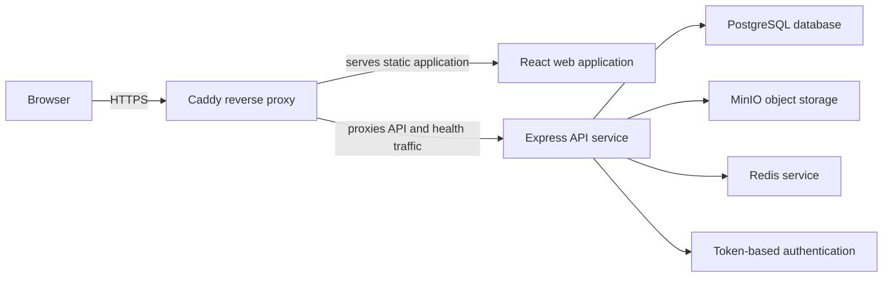
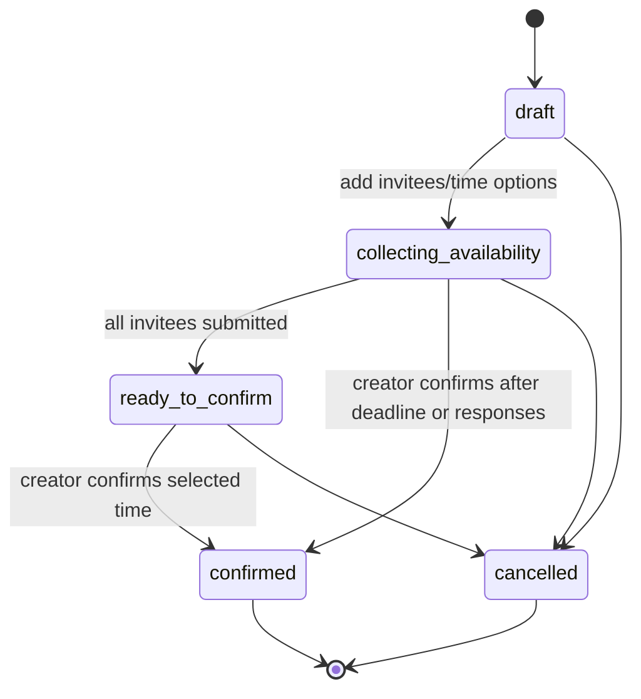
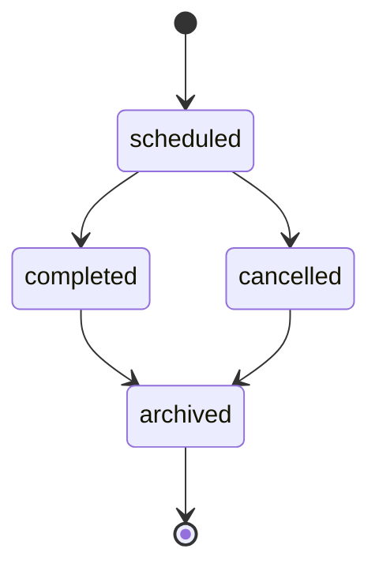
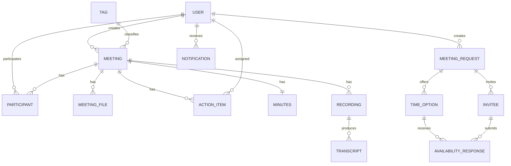
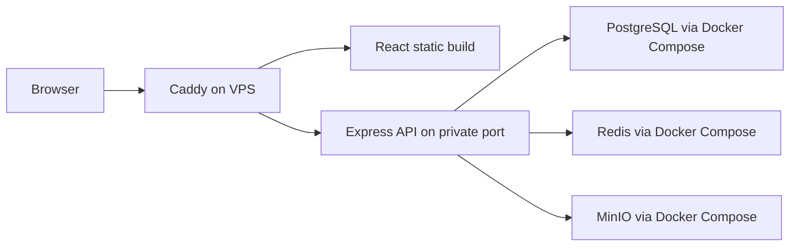

# DOST Meeting Management Technical Specification

Last updated: 2026-05-20

## 1. Purpose

DOST Meeting Management is a web application for scheduling meetings, collecting invitee
availability, confirming final meeting times, managing meeting materials and recordings,
maintaining minutes, tracking action items, and showing dashboard notifications.

This specification is written for client review. It describes the delivered system behavior,
planned Semester 2 extensions, deployment expectations, security requirements, and an initial
on-premise sizing guide for 10,000 registered users.

### 1.1 Feature Status Flags

| Flag                   | Meaning                                                                                 |
| ---------------------- | --------------------------------------------------------------------------------------- |
| `[Implemented]`        | Available in the current application and included in the delivered scope.               |
| `[Scaffolded]`         | Foundation exists, but the complete user-facing workflow is not yet delivered.          |
| `[Semester 2 Planned]` | Planned for Semester 2 and should not be treated as part of the current delivery scope. |
| `[Future Enhancement]` | Potential improvement outside the currently confirmed delivery scope.                   |

## 2. User Characteristics

| User type         | Characteristics                                                 | Main goals                                                                                                | System access                                         |
| ----------------- | --------------------------------------------------------------- | --------------------------------------------------------------------------------------------------------- | ----------------------------------------------------- |
| Staff user        | Authenticated DOST staff member with an email/password account. | View dashboard, access assigned meetings, submit availability, manage assigned action items.              | Authenticated web app and API access.                 |
| Meeting creator   | User who creates a meeting or meeting request.                  | Create meeting requests, add time options, invite participants, confirm meetings, manage meeting records. | Full control of their created meetings and requests.  |
| Meeting organizer | Participant with an organizer role.                             | Help manage participants, files, recordings, and minutes for a meeting.                                   | Elevated meeting-scoped permissions.                  |
| Attendee          | Participant with an attendee role.                              | View meeting detail, access files/minutes, complete action items.                                         | Meeting-scoped read/collaboration permissions.        |
| IT administrator  | Client-side system or infrastructure administrator.             | Configure environments, operate deployments, manage capacity, validate service health.                    | Infrastructure and application administration access. |

The system supports general user profile fields such as role and department. Meeting-level
authorization is primarily based on meeting creator and participant role.

## 3. System Architecture

### 3.1 High-Level Architecture



Caddy is the public browser-facing entrypoint. The browser loads the React application from Caddy
and sends same-origin API requests back to Caddy. Caddy then forwards API and health requests to the
private Express API service. The browser does not call the private API service directly.

### 3.2 System Components

| Component       | Technology / approach                         | Status                 | Client-facing responsibility                                                                 |
| --------------- | --------------------------------------------- | ---------------------- | -------------------------------------------------------------------------------------------- |
| Web application | React single-page application                 | `[Implemented]`        | Dashboard, meeting repository, meeting detail, scheduling, minutes, files, and action items. |
| API service     | Node.js and Express                           | `[Implemented]`        | Business rules, authorization, validation, workflow transitions, file orchestration.         |
| Database        | PostgreSQL                                    | `[Implemented]`        | Meeting metadata, users, participants, requests, minutes, action items, notifications.       |
| Object storage  | MinIO                                         | `[Implemented]`        | Meeting files, recordings, and generated audio/transcript artifacts.                         |
| Redis           | Redis-compatible service                      | `[Scaffolded]`         | Readiness dependency now; planned queue/cache foundation for Semester 2.                     |
| Reverse proxy   | Caddy                                         | `[Implemented]`        | TLS termination, static web delivery, API routing, and browser-facing traffic control.       |
| AI services     | Speech-to-text and summarization integrations | `[Semester 2 Planned]` | Recording transcription, AI summaries, and draft action-item extraction.                     |

### 3.3 Application Modules

| Module                         | Status                 | Summary                                                                                          |
| ------------------------------ | ---------------------- | ------------------------------------------------------------------------------------------------ |
| Authentication                 | `[Implemented]`        | Staff login, session validation, authenticated API access.                                       |
| Dashboard                      | `[Implemented]`        | Upcoming meetings, pending meeting requests, availability requests, action items, notifications. |
| Meeting repository             | `[Implemented]`        | Searchable and filterable meeting list with meeting file visibility.                             |
| Meeting detail                 | `[Implemented]`        | Meeting metadata, participants, materials, minutes, recording, and action items.                 |
| Scheduling requests            | `[Implemented]`        | Candidate time options, invitee availability, deadline handling, final confirmation.             |
| Participant management         | `[Implemented]`        | Add/remove participants and manage meeting-scoped participant roles.                             |
| File management                | `[Implemented]`        | Upload, list, download, stream, and delete meeting materials.                                    |
| Minutes management             | `[Implemented]`        | Meeting minutes record with editable content and publication fields.                             |
| Action items                   | `[Implemented]`        | Meeting-linked and user-linked action-item tracking.                                             |
| In-app notifications           | `[Implemented]`        | Notification feed, read/unread state, archive actions.                                           |
| Recording-to-minutes workflow  | `[Scaffolded]`         | Recording metadata and generation status foundation.                                             |
| AI transcription and summaries | `[Semester 2 Planned]` | Transcription, AI-generated summaries, and suggested action items from recordings.               |
| Expanded RBAC/admin controls   | `[Semester 2 Planned]` | App-wide administrative controls and role-aware management workflows.                            |

## 4. Core Workflows

### 4.1 Authentication

1. User submits email and password.
2. API validates credentials.
3. API returns an authenticated session token and user profile.
4. The web application uses the token for subsequent protected API calls.
5. The API rejects unauthenticated or unauthorized requests.

Registration policy should follow the client's operating model. For closed staff-only deployments,
account creation should be limited to approved administrative processes.

### 4.2 Meeting Request Scheduling



Important behavior:

- Meeting requests exist before a confirmed meeting is created.
- Invitees submit availability for offered time options.
- The response deadline closes invitee submissions but does not automatically cancel the request.
- The creator may confirm a meeting after the deadline even when some invitees did not respond.
- Confirming creates the scheduled meeting and adds known invitee users as participants.

### 4.3 Meeting Lifecycle



Status transitions are forward-only. Archived meetings are treated as terminal records.

### 4.4 Files, Recordings, and Minutes

- Meeting materials are uploaded through the web application and stored in object storage.
- Meeting participants can list and download materials for meetings they can access.
- Organizers and creators can manage meeting materials and recordings.
- Download links are short-lived.
- Minutes are stored as a dedicated meeting resource.
- `[Scaffolded]` Recording generation status exists today.
- `[Semester 2 Planned]` Recording upload reliability, audio extraction, transcription, AI summaries,
  and suggested action-item generation will be completed in Semester 2.

## 5. Database Design

### 5.1 Entity Relationship Overview



### 5.2 Logical Data Model

| Entity                | Purpose                                                           | Main relationships                                             |
| --------------------- | ----------------------------------------------------------------- | -------------------------------------------------------------- |
| User                  | Authenticated staff account and profile.                          | Creates meetings and requests; receives action items.          |
| Meeting               | Confirmed or scheduled meeting record.                            | Has participants, files, minutes, recordings, action items.    |
| Participant           | Meeting membership and meeting-scoped role.                       | Links users to meetings.                                       |
| Meeting file          | Metadata for uploaded meeting materials.                          | Belongs to one meeting and one uploader.                       |
| Action item           | Task created from or attached to a meeting.                       | Belongs to one meeting; may be assigned to one user.           |
| Meeting request       | Scheduling poll before a meeting is confirmed.                    | Has invitees and candidate time options.                       |
| Time option           | Candidate date/time option for a meeting request.                 | Receives invitee availability responses.                       |
| Invitee               | Person invited to respond to a meeting request.                   | May link to an existing user account.                          |
| Availability response | Invitee response for a candidate time option.                     | Belongs to one invitee and one time option.                    |
| Tag                   | Meeting repository classification.                                | Classifies meetings.                                           |
| Recording             | Dedicated meeting recording metadata.                             | Belongs to one meeting; may produce transcripts.               |
| Transcript            | `[Scaffolded]` Transcript and generation status record.           | Belongs to one recording and meeting.                          |
| Minutes               | One meeting minutes record containing prepared meeting notes.     | Belongs to one meeting.                                        |
| Notification          | Persisted in-app notification shown in dashboard/topbar contexts. | Belongs to one recipient user and may reference system events. |

### 5.3 Data Integrity Requirements

- Use stable unique identifiers for all primary records.
- Enforce meeting, participant, request, invitee, and recording relationships at the database level.
- Enforce valid status values for meetings, requests, minutes, transcripts, and action items.
- Enforce only one selected scheduling time option per meeting request.
- Enforce only one active dedicated recording per meeting.
- Maintain indexes for common user, meeting, status, date, search, and notification queries.

## 6. API Interface

All application APIs are exposed under the same browser-facing domain through the reverse proxy.
Application paths are prefixed with `/api` unless noted otherwise. Exact request/response schemas
should be confirmed during integration and acceptance testing.

The detailed API specification, including endpoint grouping, sample requests, path/query parameters,
and expected responses, is maintained in the Postman collection at
`docs/postman/dost-meeting-mgnt.postman_collection.json`.

### 6.1 Authentication and User Session

| Method | Path          | Resource             | Purpose                                      |
| ------ | ------------- | -------------------- | -------------------------------------------- |
| POST   | `/auth/login` | Authentication login | Authenticate a user and issue a session.     |
| GET    | `/auth/me`    | Current user         | Return the current authenticated user.       |
| GET    | `/users`      | User directory       | List users for assignment and participation. |

### 6.2 Meetings

| Method | Path                                        | Resource             | Purpose                                                                    |
| ------ | ------------------------------------------- | -------------------- | -------------------------------------------------------------------------- |
| POST   | `/meetings`                                 | Meetings             | Create a scheduled meeting.                                                |
| GET    | `/meetings`                                 | Meetings             | List accessible meetings with pagination, status/date filters, and search. |
| GET    | `/meetings/:id`                             | Meeting detail       | Read one accessible meeting with participants and related records.         |
| PUT    | `/meetings/:id`                             | Meeting detail       | Update meeting fields and enforce valid status transitions.                |
| DELETE | `/meetings/:id`                             | Meeting detail       | Delete a meeting where the user has sufficient permission.                 |
| GET    | `/meetings/:meetingId/participants`         | Meeting participants | List participants.                                                         |
| POST   | `/meetings/:meetingId/participants`         | Meeting participants | Add participants by user and role.                                         |
| PATCH  | `/meetings/:meetingId/participants/:userId` | Meeting participant  | Update a participant role.                                                 |
| DELETE | `/meetings/:meetingId/participants/:userId` | Meeting participant  | Remove a participant while preserving organizer safeguards.                |

### 6.3 Meeting Requests

| Method | Path                                                            | Resource               | Purpose                                                  |
| ------ | --------------------------------------------------------------- | ---------------------- | -------------------------------------------------------- |
| POST   | `/meeting-requests`                                             | Meeting requests       | Create a scheduling request.                             |
| GET    | `/meeting-requests/:requestId`                                  | Meeting request detail | Read request detail, time options, invitees, and status. |
| GET    | `/meeting-requests/:requestId/invitees/:inviteeId`              | Invitee request detail | Read invitee-specific request detail.                    |
| PUT    | `/meeting-requests/:requestId/time-options`                     | Request time options   | Replace candidate time options.                          |
| PUT    | `/meeting-requests/:requestId/invitees`                         | Request invitees       | Replace invitees.                                        |
| PUT    | `/meeting-requests/:requestId/invitees/:inviteeId/availability` | Invitee availability   | Submit availability responses.                           |
| POST   | `/meeting-requests/:requestId/confirm`                          | Request confirmation   | Confirm selected time and create a meeting.              |
| DELETE | `/meeting-requests/:requestId`                                  | Meeting request        | Cancel the request and linked meeting when applicable.   |

### 6.4 Files, Recordings, Minutes, and Action Items

| Method | Path                                              | Resource             | Purpose                                                    |
| ------ | ------------------------------------------------- | -------------------- | ---------------------------------------------------------- |
| POST   | `/meetings/:meetingId/files`                      | Meeting files        | Upload a meeting material.                                 |
| GET    | `/meetings/:meetingId/files`                      | Meeting files        | List meeting files.                                        |
| GET    | `/files/:id/download`                             | File download        | Return an authorized download link.                        |
| GET    | `/files/:id/content`                              | File content         | Stream authorized file content.                            |
| DELETE | `/files/:id`                                      | File                 | Delete file metadata and object storage record.            |
| GET    | `/meetings/:meetingId/recording`                  | Meeting recording    | Get the active recording and latest generation status.     |
| PUT    | `/meetings/:meetingId/recording`                  | Meeting recording    | Upload or replace a dedicated recording.                   |
| DELETE | `/meetings/:meetingId/recording`                  | Meeting recording    | Archive or remove the active recording.                    |
| POST   | `/meetings/:meetingId/recording/generate-minutes` | Generate minutes     | `[Scaffolded]` Start recording-to-minutes generation.      |
| GET    | `/meetings/:meetingId/minutes`                    | Meeting minutes      | Read or initialize meeting minutes.                        |
| PUT    | `/meetings/:meetingId/minutes`                    | Meeting minutes      | Update meeting minutes.                                    |
| PUT    | `/meetings/:meetingId/minutes/:minutesId`         | Meeting minutes      | Update a specific minutes record.                          |
| GET    | `/meetings/:meetingId/action-items`               | Meeting action items | List meeting action items.                                 |
| POST   | `/meetings/:meetingId/action-items`               | Meeting action items | Create an action item.                                     |
| GET    | `/action-items`                                   | User action items    | List current user's action items.                          |
| GET    | `/action-items/:id`                               | Action item          | Read one action item.                                      |
| PUT    | `/action-items/:id`                               | Action item          | Update action item content, assignee, status, or priority. |
| DELETE | `/action-items/:id`                               | Action item          | Delete an action item.                                     |

### 6.5 Dashboard, Notifications, Tags, and Health

Dashboard, notification, and tag paths use the `/api` prefix. Health paths are exposed without the
`/api` prefix so infrastructure can check service status directly.

| Method | Path                          | Resource             | Purpose                                      |
| ------ | ----------------------------- | -------------------- | -------------------------------------------- |
| GET    | `/dashboard`                  | Dashboard            | Return dashboard aggregate data.             |
| GET    | `/notifications/summary`      | Notification summary | Return latest topbar notification state.     |
| GET    | `/notifications`              | Notification feed    | Return paginated notifications.              |
| POST   | `/notifications/:id/read`     | Notification action  | Mark one notification as read.               |
| POST   | `/notifications/read`         | Notification action  | Mark selected notifications as read.         |
| POST   | `/notifications/read-all`     | Notification action  | Mark all notifications as read.              |
| POST   | `/notifications/:id/archive`  | Notification action  | Archive one notification.                    |
| POST   | `/notifications/archive-read` | Notification action  | Archive all read notifications.              |
| GET    | `/tags`                       | Tags                 | List meeting tags.                           |
| POST   | `/tags`                       | Tags                 | Create a meeting tag where authorized.       |
| GET    | `/health/live`                | Liveness health      | Confirm the application process is running.  |
| GET    | `/health/ready`               | Readiness health     | Confirm required dependencies are reachable. |
| GET    | `/health`                     | Readiness health     | Return readiness status and process uptime.  |

## 7. Security Requirements

### 7.1 Authentication and Session Security

- Require authenticated sessions for all non-public application functionality.
- Use strong production secrets managed by the deployment environment, not committed files.
- Configure session lifetime according to the client's risk profile.
- Store only hashed passwords.
- Never return password hashes, secret values, or infrastructure credentials in API responses.
- Apply a closed-registration policy for staff-only deployments unless the client explicitly requires
  self-service account creation.

### 7.2 Authorization

- Enforce meeting access by creator or participant membership.
- Restrict participant management, file deletion, recording management, and minutes updates to the
  meeting creator or organizers.
- Restrict meeting request management to the request creator.
- Allow invitee-specific availability submission only for the relevant invitee or request creator.
- Prevent removal or demotion of the last organizer for a meeting.
- `[Semester 2 Planned]` Expand app-wide role-based access control and administrator workflows.

### 7.3 Input Validation

- Validate all external input at the API boundary.
- Validate identifiers, dates, time ranges, status values, roles, priorities, and search parameters.
- Reject malformed or unsupported values early with consistent error responses.
- Sanitize and bound free-text search inputs.
- Apply upload size and file-type validation based on the target upload workflow.

### 7.4 Network and Proxy Security

- Keep the reverse proxy as the only public entrypoint.
- Keep the API service, database, Redis, and object storage on private network paths.
- Use HTTPS for browser traffic.
- Enable API rate limiting and proxy-aware client IP handling.
- Avoid exposing administrative consoles publicly unless protected by network and identity controls.

### 7.5 File and Object Storage Security

- Require meeting access before listing, uploading, streaming, or downloading meeting materials.
- Use short-lived download links where presigned access is required.
- Store object storage credentials securely in the deployment environment.
- Separate ordinary meeting files from recording/audio artifacts at the bucket or policy level.
- Treat large recording uploads as a high-risk workflow and use chunked or direct-to-object-storage
  patterns in Semester 2.

## 8. Deployment Guide

### 8.1 Deployment Model

The recommended production model is:

1. Browser traffic reaches Caddy over HTTPS.
2. Caddy serves the built React application.
3. Caddy forwards API and health requests to the private API service.
4. The API service connects to PostgreSQL, Redis, and MinIO over private network paths.
5. AI worker services are added separately in Semester 2 if transcription and summarization are enabled.

The recommended future direction is containerized deployment. Docker Compose is acceptable for the
current MVP, local development, and small non-HA demonstrations. For client pilot and production, the
system should move to an orchestrated container deployment or equivalent managed platform. Docker
Swarm is a practical next step if the client wants simpler operations than Kubernetes while still
supporting multi-node services, rolling updates, overlay networking, secrets/configs, and replicated
stateless services. Kubernetes or OpenShift is also suitable when the client already operates those
platforms.

The production topology should not rely on the development Compose file as its high-availability
architecture. PostgreSQL, Redis, and MinIO still require explicit HA, persistent storage, backup, and
failover design whether they run on dedicated hosts, managed services, Docker Swarm, or Kubernetes.

### 8.2 Environment Configuration

Production environments should define the following configuration values. Secret values must be
generated per environment and stored in the client's approved secret-management mechanism.

| Configuration             | Purpose                                                               |
| ------------------------- | --------------------------------------------------------------------- |
| `NODE_ENV`                | Runtime mode; production deployments should use `production`.         |
| `PORT`                    | Private API service port behind Caddy.                                |
| `RATE_LIMIT_WINDOW_MS`    | API rate-limit time window.                                           |
| `RATE_LIMIT_MAX`          | Maximum API requests allowed within the rate-limit window.            |
| `TRUST_PROXY`             | Enables proxy-aware client IP handling when running behind Caddy.     |
| `DATABASE_URL`            | PostgreSQL connection string used by the API service.                 |
| `POSTGRES_USER`           | PostgreSQL user for provisioned database environments.                |
| `POSTGRES_PASSWORD`       | PostgreSQL password for provisioned database environments.            |
| `POSTGRES_DB`             | PostgreSQL database name.                                             |
| `REDIS_URL`               | Redis service connection URL.                                         |
| `MINIO_ENDPOINT`          | MinIO service hostname or endpoint.                                   |
| `MINIO_PORT`              | MinIO service port.                                                   |
| `MINIO_USE_SSL`           | Whether the API should use TLS when connecting to MinIO.              |
| `MINIO_ACCESS_KEY`        | MinIO access key for application object-storage access.               |
| `MINIO_SECRET_KEY`        | MinIO secret key for application object-storage access.               |
| `MINIO_BUCKET_FILES`      | Bucket for ordinary meeting files.                                    |
| `MINIO_BUCKET_AUDIO`      | Bucket for recordings and audio artifacts.                            |
| `JWT_SECRET`              | Token-signing secret for authenticated sessions.                      |
| `JWT_EXPIRES_IN`          | Session token lifetime.                                               |
| `VITE_API_BASE_URL`       | Web application API base URL; use same-origin routing behind Caddy.   |
| AI provider configuration | `[Semester 2 Planned]` Provider/model settings for transcription/LLM. |

Deployment automation, where used, should also define the deployment host, deployment user,
deployment path, deployment service name, connection port, and private deployment credential. These
values should be stored as protected CI/CD variables or secrets, not in source-controlled files.

### 8.3 Deployment Guideline A: MVP VPS with Docker Compose

This guideline is recommended for the current MVP, demonstrations, coursework submission, and small
non-HA pilots. It is the simplest path to operate and debug.

#### 8.3.1 Target Use

| Use case                  | Fit             | Notes                                                               |
| ------------------------- | --------------- | ------------------------------------------------------------------- |
| Local development         | Recommended     | Fast setup with local PostgreSQL, Redis, and MinIO.                 |
| MVP / demo VPS            | Recommended     | Suitable for showing the product and validating workflows.          |
| Small internal pilot      | Acceptable      | Use only when downtime and manual recovery are acceptable.          |
| 10,000-user HA production | Not recommended | Does not provide the required high-availability topology by itself. |

#### 8.3.2 MVP VPS Topology



Docker Compose is used for local/supporting dependencies. The application can run as a host service
or development process, while Caddy remains the public browser-facing entrypoint.

#### 8.3.3 MVP Deployment Steps

1. Provision one VPS with Node.js, npm, Docker, Docker Compose, Caddy, and Git.
2. Create the application directory and clone or pull the repository.
3. Populate `.env` with environment-specific values.
4. Start supporting services with Docker Compose.
5. Install dependencies from the lockfile.
6. Run database migrations.
7. Build the React application with same-origin API routing.
8. Start or restart the private Express API service.
9. Configure Caddy to serve the built React app and proxy `/api/*` and `/health*`.
10. Validate liveness, readiness, login, dashboard, meeting detail, and file access.

Example release CLI:

```bash
cd <app-path>
git fetch --all --prune
git checkout main
git pull --ff-only origin main
docker compose up -d postgres redis minio minio-init
npm ci
VITE_API_BASE_URL=/ npm run build --workspace=client
npm run migrate --workspace=server
sudo systemctl restart <service-name>
sudo systemctl reload caddy
curl -fsS http://127.0.0.1:<api-port>/health/live
curl -fsS http://127.0.0.1:<api-port>/health/ready
curl -fsS https://<domain>/health/live
```

The existing `Deploy` GitHub Actions workflow supports this host/VPS deployment model.

#### 8.3.4 MVP Limitations

- Docker Compose is single-host oriented and should not be described as the HA production
  architecture.
- PostgreSQL, Redis, and MinIO in the MVP topology are single-node dependencies unless separately
  configured.
- Host failure, disk failure, or local Docker volume loss can cause service outage or data loss.
- Backups, restore testing, and manual recovery procedures are required even for a pilot.

### 8.4 Deployment Guideline B: Docker Swarm

To be continued.

## 9. Testing and Validation

| Scope                    | Validation expectation                                                                   |
| ------------------------ | ---------------------------------------------------------------------------------------- |
| Functional testing       | Login, dashboard, meeting creation, scheduling requests, meeting detail, files, minutes. |
| API testing              | Authentication, authorization, validation errors, pagination, status transitions.        |
| Database testing         | Migration application, data integrity constraints, relationship behavior.                |
| File testing             | Upload, download, stream, delete, size limits, unauthorized access rejection.            |
| Security testing         | Authenticated route protection, meeting-scoped permissions, rate limiting.               |
| Deployment smoke testing | Liveness/readiness health, login, dashboard, core meeting workflow, file access.         |
| Load testing             | Dashboard, meeting repository search, meeting detail, uploads, and action-item updates.  |

Readiness health should fail when required dependencies are unavailable. Liveness health should only
confirm that the application process is running.

## 10. Delivered Scope and Planned Improvements

| Item                                    | Status                 | Client-facing note                                                                                                                                                                                     |
| --------------------------------------- | ---------------------- | ------------------------------------------------------------------------------------------------------------------------------------------------------------------------------------------------------ |
| Core meeting management                 | `[Implemented]`        | Meeting creation, list/search, detail, participants, files, minutes, and action items are in scope.                                                                                                    |
| Meeting request scheduling              | `[Implemented]`        | Invitees can respond to candidate times; creators can confirm after responses or deadline.                                                                                                             |
| Dashboard and notifications             | `[Implemented]`        | Dashboard aggregates upcoming meetings, requests, action items, and notification state.                                                                                                                |
| Dedicated recording record              | `[Scaffolded]`         | Recording metadata and generation status exist; full AI processing is Semester 2.                                                                                                                      |
| Large recording upload reliability      | `[Semester 2 Planned]` | Large recording workflows should use chunking or direct object-storage upload patterns.                                                                                                                |
| Speech-to-text transcription            | `[Semester 2 Planned]` | Recording transcription will be implemented after provider/model evaluation.                                                                                                                           |
| AI summaries and extracted action items | `[Semester 2 Planned]` | AI-generated summaries and suggested action items require review/approval controls before publication.                                                                                                 |
| On-prem AI model evaluation             | `[Semester 2 Planned]` | Model, GPU, latency, accuracy, and data-governance trade-offs should be assessed before implementation.                                                                                                |
| Expanded RBAC and admin controls        | `[Semester 2 Planned]` | Broader administrative role management and app-wide route checks are planned.                                                                                                                          |
| External notification delivery channels | `[Future Enhancement]` | Email, push, Slack, Teams, or similar outbound channels are outside the current scope.                                                                                                                 |
| Backend-driven repository pagination    | `[Future Enhancement]` | May be required when the meeting repository grows beyond comfortable client-side filtering.                                                                                                            |
| Containerized production deployment     | `[Future Enhancement]` | Recommended future direction. Use Docker Compose for MVP/demo only, Docker Swarm for a simpler client pilot/production path, or Kubernetes/OpenShift where the client already has platform capability. |
