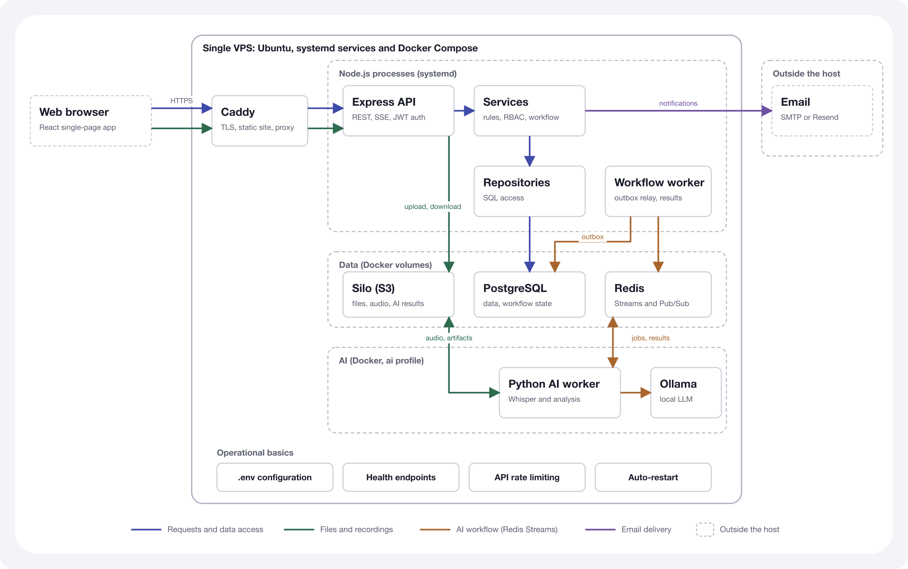

# DEPLOYMENT GUIDE

Work Integrated Learning (WIL) Project Template

| Field            | Value                                                                                                                                        |
| ---------------- | -------------------------------------------------------------------------------------------------------------------------------------------- |
| Project Title    | meeting-management                                                                                                                           |
| Industry Partner | Department of Science and Technology (DOST), Government of the Philippines                                                                   |
| Project Team     | CheHao, Liu (Jay); Hannah Law (Hannah); Paveen Anuntakulnatee (Pleum); Yuhan Lei (Johanna); Eunse Shim (Elsie); Nattanan Thepsatorn (Bonney) |
| Version          | 1.2                                                                                                                                          |
| Date             | 14 October 2026                                                                                                                              |
| System Name      | DOST Meeting Management                                                                                                                      |

## Document Control

| Version | Date            | Prepared by  | Change / Description                                                                                                                                                                                                                     |
| ------- | --------------- | ------------ | ---------------------------------------------------------------------------------------------------------------------------------------------------------------------------------------------------------------------------------------- |
| 1.0     | 4 October 2026  | Project team | Initial version                                                                                                                                                                                                                          |
| 1.1     | 7 October 2026  | Project team | Option 3 changed to a priced DigitalOcean managed deployment; GPU status and acceleration guidance added; configuration for managed services added; Whisper and Ollama marked mandatory; statements on running several workers corrected |
| 1.2     | 14 October 2026 | Project team | axios updated to ^1.20.0; the Technical Specification moved to `docs/technical-spec.pdf`; the Testing Results Report is referenced from the `v1.0.0` release package                                                                     |

## Mandatory WIL Deployment Scope

IMPORTANT SCOPE NOTE

The project team is not required to deploy the developed system into a production environment. The purpose of this Deployment Guide is to provide the industry partner with sufficient technical information, deployment options, recommendations, and proposed procedures to support future deployment.

No project team member should personally incur costs for implementation, hosting, deployment, or demonstration. Development, testing, and demonstration should use local development environments, free and open-source software, and/or suitable free-tier services that do not require payment.

Paid or subscription-based solutions may be recommended for future implementation by the industry partner. Where such solutions are proposed, they should be assessed against suitable free/open-source or no-cost alternatives. The actual procurement, production deployment, configuration, operation, and maintenance of the system will be undertaken by the industry partner following project handover.

## 1. Introduction and Purpose

This Deployment Guide documents how the DOST Meeting Management system could be deployed by the Department of Science and Technology (DOST) after project handover. It records what the project team built and used, the options available for a future deployment, a recommended option, and a proposed procedure with the gaps that remain before production use.

**Audience.** DOST IT and infrastructure staff who will provision and operate the system, and the decision makers who will choose a hosting approach.

**System covered.** The `meeting-mgnt` repository: a React web application, a Node.js/Express API and workflow worker, a Python AI worker (Whisper transcription and Ollama-based analysis), and the PostgreSQL, Redis and S3-compatible object storage services they depend on.

**Responsibility boundary.** The project team develops, tests and demonstrates the prototype, and documents deployment requirements and options (this guide). It does not procure, deploy, operate or maintain a production environment. DOST selects the final approach and is responsible for procurement, production deployment, configuration, operation and maintenance after handover (see Appendix A).

**Evidence labels.** Statements in this guide are one of: _verified_ (checked against the repository or an official source on the access date shown), _measured_ (observed in a test), or _recommendation_ (a proposal that has not been implemented or tested). Anything the team could not verify is stated as such.

**Assumption about the partner's infrastructure.** DOST may operate its own data centre, but the team has not been told what infrastructure DOST has or which data classification applies to meeting recordings and transcripts. This guide is therefore hosting-agnostic: it assumes a Linux virtual machine that DOST provides on its own infrastructure or rents from a provider.

## 2. System Overview

DOST Meeting Management is a workspace application for creating meeting scheduling requests, collecting participant availability, confirming meetings, managing meeting materials and recordings, keeping minutes, tracking action items and showing in-app notifications. A meeting recording can be transcribed and analysed by AI to produce a transcript, a structured summary, decisions and proposed action items that staff review before applying them to the minutes.

**Users (verified).** Two account roles exist, `staff` and `admin` (`server/services/permissions.js`). Within a meeting, a user is an owner, organiser, attendee or optional participant. External invitees respond to availability requests through emailed token links without an account. Accounts are created by an administrator; self-registration is closed by default (`SELF_REGISTRATION_ENABLED=false`).

**Major functions.** Meeting request scheduling and confirmation; meeting list, search and detail; participants and roles; file upload and download; recording upload with browser-side audio extraction from video; asynchronous transcription and analysis with live status over server-sent events; reviewable AI action-item suggestions; minutes; action items; dashboard and notifications; administrator management of accounts and roles.



_Figure 1. System and deployment architecture for a single host (Option 1). The Node.js services run under systemd; PostgreSQL, Redis, Silo object storage and the AI services run as Docker Compose containers bound to the loopback interface._

| Component             | Technology                                                                                                                  | Runs as                       | Network exposure                                   |
| --------------------- | --------------------------------------------------------------------------------------------------------------------------- | ----------------------------- | -------------------------------------------------- |
| Reverse proxy         | Caddy 2                                                                                                                     | systemd service               | Public, ports 80 and 443                           |
| Web application       | React 19 static build (Vite)                                                                                                | Files served by Caddy         | Public through Caddy                               |
| API service           | Node.js, Express 5                                                                                                          | systemd `meeting-mgnt-server` | Port 3001; reached by Caddy at `127.0.0.1:3001`    |
| Workflow worker       | Node.js                                                                                                                     | systemd `meeting-mgnt-worker` | None                                               |
| Database              | PostgreSQL 16                                                                                                               | Docker Compose                | `127.0.0.1:5432`                                   |
| Cache and messaging   | Redis 7 (Streams and Pub/Sub)                                                                                               | Docker Compose                | `127.0.0.1:6379`                                   |
| Object storage        | Silo (`pgsty/silo`), a maintained fork of the archived MinIO; S3-compatible API. The Compose service keeps the name `minio` | Docker Compose                | `127.0.0.1:9000` (API), `127.0.0.1:9001` (console) |
| AI service and worker | Python 3.11, Whisper, FastAPI                                                                                               | Docker Compose profile `ai`   | `127.0.0.1:8000` (service); worker has no port     |
| LLM runtime           | Ollama with Llama 3                                                                                                         | Docker Compose profile `ai`   | `127.0.0.1:11434`                                  |

The API listens with `app.listen(PORT)` and no host argument (`server/index.js`), so Node binds all interfaces. It must be protected by a firewall so that only Caddy can reach port 3001 (see Section 10).

**AI data handling.** Audio, transcripts and analysis are processed by Whisper and Ollama running inside the deployment. Audio and transcript text are stored in PostgreSQL and object storage and are not sent to a third-party AI service. Email content (recipient addresses and the meeting title, time, location and agenda) is sent to the configured SMTP or Resend provider.

## 3. Development and Demonstration Environment

The environment below is what the team used to develop, test and demonstrate the prototype. It is not necessarily the recommended production environment (see Sections 4 and 6).

| Component                  | Technology / Tool                                                                                                                              | Version                                                                                                                                                                                         | Purpose                                                                                                                                                                                                                                         |
| -------------------------- | ---------------------------------------------------------------------------------------------------------------------------------------------- | ----------------------------------------------------------------------------------------------------------------------------------------------------------------------------------------------- | ----------------------------------------------------------------------------------------------------------------------------------------------------------------------------------------------------------------------------------------------- |
| Runtime                    | Node.js, npm workspaces (`client`, `server`)                                                                                                   | Node.js 22 or later                                                                                                                                                                             | Runs the API, worker, build and tests                                                                                                                                                                                                           |
| Front end                  | React, Vite, Tailwind CSS, React Router, axios                                                                                                 | React ^19.2.5, Vite ^8.0.9, Tailwind ^3.4.19, React Router ^7.14.2, axios ^1.20.0                                                                                                               | Web application                                                                                                                                                                                                                                 |
| API                        | Express, express-validator, express-rate-limit, jsonwebtoken, bcryptjs, multer, nodemailer                                                     | Express ^5.2.1, express-validator ^7.3.2, express-rate-limit ^8.5.2, jsonwebtoken ^9.0.3, bcryptjs ^3.0.3, multer ^2.0.1, nodemailer ^9.0.4                                                     | REST API, authentication, validation, uploads, email                                                                                                                                                                                            |
| Data clients               | pg, ioredis, minio                                                                                                                             | pg ^8.20.0, ioredis ^6.0.0, minio ^8.0.5                                                                                                                                                        | Database, Redis and object storage access                                                                                                                                                                                                       |
| Database                   | PostgreSQL (Docker image `postgres:16-alpine`)                                                                                                 | 16; 42 SQL migrations in `server/db/migrations`                                                                                                                                                 | Authoritative data and workflow state                                                                                                                                                                                                           |
| Cache and messaging        | Redis (Docker image `redis:7-alpine`)                                                                                                          | 7.x                                                                                                                                                                                             | AI job Streams and status Pub/Sub                                                                                                                                                                                                               |
| Object storage             | Silo (Docker image `pgsty/silo`, also used by the one-shot `minio-init` container)                                                             | `RELEASE.2026-09-16T00-00-00Z` (pinned). Replaced `minio/minio:latest` and `minio/mc:latest` on 1 October 2026 (pull request #110) because those images could no longer be pulled (Section 4.3) | Meeting files, recordings, AI result artefacts                                                                                                                                                                                                  |
| AI worker and service      | Python (`python:3.11-slim`), openai-whisper, PyTorch, FastAPI                                                                                  | Whisper model `small` on CPU; PyTorch >=2.7                                                                                                                                                     | Speech-to-text and analysis orchestration                                                                                                                                                                                                       |
| LLM runtime                | Ollama (Docker image `ollama/ollama:latest`) with `llama3`                                                                                     | Model about 4.7 GB (compose comment)                                                                                                                                                            | Structured meeting analysis                                                                                                                                                                                                                     |
| Containers                 | Docker Engine and Docker Compose                                                                                                               | Not pinned in the repository                                                                                                                                                                    | Local infrastructure and AI services                                                                                                                                                                                                            |
| Automated tests            | Jest (server), Node test runner (client), ESLint 9, Prettier 3                                                                                 | Jest ^30.3.0                                                                                                                                                                                    | Unit and integration tests, linting, formatting                                                                                                                                                                                                 |
| CI                         | GitHub Actions workflow `CI`                                                                                                                   | —                                                                                                                                                                                               | Lint, test and client build on the repository                                                                                                                                                                                                   |
| Developer machine overlays | `docker-compose.mac.yml` (macOS: the AI containers call a natively installed Ollama; Whisper on CPU) and `docker-compose.gpu.yml` (NVIDIA GPU) | Selected with `COMPOSE_FILE` and `COMPOSE_PROFILES` in `.env`                                                                                                                                   | Same `docker compose up -d --build` on CPU and macOS machines; the NVIDIA overlay has not been run                                                                                                                                              |
| Optional GPU configuration | NVIDIA GPU overlay (`docker-compose.gpu.yml`) and a GPU benchmark procedure in the repository                                                  | Not run                                                                                                                                                                                         | Prepared for a future GPU benchmark. Not run because the team did not have access to an NVIDIA GPU environment                                                                                                                                  |
| Deployment rehearsal       | Single Ubuntu VPS with fixture AI providers                                                                                                    | Ubuntu (single host)                                                                                                                                                                            | Rehearsal of the systemd and Caddy deployment. A voluntary exercise outside the WIL requirements, self-funded by one team member and not project-funded. It is not needed to reproduce the prototype: the local environment above is sufficient |

## 4. System Requirements and Dependencies

### 4.1 Requirements

| Requirement / Dependency       | Type             | Required Version / Specification                                                                                        | Mandatory / Optional | Notes                                                                                                                                                                                                                                 |
| ------------------------------ | ---------------- | ----------------------------------------------------------------------------------------------------------------------- | -------------------- | ------------------------------------------------------------------------------------------------------------------------------------------------------------------------------------------------------------------------------------- |
| Linux server                   | Infrastructure   | Ubuntu 22.04 or 24.04 LTS with systemd (the setup script `scripts/bootstrap-vps.sh`, pull request #108, supports these) | Mandatory            | Ubuntu 24.04 LTS standard security maintenance runs to May 2029 and Expanded Security Maintenance to May 2034 (Ubuntu release cycle, accessed 30 Sep 2026). Other Linux distributions are untested                                    |
| Compute, memory, disk          | Infrastructure   | See the sizing tiers in 4.2                                                                                             | Mandatory            | AI processing dominates the requirement                                                                                                                                                                                               |
| Node.js                        | Runtime          | 22 or later                                                                                                             | Mandatory            | Also needed on a build machine to build the client bundle                                                                                                                                                                             |
| Docker Engine with Compose v2  | Runtime          | Current stable release                                                                                                  | Mandatory            | Runs PostgreSQL, Redis, Silo and the AI services. Versions are not pinned in the repository                                                                                                                                           |
| PostgreSQL                     | Data service     | 16, with the `pgcrypto` and `uuid-ossp` extensions                                                                      | Mandatory            | The extensions are created by `scripts/postgres-init.sql` on first boot of the container. A managed database must allow them                                                                                                          |
| Redis                          | Data service     | 7.x                                                                                                                     | Mandatory            | Used for Pub/Sub and AI Streams; readiness checks fail without it. Set `maxmemory-policy noeviction` when AI Streams are enabled                                                                                                      |
| S3-compatible object storage   | Data service     | Buckets `meeting-files`, `meeting-audio`, `meeting-ai-results`                                                          | Mandatory            | Silo, pinned to a dated release (see 4.3). Another S3-compatible store would need testing with the MinIO JavaScript and Python clients the code uses                                                                                  |
| Reverse proxy with TLS         | Network          | Caddy 2 (configuration in `deploy/Caddyfile`)                                                                           | Mandatory            | Any reverse proxy with TLS could be used, but only Caddy is configured and tested                                                                                                                                                     |
| Domain name and DNS            | Network          | A DNS record pointing at the server                                                                                     | Optional             | Needed for automatic HTTPS. Without a domain the site is served over HTTP on the server IP address (pilot only)                                                                                                                       |
| Email provider                 | External service | SMTP account or Resend account                                                                                          | Mandatory            | Needed for invitations and notifications. Credentials are supplied in `.env`                                                                                                                                                          |
| Whisper and Ollama runtimes    | AI               | Whisper `small`, Ollama with `llama3`                                                                                   | Mandatory            | Required for the core recording-to-minutes workflow (transcription, summary and proposed action items). The rest of the system runs with `AI_PIPELINE_ENABLED=false`, but recordings are then stored without a transcript or analysis |
| Internet access during install | Network          | npm registry, Docker registries, PyTorch and Ollama model downloads, apt                                                | Mandatory            | Offline installation would need internal mirrors, which have not been tested                                                                                                                                                          |
| Firewall                       | Security         | Allow 80 and 443 from users, 22 from administrators only                                                                | Mandatory            | Also blocks direct access to port 3001 (see Section 10)                                                                                                                                                                               |
| Backup storage                 | Infrastructure   | Separate disk, host or object store                                                                                     | Mandatory            | Not provided by the system (see Section 13)                                                                                                                                                                                           |
| Supported browsers             | Client           | Current desktop browsers                                                                                                | Mandatory            | Audio extraction from video runs in the browser; the supported browser list has not been established                                                                                                                                  |

### 4.2 Sizing tiers

These figures are starting points to be validated by DOST. They are not the result of a load test.

| Tier                                | vCPU      | RAM           | Disk          | Evidence and status                                                                                                                                                                                                                       |
| ----------------------------------- | --------- | ------------- | ------------- | ----------------------------------------------------------------------------------------------------------------------------------------------------------------------------------------------------------------------------------------- |
| Demonstration host, fixture AI only | 2 or more | 2 GiB or more | 40 GB or more | Measured: a 1 vCPU host with 961 MiB RAM ran the API, worker, PostgreSQL, Redis and object storage (then MinIO) but was swap-bound (476 of 495 MiB swap in use) and could not run Whisper or Ollama. The 2 GiB figure is a recommendation |
| Pilot with CPU AI processing        | 8         | 16 GiB        | 100 GB SSD    | Recommended starting point. The setup script (`scripts/bootstrap-vps.sh`, pull request #108) refuses Whisper and Ollama hosts below 8 GiB RAM and 20 GiB free disk                                                                        |
| Heavier pilot or more recordings    | 16        | 32 GiB        | 200 GB SSD    | Recommended starting point; needs its own capacity test                                                                                                                                                                                   |

**AI processing time (measured).** A 26-minute recording took about 12 minutes for Whisper transcription and about 6 minutes for Llama 3 analysis on CPU, roughly 18 minutes end to end. The reference hardware for this measurement was not recorded, so DOST should repeat the measurement on the hardware it selects. One AI worker processes jobs one at a time.

**Disk.** Allow separately for the Llama 3 model (about 4.7 GB), the Whisper model cache, the PyTorch-based container image (size not measured), PostgreSQL data and retained audio in object storage.

**GPU.** An optional NVIDIA GPU profile (`docker-compose.gpu.yml`) and a GPU benchmark procedure are included in the repository. They have not been benchmarked or validated because the team did not have access to an NVIDIA GPU environment, so all AI timings in this guide are CPU-only. DOST should benchmark the profile on its own GPU hardware before relying on it.

### 4.3 Licences and support status of runtime components

Checked against the projects' official pages on 30 September 2026. npm and Python package licences were not audited; a dependency licence scan is recommended before adoption.

| Component      | Licence                                                                                                         | Source                                                           | Point for DOST to review                                                                                                                                                                                                                                                                                                                                                                                                                                                                                                                                                                                                                                                                                                                                                                                                |
| -------------- | --------------------------------------------------------------------------------------------------------------- | ---------------------------------------------------------------- | ----------------------------------------------------------------------------------------------------------------------------------------------------------------------------------------------------------------------------------------------------------------------------------------------------------------------------------------------------------------------------------------------------------------------------------------------------------------------------------------------------------------------------------------------------------------------------------------------------------------------------------------------------------------------------------------------------------------------------------------------------------------------------------------------------------------------- |
| Node.js        | MIT                                                                                                             | https://github.com/nodejs/node                                   | Use an LTS release line (even-numbered major version)                                                                                                                                                                                                                                                                                                                                                                                                                                                                                                                                                                                                                                                                                                                                                                   |
| PostgreSQL     | PostgreSQL Licence (liberal, similar to BSD or MIT)                                                             | https://www.postgresql.org/about/licence/                        | None                                                                                                                                                                                                                                                                                                                                                                                                                                                                                                                                                                                                                                                                                                                                                                                                                    |
| Redis          | Redis 7.2 and earlier: BSD. Redis 7.4 to 7.8: dual RSALv2 / SSPLv1. Redis 8 and later: RSALv2, SSPLv1 or AGPLv3 | https://redis.io/legal/licenses/                                 | The compose file uses the `redis:7-alpine` tag, which follows the newest 7.x release and is therefore expected to be 7.4 or later. RSALv2 and SSPLv1 are source-available rather than OSI open source. Alternatives: pin a specific version, use Redis 8 under AGPLv3, or use Valkey (BSD, Linux Foundation, https://valkey.io/)                                                                                                                                                                                                                                                                                                                                                                                                                                                                                        |
| MinIO          | AGPLv3                                                                                                          | https://github.com/minio/minio                                   | **No longer used by this release; listed because Silo derives from it.** The GitHub repository was archived by its owner on 25 April 2026 and states it is no longer maintained; the community edition is distributed as source code only. On 30 September 2026 `docker manifest inspect` returned "denied: requested access to the resource is denied" for `minio/minio:latest` and `minio/mc:latest`, so a fresh host could not start object storage. The compose file was switched to Silo on 1 October 2026 (pull request #110)                                                                                                                                                                                                                                                                                     |
| PGSTY Silo     | AGPL-3.0-or-later; derived from `minio/minio` with upstream copyright and notices preserved (project README)    | https://github.com/pgsty/silo                                    | **Object storage used by this release** (pull request #110), pinned to `pgsty/silo:RELEASE.2026-09-16T00-00-00Z` for both the storage service and `minio-init`. The image ships `mc` (a symlink to `mcli`) and `curl`, so the bucket-initialisation script and the health check are unchanged, and the `MINIO_*` settings keep their names. Tested by the team on 1 October 2026 against a copy of an existing MinIO volume: existing objects readable, bucket initialisation, server upload, stat, get, presigned GET and PUT, removal, and the AI worker's JSON read/write and audio download. The project is a community fork whose README describes compatibility with upstream MinIO as "best effort"; several unrelated forks are also named "silo", so use `pgsty/silo`. DOST legal should review the AGPL terms |
| Caddy          | Apache-2.0                                                                                                      | https://github.com/caddyserver/caddy                             | None                                                                                                                                                                                                                                                                                                                                                                                                                                                                                                                                                                                                                                                                                                                                                                                                                    |
| Ollama         | MIT                                                                                                             | https://github.com/ollama/ollama                                 | None                                                                                                                                                                                                                                                                                                                                                                                                                                                                                                                                                                                                                                                                                                                                                                                                                    |
| OpenAI Whisper | MIT (code and model weights)                                                                                    | https://github.com/openai/whisper                                | None                                                                                                                                                                                                                                                                                                                                                                                                                                                                                                                                                                                                                                                                                                                                                                                                                    |
| Meta Llama 3   | Meta Llama 3 Community License Agreement (18 April 2024)                                                        | https://www.llama.com/llama3/license/ (redirects to Meta's site) | The licence requires compliance with Meta's Acceptable Use Policy, forbids using outputs to improve competing large language models, requires "Built with Meta Llama 3" attribution if the model is redistributed, and requires a separate licence above 700 million monthly active users. DOST should confirm the terms are acceptable for government use                                                                                                                                                                                                                                                                                                                                                                                                                                                              |
| React          | MIT                                                                                                             | https://github.com/facebook/react                                | None                                                                                                                                                                                                                                                                                                                                                                                                                                                                                                                                                                                                                                                                                                                                                                                                                    |
| Express        | MIT                                                                                                             | https://github.com/expressjs/express                             | None                                                                                                                                                                                                                                                                                                                                                                                                                                                                                                                                                                                                                                                                                                                                                                                                                    |
| Ubuntu Server  | Not assessed                                                                                                    | https://ubuntu.com/about/release-cycle                           | Support dates are given in 4.1                                                                                                                                                                                                                                                                                                                                                                                                                                                                                                                                                                                                                                                                                                                                                                                          |

## 5. Local Installation and Demonstration Procedure

These steps run the prototype on one workstation with Node.js 22 or later, Docker with Compose, and Git. Commands are run from the repository root unless stated.

### Step 1: Obtain the source code / release package

DOST receives the handover release, tag `v1.0.0`, as a release package: the source code archive of the GitHub release. Unpack it and change into its folder:

```bash
unzip meeting-mgnt-1.0.0.zip
cd meeting-mgnt-1.0.0
```

Expected result: the folders `client/`, `server/`, `ai-service/`, `deploy/` and `docs/` exist. The package contains no Git history; Section 9.2 describes how to put it under version control for a production installation.

### Step 2: Install required dependencies

```bash
node --version    # v22 or later
docker compose version
npm install
```

Expected result: `npm install` completes for the `client` and `server` workspaces. Troubleshooting: an older Node.js version fails on newer dependencies, so upgrade to Node.js 22.

### Step 3: Configure environment settings

```bash
cp .env.example .env
```

`.env.example` is the reference for every setting. The defaults work for local use. Do not reuse development defaults (database password, object-storage credentials `MINIO_ACCESS_KEY` and `MINIO_SECRET_KEY`, `JWT_SECRET=replace-me`) in any shared or production environment. Email delivery needs valid SMTP or Resend credentials (`EMAIL_PROVIDER` and the matching settings); without them invitation emails cannot be sent.

AI settings for the demonstration:

| Goal                                     | Settings                                                                                        |
| ---------------------------------------- | ----------------------------------------------------------------------------------------------- |
| No AI (default)                          | `AI_PIPELINE_ENABLED=false`                                                                     |
| Recording workflow with canned AI output | `AI_PIPELINE_ENABLED=true`, `AI_TRANSCRIPTION_PROVIDER=fixture`, `AI_ANALYSIS_PROVIDER=fixture` |
| Real Whisper and Ollama                  | `AI_PIPELINE_ENABLED=true`, `AI_TRANSCRIPTION_PROVIDER=whisper`, `AI_ANALYSIS_PROVIDER=llm`     |

### Step 4: Create or initialise the database

```bash
docker compose up -d
docker compose ps
npm run migrate --workspace=server
```

Expected result: PostgreSQL, Redis and Silo (Compose service `minio`) are running and healthy, the one-shot `minio-init` container has created the buckets and exited, and the migration command applies the 42 SQL migrations, recorded in the `schema_migrations` table. The `pgcrypto` and `uuid-ossp` extensions are created by `scripts/postgres-init.sql` on the first start of the database container. Troubleshooting: if a port is in use, stop the other service or change the mapping; migrations can be re-run safely because applied versions are skipped.

### Step 5: Load sample or test data (if applicable)

Optional. The seed loads demonstration data for local use only; skip it to start with an empty system.

```bash
npm run seed --workspace=server
```

Expected result: demonstration users, meetings, requests and action items are created. The accounts use `@seed.local` email addresses. The seed sets no fixed password: put `SEED_PASSWORD` in `.env` to choose one, otherwise the run generates a random password and prints it once at the end next to the accounts that use it. Accounts that already exist keep their password and role unless `SEED_RESET_PASSWORDS=true`. The seed is destructive (it truncates meetings and deletes every account that is not a seed user) and refuses to run when `NODE_ENV=production`, so use it only on a disposable local database.

### Step 6: Start application services

Use one terminal per process:

```bash
npm run dev --workspace=server          # API on port 3001
npm run worker:dev --workspace=server   # only when AI_PIPELINE_ENABLED=true; one worker is enough locally
npm run dev --workspace=client          # Vite development server
```

For the AI workflow, also start the Python AI worker. With canned output, follow the "Fixture-only host" instructions in the AI service README. With real models:

```bash
docker compose --profile ai up -d --build ollama ai-service ai-worker
docker compose exec ollama ollama pull llama3
```

The first build downloads PyTorch and takes several minutes, and the first transcription downloads the Whisper model. Troubleshooting: without the AI worker, recording processing stays queued and the interface shows "Waiting for the AI worker".

### Step 7: Access the system

Create the first administrator. Run this after Step 5, because the seed deletes every account that is not a seed user:

```bash
ADMIN_PASSWORD='<choose a password>' npm run create-admin --workspace=server -- --email admin@example.com --name "Administrator"
```

Without `ADMIN_PASSWORD`, a random password is generated and printed once. Open http://localhost:5173 (the Vite default, which matches `CLIENT_URL` in `.env.example`) and sign in with this account. The seeded accounts from Step 5 are for local demonstration only; do not use them in any shared or production environment. The interface has no sign-up page, and `POST /api/auth/register` returns 403 unless `SELF_REGISTRATION_ENABLED=true`. The API is at http://localhost:3001.

### Step 8: Verify successful installation

```bash
curl -fsS http://localhost:3001/health/live
curl -fsS http://localhost:3001/health/ready
npm run lint
npm run test
```

Expected result: `/health/live` confirms the process is running; `/health/ready` returns HTTP 200 only when PostgreSQL, Redis and object storage are reachable (it returns 503 otherwise and does not check the AI services). Lint and unit tests pass; `npm run test:db --workspace=server` runs the database-backed server tests against the local database. In the browser, sign in, open the dashboard, create a meeting request, and upload a recording and choose Process Recording to see the pipeline steps (Uploading, Transcribing, Analysing, Completed). Check that the recording upload area stays disabled until the consent checkbox is ticked, and that the sign-in page shows no credentials.

## 6. Deployment Options for Future Industry Implementation

| Option   | Proposed Solution / Architecture                                                                                                                                                                                                                                                                                                                                                       | Type                                                           | Indicative Cost                                                                                                                                        | Key Requirements                                                                                                                                                                                                                                                | Notes                                                                                                                                                                                                                                                                                                                                                                                                                                                                                                                              |
| -------- | -------------------------------------------------------------------------------------------------------------------------------------------------------------------------------------------------------------------------------------------------------------------------------------------------------------------------------------------------------------------------------------- | -------------------------------------------------------------- | ------------------------------------------------------------------------------------------------------------------------------------------------------ | --------------------------------------------------------------------------------------------------------------------------------------------------------------------------------------------------------------------------------------------------------------- | ---------------------------------------------------------------------------------------------------------------------------------------------------------------------------------------------------------------------------------------------------------------------------------------------------------------------------------------------------------------------------------------------------------------------------------------------------------------------------------------------------------------------------------- |
| Option 1 | Single Linux host running everything: Node.js services under systemd, PostgreSQL, Redis, S3-compatible object storage (Silo) and the AI services under Docker Compose, Caddy in front. On a DOST virtual machine or a rented VPS                                                                                                                                                       | Open source; no software licence cost                          | Infrastructure only. Reference: one 8 vCPU / 16 GiB VPS at USD 96.00 to 173.00 per month (Section 11). On DOST infrastructure: cost determined by DOST | One host at the 8 vCPU / 16 GiB tier or above (Section 4.2); firewall; optional domain; email provider                                                                                                                                                          | The architecture the prototype was built and tested for. Simple to operate. Single point of failure; state and backups live on one host                                                                                                                                                                                                                                                                                                                                                                                            |
| Option 2 | One application host running the Node.js services, Caddy and the AI services, with managed PostgreSQL and S3-compatible object storage from a provider or from DOST's platform                                                                                                                                                                                                         | Hybrid: open-source application with paid or provided services | Option 1 host plus managed PostgreSQL (from USD 60.90 per month, primary node) and object storage (from USD 5.00 per month), Section 11                | Provider or platform offering PostgreSQL 16 with `pgcrypto` and `uuid-ossp`, and an S3-compatible endpoint reachable by browsers for presigned downloads                                                                                                        | Moves stateful data off the application host and adds provider backups. Not tested by the team: the code uses the MinIO JavaScript and Python clients and a managed endpoint has not been exercised                                                                                                                                                                                                                                                                                                                                |
| Option 3 | Managed, horizontally scaled deployment on DigitalOcean in one region (for example Singapore): a regional load balancer terminating TLS in front of two or more application Droplets (each running the API, the workflow worker and Caddy, as in Option 1), a separate AI Droplet, managed PostgreSQL with a standby node, managed Valkey (Redis-compatible) and Spaces object storage | Paid managed services; open-source application                 | About USD 298 per month with CPU AI processing, or about USD 757 per month with a GPU AI Droplet (Section 11)                                          | A DigitalOcean account; all resources in one region and VPC; the domain's DNS hosted on DigitalOcean for a managed Let's Encrypt certificate on the load balancer (otherwise upload a certificate); the Valkey eviction policy left at its default `noeviction` | Highest availability of the three: the database fails over to its standby and one application Droplet can fail without an outage, but Valkey and the AI Droplet remain single nodes. Reuses the Option 1 installation (systemd and Caddy, no container images), installed by hand because the setup script targets a single host. Application Droplet size is a recommendation, not measured. Not deployed or tested by the team. Other clouds offer equivalent services (for example AWS load balancing, RDS, ElastiCache and S3) |

**Configuration for managed services (Options 2 and 3).** The API and the workflow worker read service addresses from `.env`: `DATABASE_URL` for PostgreSQL, `REDIS_URL` for Redis or Valkey (a `rediss://` URL when the provider requires TLS) and the `MINIO_*` settings for object storage. The AI worker container defaults to the local Compose services, so point it at the same managed services with `AI_WORKER_REDIS_URL` (Option 3) and `AI_WORKER_MINIO_ENDPOINT`, `AI_WORKER_MINIO_PORT` and `AI_WORKER_MINIO_USE_SSL`. In Option 3, set `APP_SITE=:80` so that Caddy serves plain HTTP to the load balancer, which terminates TLS. API rate limiting is counted separately on each application Droplet, so with two Droplets a client can make up to twice the configured requests until the limit moves to a shared Redis store (Technical Specification, Section 8.2).

**GPU acceleration (applies to any option).** AI processing is the slowest part of the system: on CPU a 26-minute recording takes about 18 minutes (Section 4.2). The repository includes an optional NVIDIA GPU overlay (`docker-compose.gpu.yml`) that runs Whisper and Ollama on the GPU. It can be added to any option: in Option 1 or 2 the AI services run on a host with an NVIDIA GPU, and in Option 3 the AI Droplet becomes a GPU Droplet (Section 11). It requires an x86_64 host, an NVIDIA driver with CUDA support and GPU access for Docker containers (for example through the NVIDIA Container Toolkit); the overlay was prepared for a card with 12 GiB of memory. The team did not have access to an NVIDIA GPU environment, so the overlay has not been validated and the speed-up has not been measured. DOST should benchmark it on candidate hardware before buying GPU capacity, which costs more than CPU-only hosting (Section 11).

## 7. Comparative Assessment of Deployment Options

| Assessment Criterion          | Option 1                                                                                                                       | Option 2                                                                                                                                             | Option 3                                                                                                                                                                                                                                                                                     |
| ----------------------------- | ------------------------------------------------------------------------------------------------------------------------------ | ---------------------------------------------------------------------------------------------------------------------------------------------------- | -------------------------------------------------------------------------------------------------------------------------------------------------------------------------------------------------------------------------------------------------------------------------------------------- |
| Cost                          | Lowest. One host; all software licence costs are zero for the checked components. Reference VPS USD 96.00 to 173.00 per month  | About USD 162 per month at the reference prices (host USD 96.00, managed PostgreSQL USD 60.90, object storage USD 5.00), before backups and transfer | Highest. About USD 298 per month at the reference prices (load balancer USD 12.00, two application Droplets USD 48.00, AI Droplet USD 96.00, PostgreSQL with a standby node USD 121.80, Valkey USD 15.00, Spaces USD 5.00), before backups and transfer; about USD 757 with a GPU AI Droplet |
| Technical requirements        | One Linux host, Docker, Node.js 22, Caddy. Setup script provided (Section 9.3)                                                 | Same as Option 1 plus a managed PostgreSQL and an S3 endpoint; network path from host to provider                                                    | A DigitalOcean account; load balancer, VPC, managed PostgreSQL and Valkey, Spaces; the Option 1 installation repeated on each application Droplet                                                                                                                                            |
| Ease of deployment            | High. Repository provides systemd units, Caddyfile and a setup script (the script has not been run end to end on a fresh host) | Medium. Option 1 steps plus provisioning and configuring the managed services                                                                        | Medium to low. More resources to provision and connect; the setup script does not cover this layout, so installation is manual                                                                                                                                                               |
| Scalability                   | Vertical only. The AI worker processes one recording at a time on CPU                                                          | Data tier scales independently. AI throughput still limited to the single AI host                                                                    | Highest. Add application Droplets behind the load balancer; the workflow worker can run on each because outbox rows are claimed with `FOR UPDATE SKIP LOCKED` and each process reads AI results under its own consumer name; add AI Droplets for throughput. Not load tested                 |
| Security                      | Loopback-bound data services, Caddy TLS, host firewall. Hardening is DOST's responsibility                                     | Provider-managed patching for the database and storage; more network paths to secure                                                                 | Provider-managed patching for the database, cache and storage; TLS at the load balancer; traffic between Droplets and managed services on the private network; more components to secure                                                                                                     |
| Reliability / availability    | No high availability. Host failure means an outage until restore                                                               | Managed database offers provider backups and optional standby nodes; the application host remains a single point of failure                          | Database standby failover and two or more application Droplets remove the main single points of failure; Valkey and the AI Droplet remain single nodes. Not tested                                                                                                                           |
| Maintainability               | Few moving parts. Updates are manual (Section 9.7); the team knows this topology                                               | More components to coordinate across providers                                                                                                       | Option 1 procedures repeated per application Droplet; managed services reduce database, cache and storage administration                                                                                                                                                                     |
| Technical support             | Community support for open-source components; no vendor support agreement                                                      | Provider support for the managed services; community support for the rest                                                                            | Provider support for the managed services; community support for the rest                                                                                                                                                                                                                    |
| Integration capability        | Email through SMTP or Resend; REST API documented in the server README and a Postman collection                                | Same                                                                                                                                                 | Same                                                                                                                                                                                                                                                                                         |
| Vendor lock-in                | None                                                                                                                           | Low to medium. PostgreSQL and S3 are standard, but provider features and pricing differ                                                              | Low to medium. PostgreSQL, Redis-compatible and S3 interfaces are standard, but load balancing, networking and pricing are provider-specific                                                                                                                                                 |
| Organisational suitability    | Fits a small pilot and a partner with limited platform capacity                                                                | Fits when backups and recovery matter more than minimal cost                                                                                         | Fits when availability matters and DOST accepts a public cloud provider and its hosting location                                                                                                                                                                                             |
| Advantages                    | Cheapest, simplest, closest to what was tested, easy to keep meeting data on DOST-controlled infrastructure                    | Removes the least reliable part of Option 1 (state on one disk); adds managed backups; clear upgrade path from Option 1                              | Highest availability and scalability without new packaging; reuses the Option 1 installation; every component has a published price                                                                                                                                                          |
| Disadvantages                 | No high availability; manual backups and updates; all risk on one host                                                         | Higher cost; data may leave DOST premises with a public provider; untested with the code                                                             | Highest cost; data hosted by a public provider, possibly outside the Philippines; manual installation; untested with the code                                                                                                                                                                |
| Overall assessment / priority | Priority 1. Recommended starting point                                                                                         | Priority 2. Upgrade path when high availability or provider backups are needed                                                                       | Priority 3. Consider when the pilot needs more availability or throughput than Option 2 provides                                                                                                                                                                                             |

## 8. Recommended Deployment Approach

### Recommended option

Option 1, a single Linux host running the application with Docker Compose and systemd, as the starting point for a pilot. Move to Option 2 when availability and backup requirements exceed what one host can offer.

### Rationale

Option 1 matches the topology the prototype was built and tested for, has the lowest cost and the fewest components, and keeps recordings, transcripts and AI processing on infrastructure that DOST controls. Meeting recordings of a government agency are sensitive, and self-hosted Whisper and Ollama avoid sending audio to a third-party AI service. This is a consideration for DOST's data classification and legal review, not legal advice.

**Regulatory and hosting considerations.** DOST should confirm its hosting and data-protection requirements with its own legal and privacy officers before choosing a hosting location.

### Key advantages

- Lowest cost and fewest moving parts; every checked software component has no licence fee.
- Closest to the tested configuration; systemd units, Caddyfile and a setup script exist in the repository.
- Data and AI processing stay on infrastructure DOST controls.

### Key limitations / trade-offs

- No high availability: a host or disk failure causes an outage or data loss unless backups are taken and restore is tested.
- AI processing on CPU is slow (about 18 minutes for a 26-minute recording on the reference hardware, which was not recorded). GPU acceleration is not part of the recommended configuration because it has not been validated. One CPU worker processes roughly three 26-minute recordings per hour (estimated from the single CPU measurement). If DOST's recording volume makes the queue too long, benchmark the GPU overlay (Section 6) before procuring GPU hardware.
- Object storage runs on PGSTY Silo, a community-maintained fork of the archived MinIO, pinned to a dated release (pull request #110, Section 4.3). Its future maintenance depends on a small project, so DOST should track its releases and keep a fallback in view: another S3-compatible store such as SeaweedFS (Apache-2.0, https://github.com/seaweedfs/seaweedfs) or a managed object store (Option 2). Either would need testing with the code.
- Updates, backups and monitoring are manual today.

### Assumptions

- DOST provides or rents one Linux virtual machine at the tier in Section 4.2, and has internet access for installation.
- DOST already has, or will obtain, a domain name and an email provider account.
- The team has not been told what infrastructure DOST operates; this is an open question for DOST.
- Expected usage is a pilot; no load test has been performed.

### Indicative cost implications

At the reference prices in Section 11, Option 1 on a rented VPS is about USD 96.00 per month for the 8 vCPU / 16 GiB tier plus about USD 19.20 per month for weekly provider backups (derived from the published 20 percent rate), or the cost of an existing DOST virtual machine. Option 2 adds managed PostgreSQL and object storage, about USD 162 per month before backups and transfer. All figures are indicative and dated 30 September 2026.

## 9. Proposed Production Deployment Procedure

These are proposed future steps for DOST. The project team is not required to execute them. "Responsible" is a suggested role at DOST.

### 9.1 Prepare / provision the production infrastructure

- **Responsible:** DOST infrastructure team.
- **Prerequisites:** approved hosting location and budget; data classification decision (Section 8).
- **Procedure:** provision an Ubuntu 22.04 or 24.04 LTS virtual machine at the tier in Section 4.2. Create an administrative SSH user with key-based login. Open only ports 22 (from administrator addresses), 80 and 443. Create a DNS record for the chosen domain. Confirm time synchronisation.
- **Expected result:** a reachable host with an up-to-date operating system and a restricted firewall.

### 9.2 Obtain the approved application release

- **Responsible:** DOST engineering lead, with the project team's handover material.
- **Prerequisites:** the release package for tag `v1.0.0`; a Git server that DOST controls.
- **Procedure:** the setup script (Section 9.3) and the update procedure (Section 9.7) work from a Git checkout, and the release package has no Git history. Unpack the package, import it into a repository on DOST's Git server (for example `git init`, `git add .`, `git commit -m "Release v1.0.0"`, `git tag v1.0.0`, then push), and on the host run `git clone <dost-repository-url> /srv/meeting-mgnt` and `git checkout v1.0.0`. Build the client on a build machine rather than the production host: run `npm ci`, then `VITE_API_BASE_URL=/ npm run build --workspace=client`.
- **Expected result:** release `v1.0.0` in a DOST-controlled Git repository, checked out on the host, and a built `client/dist` folder.

### 9.3 Install production dependencies

- **Responsible:** DOST system administrator.
- **Prerequisites:** root access to the host.
- **Procedure:** either run the repository's setup script or install manually.
  - Script: `sudo bash scripts/bootstrap-vps.sh --deploy-user <user> --admin-email <address> --domain <domain>` installs Node.js 22, Docker, Caddy, the data services, the AI stack, the systemd units and the sudoers rule for a deploy user, and creates the first administrator. On a fresh host `--admin-email` is required (self-registration is closed, so nobody could sign in otherwise). The administrator password comes from the `ADMIN_PASSWORD` environment variable if set (pass it with `sudo --preserve-env=ADMIN_PASSWORD`), otherwise a random one is generated and printed once in the final summary. **Status: the script is merged (pull request #108) but has not been run end to end on a fresh host.** Since pull request #110 it starts the pinned Silo image, so the object-storage step no longer depends on the archived MinIO images. Test it on a disposable machine first.
  - Manual: install Node.js 22, Docker Engine with the Compose plugin, Caddy and Git from their official apt repositories; then `npm ci --omit=dev --no-audit --no-fund` in `/srv/meeting-mgnt`.

- **Expected result:** all runtime dependencies installed.

### 9.4 Configure production environment and secrets

- **Responsible:** DOST system administrator and security officer.
- **Prerequisites:** approved secret handling process; email provider credentials.
- **Procedure:** copy `.env.example` to `/srv/meeting-mgnt/.env`, set mode `600` or `640` and restrict it to the service account. Set at least the following, generating every secret with a strong random source (for example `openssl rand -hex 24`) and never reusing development defaults:

  | Area           | Settings                                                                                                                                                    |
  | -------------- | ----------------------------------------------------------------------------------------------------------------------------------------------------------- |
  | Runtime        | `NODE_ENV=production`, `TRUST_PROXY=true`, `PORT=3001`, client build with `VITE_API_BASE_URL=/`, `CLIENT_URL` set to the public HTTPS address               |
  | Authentication | Unique `JWT_SECRET` and a deliberate `JWT_EXPIRES_IN`                                                                                                       |
  | Database       | `POSTGRES_USER`, `POSTGRES_PASSWORD`, `POSTGRES_DB` and a matching `DATABASE_URL`                                                                           |
  | Redis          | `REDIS_URL`; `maxmemory-policy noeviction` on the Redis server when AI Streams are enabled                                                                  |
  | Object storage | Non-default `MINIO_ACCESS_KEY` and `MINIO_SECRET_KEY`, the three bucket names, and a browser-reachable HTTPS endpoint if presigned downloads are used       |
  | Email          | `EMAIL_PROVIDER`, `EMAIL_FROM` and the SMTP or Resend credentials                                                                                           |
  | AI             | `AI_PIPELINE_ENABLED=true`, `AI_TRANSCRIPTION_PROVIDER=whisper`, `AI_ANALYSIS_PROVIDER=llm`, and `ALLOW_UNSAFE_FIXTURE_PROVIDERS` not set to `true`         |
  | Accounts       | Leave `SELF_REGISTRATION_ENABLED` at `false`. `SEED_PASSWORD` and `SEED_RESET_PASSWORDS` are for local seeding only; the seed refuses `NODE_ENV=production` |

  Keep `NODE_ENV=production` in `.env` itself: values from a unit's `EnvironmentFile` take precedence over its `Environment=` lines, so a development value left in `.env` overrides the production value set in the unit.

- **Expected result:** a protected `.env` with no development defaults or placeholder values. Passwords and keys are never written into this guide or committed to the repository.

### 9.5 Create and configure the production database

- **Responsible:** DOST database administrator.
- **Prerequisites:** Docker Compose running the data services, or a managed PostgreSQL 16 (Option 2); a verified backup if this is an upgrade.
- **Procedure:** `docker compose up -d postgres redis minio minio-init`, confirm with `docker compose ps`, then `npm run migrate --workspace=server`. Do not run `npm run seed` in production (it refuses to). Create the first administrator with `npm run create-admin --workspace=server -- --email <address> --name "<name>"`, or through `scripts/bootstrap-vps.sh --admin-email`. The password is read from the `ADMIN_PASSWORD` environment variable (never a command-line argument, which other users could see in the process list); if it is unset a random password is generated and printed once. The command is safe to re-run: an existing administrator is left unchanged, an existing staff account is refused unless `--promote` is passed, and without `--email` it succeeds only if an administrator already exists (exit code 2 otherwise). The administrator then creates other accounts in the Admin page ("Add user") and should change the initial password with Account > Change password.
- **Expected result:** the schema is at the latest migration, the buckets exist and the first administrator can sign in.

### 9.6 Configure network and security controls

- **Responsible:** DOST network and security team.
- **Prerequisites:** firewall control on the host or network.
- **Procedure:** allow inbound 80 and 443 only; deny direct access to port 3001 because the API binds all interfaces; leave PostgreSQL, Redis, Silo (Compose service `minio`), ai-service and Ollama on the loopback bindings in `docker-compose.yml`. Set `APP_SITE` (for example to the domain name) and `CLIENT_DIST` for Caddy with `systemctl edit caddy`, because the default site address in `deploy/Caddyfile` is a fixed example IP address. If browsers must download files by presigned URL, expose object storage through Caddy over HTTPS (the commented `MINIO_SITE` block in the Caddyfile) and set `MINIO_ENDPOINT`, `MINIO_PORT=443` and `MINIO_USE_SSL=true`. Do not expose the storage console (port 9001) publicly.
- **Expected result:** only Caddy is reachable from outside and HTTPS is enabled when a domain is configured.

### 9.7 Deploy application components

- **Responsible:** DOST system administrator.
- **Prerequisites:** Sections 9.2 to 9.6 complete.
- **Procedure (first release and every update).** The partner is not assumed to use GitHub Actions; the repository contains an optional workflow (`.github/workflows/deploy.yml`) that automates the same steps.

  ```bash
  cd /srv/meeting-mgnt
  # take and verify PostgreSQL and object-storage backups first (Section 13)
  git fetch --prune origin
  git checkout <verified-release>
  npm ci --omit=dev --no-audit --no-fund
  npm run migrate --workspace=server
  # from the build machine, copy the client bundle to CLIENT_DIST on the host:
  #   rsync -az --delete client/dist/ <user>@<host>:/srv/meeting-mgnt/client/dist/
  sudo systemctl restart meeting-mgnt-server.service
  sudo systemctl restart meeting-mgnt-worker.service
  # when ai-service/ or its dependencies changed:
  docker compose --profile ai up -d --build ollama ai-service ai-worker
  docker compose exec ollama ollama pull llama3
  sudo systemctl reload caddy
  ```

  Install the units first (`deploy/meeting-mgnt-server.service`, `deploy/meeting-mgnt-worker.service`) with `sudo cp`, `sudo systemctl daemon-reload` and `sudo systemctl enable --now`. The shipped units name a `meeting-mgnt` service account (`User=`/`Group=`); create that account or remove those lines so the units run as an account that exists. One worker instance is enough on a single host; several can run at once (Option 3, Section 7).

- **Expected result:** the API, worker, AI containers and Caddy are running; a client bundle from the same release is deployed.

### 9.8 Configure external services and integrations

- **Responsible:** DOST system administrator.
- **Prerequisites:** email provider account and a verified sender.
- **Procedure:** set the SMTP or Resend credentials in `.env`, restart the API and worker, and send a test invitation. Confirm that DNS resolves and Caddy has obtained a certificate.
- **Expected result:** invitation and notification emails are delivered and the HTTPS certificate is valid.

### 9.9 Perform deployment verification and testing

- **Responsible:** DOST system administrator with the project handover material.
- **Prerequisites:** all services running.
- **Procedure:** `curl -fsS http://127.0.0.1:3001/health/live` and `/health/ready` on the host, and `curl -fsS https://<domain>/health/live` from outside. Sign in, create a meeting request, upload and download a file, and process one recording end to end. The repository also provides `npm run check:workflow` and `npm run check:whisper --workspace=server` scripts for the recording workflow and Whisper. Complete the checklist in Section 14.
- **Expected result:** readiness returns 200, core functions work and one recording reaches Completed.

### 9.10 Conduct user acceptance testing and organisational approval

- **Responsible:** DOST business owner and pilot users.
- **Prerequisites:** verification passed; test accounts for each role.
- **Procedure:** run agreed scenarios for staff and administrator roles (scheduling, confirmation, materials, recording analysis, action items, administration), record results and defects, and obtain written sign-off from the business owner and the security officer.
- **Expected result:** documented acceptance or a list of defects to fix before go-live.

### 9.11 Go live

- **Responsible:** DOST system administrator and business owner.
- **Prerequisites:** sign-off; a recent verified backup; a rollback decision.
- **Procedure:** switch DNS to the production address if a temporary address was used; confirm that no seed accounts exist (or that their passwords were rotated), that `SELF_REGISTRATION_ENABLED` is `false` unless DOST decides otherwise, and that at least one administrator can sign in; announce availability to users; record the deployed release, migration version and configuration revision in a release log.
- **Expected result:** the system is available to users and the release is recorded.

### 9.12 Monitor and maintain the production system

- **Responsible:** DOST operations team.
- **Prerequisites:** Section 13 controls in place.
- **Procedure:** follow the monitoring, backup, update and patching routines in Section 13.
- **Expected result:** issues are detected early, backups are restorable and the system stays patched.

## 10. Security and Production Considerations

| Area                             | Current Prototype Status                                                                                                                                                                                                                                                                                                                                                                                                                                                                                                                                                        | Production Requirement                                                                                     | Recommendation / Action                                                                                                                                                                                                                |
| -------------------------------- | ------------------------------------------------------------------------------------------------------------------------------------------------------------------------------------------------------------------------------------------------------------------------------------------------------------------------------------------------------------------------------------------------------------------------------------------------------------------------------------------------------------------------------------------------------------------------------- | ---------------------------------------------------------------------------------------------------------- | -------------------------------------------------------------------------------------------------------------------------------------------------------------------------------------------------------------------------------------- |
| Authentication / authorisation   | Verified: passwords hashed with bcrypt; JWT bearer tokens; account roles `staff` and `admin` and per-meeting roles enforced by a central permission table (`server/services/permissions.js`); `/api/users` update and delete are admin-only. `POST /api/auth/register` returns 403 unless `SELF_REGISTRATION_ENABLED=true` (default `false`); administrators create accounts (`POST /api/users`); users can change their own password (`PUT /api/auth/me/password`). JWTs (default lifetime 7 days) are stateless with no revocation and are kept in the browser's localStorage | Access limited to authorised DOST staff; least-privilege roles; account lifecycle control                  | Keep registration closed for a staff-only deployment. Consider a shorter token lifetime, httpOnly cookies or revocation, and a password-reset flow (today only an administrator can reset a password). Review the admin list regularly |
| Secrets / credentials            | `.env` file on the host; `.env.example` contains development defaults and `replace-me` placeholders; the setup script generates database, object-storage and JWT secrets; the sign-in page shows no credentials and the seed script has no fixed password; no secret manager                                                                                                                                                                                                                                                                                                    | Unique secrets, restricted file permissions, a rotation process, no secrets in the repository or documents | Generate secrets on the host; mode `600` or `640`; rotate JWT, database, storage and email credentials on a schedule; consider a secret manager on the partner's platform                                                              |
| HTTPS / TLS                      | Caddy provides automatic HTTPS when a domain is configured (Let's Encrypt or ZeroSSL); with no domain the site is HTTP on an IP address. Database, Redis and object-storage connections on the loopback interface are unencrypted                                                                                                                                                                                                                                                                                                                                               | HTTPS for all browser traffic; TLS for any database, Redis or storage traffic that leaves the host         | Use a domain and automatic HTTPS. If Option 2 or 3 moves data services off the host, enable TLS to them                                                                                                                                |
| Database security                | PostgreSQL bound to `127.0.0.1`; credentials from `.env`; the application connects with the configured database user; no TLS to the database; no separate least-privilege application user was defined                                                                                                                                                                                                                                                                                                                                                                          | Non-default credentials, restricted network access, least-privilege access, encrypted backups              | Use a dedicated application user; keep the port off the network; encrypt and protect backups                                                                                                                                           |
| Network / access controls        | Docker services published on loopback only. The API listens on all interfaces. CORS is enabled with the default policy (any origin) and no security-header middleware (such as Helmet) is used. Rate limiting is on by default: 100 requests per 5 minutes per client for `/api` (configurable). Request bodies are validated with express-validator. Uploads limited to 50 MB; no malware scanning was found                                                                                                                                                                   | Only the reverse proxy is public; security headers; restricted CORS; upload scanning where required        | Firewall port 3001; add security headers and restrict origins at Caddy or in the API; keep the same-origin deployment; add file scanning if DOST policy requires it                                                                    |
| Logging / monitoring             | Application logs go to standard output (journald or Docker logs); no structured logging library, request log or central log store; the admin activity log in the interface is client-side only and is not persisted; readiness endpoint covers PostgreSQL, Redis and object storage but not the AI services                                                                                                                                                                                                                                                                     | Audit trail for administrative actions; alerting on failures; log retention                                | Add persistent audit logging; ship logs to a central store; alert on `/health/ready` failures and on AI queue delays                                                                                                                   |
| Backup / recovery                | No automated backup, restore procedure test or retention policy exists in the repository                                                                                                                                                                                                                                                                                                                                                                                                                                                                                        | Scheduled, encrypted, off-host backups with tested restore and defined retention                           | Implement the backup routine in Section 13 and run a restore drill before go-live                                                                                                                                                      |
| Dependency and container hygiene | CI runs lint, tests and the client build; no dependency vulnerability scan was found; container images other than Silo use floating tags (`latest`, `7-alpine`)                                                                                                                                                                                                                                                                                                                                                                                                                 | Known-vulnerability scanning; reproducible, pinned versions                                                | Pin image versions; run `npm audit` or an equivalent scanner in CI; review licences (Section 4.3)                                                                                                                                      |

### 10.1 Ethics and Privacy Considerations

**Legal position.** The project follows the ACS Code of Professional Ethics and the Australian Privacy Act 1988 (Cth), applying the Australian Privacy Principles assessed below. DOST has not asked the team to assess Philippine law, including consent rules for recording meetings, and the team has not done so.

**Scope and applicability.** The Australian Privacy Principles (APPs) in the Privacy Act 1988 (Cth) bind "APP entities" (see the OAIC guidance for the definition). DOST is a Philippine agency and its processing of personal data is governed by Philippine law, so this section uses the APPs as a benchmark for good practice, not as a claim of legal compliance. The team's own handling of personal data during development is subject to its university's policies. This is not legal advice.

**ACS Code of Professional Ethics.** The current code (adopted 14 March 2023) rests on Honesty (2.1), Trustworthiness (2.2) and Respect (2.3, for others and for the profession). Source: https://www.acs.org.au/content/dam/acs/rules-and-regulations/CodeOfProfessionalEthics_Mar_2023.pdf (accessed 1 October 2026).

| Clause                                                                                           | How the project addresses it                                                                                                                                                                                                                                                                                   | Gap / action                                                                                                                                                                                                                                                                                                                                                                                             |
| ------------------------------------------------------------------------------------------------ | -------------------------------------------------------------------------------------------------------------------------------------------------------------------------------------------------------------------------------------------------------------------------------------------------------------- | -------------------------------------------------------------------------------------------------------------------------------------------------------------------------------------------------------------------------------------------------------------------------------------------------------------------------------------------------------------------------------------------------------- |
| 2.1 Honesty: do not misrepresent capabilities or the situation                                   | Limitations are listed in Section 12; statements are labelled verified, measured or recommendation; unverified items are marked as such; the self-funded rehearsal host is disclosed in Section 3                                                                                                              | The sizing in Section 4.2 has not been load tested                                                                                                                                                                                                                                                                                                                                                       |
| 2.2(a), (b) Accountability and integrity                                                         | Work is done through pull requests with a commit history                                                                                                                                                                                                                                                       | Declare the self-funded host to the coordinator (Section 3); AI-assistance disclosure below                                                                                                                                                                                                                                                                                                              |
| 2.2(d) Respect the privacy and confidentiality of personal information                           | Measures in the APP table below: local AI processing, consent confirmation, deletion of stored objects, closed registration, no credentials in the interface or seed script                                                                                                                                    | No privacy notice, retention schedule or breach-response procedure (left for DOST, listed below)                                                                                                                                                                                                                                                                                                         |
| 2.2(e)-(g) Communicate capabilities; be competent; strive for quality                            | Sizing and limits are stated with their evidence (Sections 4.2 and 12). The Testing Results Report (7 October 2026, commit `671403e`) records 618 server tests passing against a disposable PostgreSQL, 85 client tests and 20 AI-service tests (4 skipped without PyTorch), with linting and the client build | CI does not run the database-backed tests or the AI-service tests; there are no HTTP-level integration tests; object storage and Redis are mocked in automated tests; a local API-level smoke test (38 checks, including Whisper and Ollama processing) is recorded, but a browser walkthrough and a smoke test on a deployed host are not; a manual end-to-end script exists (`npm run check:workflow`) |
| 2.2(h) Develop robust, secure and user-friendly systems                                          | bcrypt password hashing, a central permission table, HTTPS through Caddy, API rate limiting, presigned downloads valid for 60 seconds, services on loopback, a consent gate for recordings                                                                                                                     | JWT in localStorage with no revocation, no security headers, CORS not restricted, no audit log (Sections 10 and 12). Accessibility was not assessed                                                                                                                                                                                                                                                      |
| 2.3.1 Respect for others: minimise harm, mitigate risks to others; respect intellectual property | A recording cannot be stored without confirming that participants were told and agreed; audio and transcripts stay on infrastructure DOST controls; third-party licences are listed in Section 4.3                                                                                                             | The confirmation is a self-attestation by the uploader and participants without accounts never see a notice. Llama 3, Redis (RSALv2 / SSPLv1) and AGPL components need DOST legal review; npm and Python package licences were not audited                                                                                                                                                               |

**APP benchmark.** Titles are those on the OAIC quick reference (https://www.oaic.gov.au/privacy/australian-privacy-principles/australian-privacy-principles-quick-reference, accessed 1 October 2026). Statuses describe the code on 4 October 2026, which includes pull request #109 ("Privacy basics", merged 30 September 2026).

| Principle                                                           | Status         | Evidence                                                                                                                                                                                                                                                                                                                                                                                                                                               | Action for DOST                                                                                            |
| ------------------------------------------------------------------- | -------------- | ------------------------------------------------------------------------------------------------------------------------------------------------------------------------------------------------------------------------------------------------------------------------------------------------------------------------------------------------------------------------------------------------------------------------------------------------------ | ---------------------------------------------------------------------------------------------------------- |
| APP 1 Open and transparent management of personal information       | Not addressed  | No privacy policy or documented information-handling practice for users; this guide and the technical specification describe the security controls                                                                                                                                                                                                                                                                                                     | Publish a privacy policy for the deployed system and name a privacy contact                                |
| APP 2 Anonymity and pseudonymity                                    | Not applicable | Accounts are required for an internal staff tool; pseudonymous use is not offered                                                                                                                                                                                                                                                                                                                                                                      | State the reason in the privacy policy                                                                     |
| APP 3 Collection of solicited personal information                  | Partly         | Collected: name, email, department, a password hash, meeting content, uploaded files and voice recordings (which capture participants who have no account). Organisers supply external invitees' names and emails. No government-identifier or health-information fields were found. Storing a recording requires a consent confirmation                                                                                                               | Decide the lawful basis and the consent wording; have legal review it                                      |
| APP 4 Dealing with unsolicited personal information                 | Not applicable | Recordings can capture unsolicited personal information; it is handled as part of the meeting record                                                                                                                                                                                                                                                                                                                                                   | Cover it in the retention rules                                                                            |
| APP 5 Notification of the collection of personal information        | Not addressed  | No collection notice at sign-in, at recording upload or in invitation emails. The consent checkbox prompts the uploader; it does not notify participants                                                                                                                                                                                                                                                                                               | Add a notice covering purposes, disclosures (including the email provider) and a contact                   |
| APP 6 Use or disclosure of personal information                     | Partly         | Data are used for meeting management; audio and transcripts are processed by Whisper and Ollama inside the deployment, not by a third-party AI service. Any signed-in user can list every user's name, email, role and department (`GET /api/users`). Invitation emails include the meeting title, time, location and agenda                                                                                                                           | Decide whether the user directory should be narrowed; keep the purposes documented                         |
| APP 7 Direct marketing                                              | Not applicable | Only transactional emails (invitations, confirmations, updates, cancellations)                                                                                                                                                                                                                                                                                                                                                                         | Add an opt-out mechanism if marketing is ever introduced                                                   |
| APP 8 Cross-border disclosure of personal information               | Partly         | The AI runtime, database, Redis and object storage are self-hosted. Email content and recipient addresses go to the configured SMTP or Resend provider, which may be overseas                                                                                                                                                                                                                                                                          | Choose an email provider that fits DOST policy, or a DOST SMTP server, and record it in the privacy policy |
| APP 9 Adoption, use or disclosure of government related identifiers | Addressed      | No government-related identifier is stored or used; accounts are identified by an internal UUID and an email address                                                                                                                                                                                                                                                                                                                                   | None                                                                                                       |
| APP 10 Quality of personal information                              | Partly         | AI outputs (summaries, decisions, proposed action items) are reviewed by a person before they are applied to the minutes. Users cannot correct their own profile data                                                                                                                                                                                                                                                                                  | Keep the human review step; add a transcript-accuracy caution and profile editing                          |
| APP 11 Security of personal information                             | Partly         | Implemented: bcrypt (cost 10), a central permission table, HTTPS through Caddy, API rate limiting, presigned downloads valid for 60 seconds, loopback-bound data services, a consent gate, and removal of a deleted meeting's stored objects (best effort). Not implemented: security headers, CORS restriction, audit log, central monitoring, automated backups, a secret manager, JWT revocation, a retention schedule, a breach-response procedure | Work through the Section 12 actions; adopt a retention schedule and a breach-response procedure            |
| APP 12 Access to personal information                               | Partly         | A user can see their own account (`GET /api/auth/me`) and the meetings they take part in; there is no data export or documented access-request process                                                                                                                                                                                                                                                                                                 | Define how DOST handles access requests                                                                    |
| APP 13 Correction of personal information                           | Not addressed  | Users can change their own password but not their own name or email; only an administrator can change other accounts                                                                                                                                                                                                                                                                                                                                   | Add self-service profile editing or a documented correction process                                        |

**Implemented in this release (verified in the repository):**

- Recording upload requires `consentConfirmed=true` (checkbox in the interface, `PUT /api/meetings/:id/recording`), and records who confirmed and when (migration `0041_recording_consent.sql`).
- Deleting a meeting removes its files, recordings (including archived ones) and AI result artefacts from object storage after the database delete; removal is best effort and logs only bucket, key and error code. Deleting a user is refused by the database while they own or joined anything (`ON DELETE RESTRICT`); whether the API turns that into a friendly error or a server error was not verified.
- Self-registration is closed by default; administrators create accounts. Users can change their own password.
- The sign-in page shows no credentials, the seed script has no fixed password and refuses production, and `.gitignore` blocks local AI workflow output that holds real transcripts.
- The first administrator is created with `npm run create-admin` or `scripts/bootstrap-vps.sh --admin-email`.

**Left for DOST to decide:** privacy notice and policy, retention schedule, breach-response procedure, audit logging, security headers and a CORS allowlist, JWT storage and revocation, the email provider, the recording-consent wording and its legal review, and narrowing the user directory.

**AI-assisted development.** Parts of the source code and documentation were written with an AI coding assistant (Claude Code) under human review; the commit history carries `Co-Authored-By` trailers for this.

## 11. Indicative Deployment Costs

Prices were read from each provider's public pricing page on 30 September 2026 (the Option 3 services on 7 October 2026) and are shown in the published currency without conversion. Where a price could not be retrieved, or depends on DOST's own infrastructure, the entry is "Partner to quote"; the team did not estimate any price.

| Requirement                                               | Proposed Product / Service                                                                                                      | Free / Paid      | Cost Model                                                    | Indicative Cost                                                                                                                                                              | Pricing Source & Date                                                                                                                               |
| --------------------------------------------------------- | ------------------------------------------------------------------------------------------------------------------------------- | ---------------- | ------------------------------------------------------------- | ---------------------------------------------------------------------------------------------------------------------------------------------------------------------------- | --------------------------------------------------------------------------------------------------------------------------------------------------- |
| Hosting / compute (Option 1 or 2; AI Droplet in Option 3) | DigitalOcean Basic Droplet, 8 vCPU, 16 GiB RAM, 320 GiB disk                                                                    | Paid             | Monthly, billed per second                                    | USD 96.00 per month                                                                                                                                                          | https://www.digitalocean.com/pricing/droplets, 30 Sep 2026                                                                                          |
| Hosting / compute (alternative)                           | Akamai Cloud (Linode) Shared CPU 16 GB (6 vCPU); Dedicated CPU 16 GB (8 vCPU)                                                   | Paid             | Monthly                                                       | Shared 16 GB USD 96.00 per month; Dedicated 16 GB (8 vCPU) USD 144.00 to 173.00 per month depending on plan generation as listed                                             | https://www.akamai.com/cloud/pricing/asia-pacific, 30 Sep 2026                                                                                      |
| Hosting / compute (alternative)                           | Hetzner Cloud CPX42 (8 vCPU, 16 GB, 320 GB NVMe, EU locations)                                                                  | Paid             | Monthly                                                       | Partner to quote (price was not present in the retrievable page text)                                                                                                        | https://www.hetzner.com/cloud/regular-performance/, 30 Sep 2026                                                                                     |
| Hosting / compute (on-premise)                            | Existing DOST infrastructure                                                                                                    | Not applicable   | Not applicable                                                | Existing partner infrastructure; cost determined by DOST                                                                                                                     | Not applicable                                                                                                                                      |
| Hosting / compute (Option 3 application tier)             | DigitalOcean Basic Droplet, 2 vCPU, 4 GiB RAM, two Droplets                                                                     | Paid             | Monthly, billed per second                                    | USD 24.00 per Droplet per month (USD 48.00 for two)                                                                                                                          | https://www.digitalocean.com/pricing/droplets, 7 Oct 2026                                                                                           |
| Load balancer (Option 3)                                  | DigitalOcean Regional Load Balancer, one node                                                                                   | Paid             | Monthly per node                                              | USD 12.00 per month                                                                                                                                                          | https://www.digitalocean.com/pricing/load-balancers, 7 Oct 2026                                                                                     |
| Database                                                  | PostgreSQL 16 in Docker Compose (Option 1)                                                                                      | Free             | No licence cost                                               | No licence cost; consumes host resources                                                                                                                                     | https://www.postgresql.org/about/licence/, 30 Sep 2026                                                                                              |
| Database (Option 2)                                       | DigitalOcean Managed PostgreSQL, 2 vCPU / 4 GiB or 4 vCPU / 8 GiB                                                               | Paid             | Monthly per node; storage in 10 GiB increments                | USD 60.90 per month (4 GiB) or USD 122.10 per month (8 GiB), primary node only                                                                                               | https://www.digitalocean.com/pricing/managed-databases, 30 Sep 2026                                                                                 |
| Database (Option 3)                                       | DigitalOcean Managed PostgreSQL, 2 vCPU / 4 GiB, with one standby node                                                          | Paid             | Monthly per node; standby nodes bill at the primary node rate | USD 121.80 per month (2 × USD 60.90)                                                                                                                                         | https://www.digitalocean.com/pricing/managed-databases and https://docs.digitalocean.com/products/databases/postgresql/details/pricing/, 7 Oct 2026 |
| Cache and messaging (Option 3)                            | DigitalOcean Managed Valkey (Redis-compatible), 1 GiB                                                                           | Paid             | Monthly                                                       | USD 15.00 per month                                                                                                                                                          | https://www.digitalocean.com/pricing/managed-databases, 7 Oct 2026                                                                                  |
| Storage                                                   | PGSTY Silo in Docker Compose (AGPL-3.0-or-later), replacing the archived MinIO (Section 4.3)                                    | Free             | No licence cost                                               | No licence cost                                                                                                                                                              | https://github.com/pgsty/silo, 30 Sep 2026                                                                                                          |
| Storage (Option 2)                                        | DigitalOcean Spaces (S3-compatible)                                                                                             | Paid             | Monthly base plus overage                                     | USD 5.00 per month including 250 GiB storage and 1 TiB outbound transfer; USD 0.02 per additional GiB stored; USD 0.01 per additional GiB transferred                        | https://www.digitalocean.com/pricing/spaces-object-storage, 30 Sep 2026                                                                             |
| Storage (alternative)                                     | Backblaze B2 (S3-compatible)                                                                                                    | Paid             | Per TB per month                                              | From USD 6.95 per TB per month; free egress up to 3 times stored data, then USD 0.01 per GB                                                                                  | https://www.backblaze.com/cloud-storage/pricing, 30 Sep 2026                                                                                        |
| Storage (self-hosted alternative)                         | SeaweedFS (Apache-2.0, S3 API)                                                                                                  | Free             | No licence cost                                               | No licence cost; not tested with this code                                                                                                                                   | https://github.com/seaweedfs/seaweedfs, 30 Sep 2026                                                                                                 |
| Domain / DNS                                              | A domain under DOST's control                                                                                                   | To be confirmed  | To be confirmed                                               | Partner to quote                                                                                                                                                             | Not applicable                                                                                                                                      |
| SSL / TLS                                                 | Let's Encrypt certificates obtained automatically by Caddy                                                                      | Free             | No charge                                                     | Free of charge                                                                                                                                                               | https://letsencrypt.org/about/, 30 Sep 2026                                                                                                         |
| Backup                                                    | Provider droplet backups (DigitalOcean), plus database dumps and object copies to separate storage                              | Paid             | Percentage of droplet price; storage per GiB or TB            | 20 percent of the Droplet price for weekly backups, 30 percent for daily (about USD 19.20 or 28.80 per month on a USD 96.00 Droplet, derived); object storage rates as above | https://www.digitalocean.com/pricing/droplets, 30 Sep 2026                                                                                          |
| Monitoring                                                | Uptime Kuma (MIT) or Prometheus (Apache-2.0), self-hosted                                                                       | Free             | No licence cost                                               | No licence cost; consumes host resources                                                                                                                                     | https://github.com/louislam/uptime-kuma and https://github.com/prometheus/prometheus, 30 Sep 2026                                                   |
| Other: email delivery                                     | Resend (or a DOST SMTP server)                                                                                                  | Free tier / paid | Monthly plan                                                  | Free plan: 3,000 emails per month, 100 per day; Pro: USD 20 per month for 50,000 emails. A DOST SMTP server: cost determined by DOST                                         | https://resend.com/pricing, 30 Sep 2026                                                                                                             |
| Other: software licences                                  | Node.js, PostgreSQL, Caddy, Ollama, Whisper, Llama 3, React, Express                                                            | Free             | No licence fee                                                | No fee for the components in Section 4.3, subject to the Llama 3, Redis and AGPL licence terms                                                                               | Section 4.3 sources, 30 Sep 2026                                                                                                                    |
| Other: GPU acceleration                                   | GPU host or cloud GPU instance (optional). Reference: DigitalOcean GPU Droplet, NVIDIA RTX 4000 Ada (20 GB), 8 vCPU, 32 GiB RAM | Paid             | Hourly                                                        | USD 0.76 per hour, about USD 554.80 per month at 730 hours (derived)                                                                                                         | https://www.digitalocean.com/pricing/gpu-droplets, 7 Oct 2026                                                                                       |

Cost disclaimer: All costs are indicative only and must be independently verified by the industry partner before procurement or implementation.

## 12. Production Readiness and Known Limitations

| Limitation / Gap                                                                                                                                                                                                                                  | Impact                                                                                                                           | Required Action Before Production                                                                                                                                                  | Priority |
| ------------------------------------------------------------------------------------------------------------------------------------------------------------------------------------------------------------------------------------------------- | -------------------------------------------------------------------------------------------------------------------------------- | ---------------------------------------------------------------------------------------------------------------------------------------------------------------------------------- | -------- |
| Object storage depends on PGSTY Silo, a community fork of the archived MinIO whose README describes compatibility with upstream MinIO as "best effort"                                                                                            | If the fork stops being maintained, security fixes stop and a migration to another store is needed                               | Keep the image pinned and track Silo releases; re-test uploads, presigned downloads and the AI workflow after each upgrade; keep SeaweedFS or a managed object store as a fallback | Medium   |
| Single host, no high availability                                                                                                                                                                                                                 | Host or disk failure causes an outage and possible data loss                                                                     | Accept the risk for a pilot, or move to Option 2 or 3; take tested backups                                                                                                         | High     |
| No automated backups, restore test or monitoring                                                                                                                                                                                                  | Data loss and undetected failures                                                                                                | Implement the routines in Section 13 and run a restore drill                                                                                                                       | High     |
| `SELF_REGISTRATION_ENABLED` is all or nothing; there is no invitation or approval flow. Password reset is administrator-only                                                                                                                      | If enabled, anyone who can reach the API can create a staff account; users who forget a password need an administrator           | Keep it `false` for a staff-only deployment; consider invitations and a reset flow                                                                                                 | Low      |
| API binds all interfaces; CORS allows any origin; no security-header middleware                                                                                                                                                                   | Port 3001 is reachable if the firewall is misconfigured; weaker browser-side protections                                         | Firewall the port; add security headers and restrict origins                                                                                                                       | Medium   |
| Recording and file upload is a single request limited to 50 MB and buffered in memory (`server/middleware/upload-middleware.js`, `client/src/lib/recordingFile.js`); no chunked or direct-to-storage upload                                       | Long meeting recordings can exceed the limit; large uploads use API memory and fail without resuming                             | Compress or split recordings, or implement chunked or presigned direct-to-storage upload                                                                                           | Medium   |
| AI processing was tested on CPU only and is slow: about 18 minutes for a 26-minute recording on hardware that was not recorded; one job at a time. The GPU configuration has not been benchmarked because no NVIDIA GPU environment was available | Long delay before transcripts and summaries appear; a queue builds under load                                                    | Measure on the chosen hardware; benchmark the GPU configuration or add more CPU cores; test concurrent recordings                                                                  | Medium   |
| No load test; no capacity claim beyond a pilot                                                                                                                                                                                                    | Unknown behaviour at scale                                                                                                       | Run a load test on the target environment before committing to a size                                                                                                              | Medium   |
| The setup script `scripts/bootstrap-vps.sh` (merged in pull request #108) has not been run end to end on a fresh host                                                                                                                             | Installation may fail on a new host                                                                                              | Run it on a disposable Ubuntu machine and fix any failures                                                                                                                         | Medium   |
| Updates are a manual procedure; there is no update script. The optional deploy workflow does not rebuild the AI containers when `ai-service/` changes                                                                                             | Inconsistent versions if a step is missed                                                                                        | Follow Section 9.7 or add an update script; rebuild the AI containers after `ai-service/` changes                                                                                  | Medium   |
| `docker-compose.yml` sets neither a Redis memory limit nor an explicit eviction policy (Redis defaults to no eviction)                                                                                                                            | Redis memory can grow without a bound; a managed Redis whose default policy evicts keys could drop Stream data and lose AI jobs  | Set `maxmemory` and `maxmemory-policy noeviction` explicitly, and check the default of any managed Redis                                                                           | Low      |
| The shipped units name a `meeting-mgnt` account, while the setup script installs them without `User=`/`Group=` so the services run as root                                                                                                        | Services running as root increase the impact of a compromise; a `meeting-mgnt` unit fails to start if the account does not exist | Use one dedicated service account consistently, keeping deploy access to the application directory                                                                                 | Medium   |
| Redis 7.4 and later, which the `redis:7-alpine` tag follows, is source-available (RSALv2 / SSPLv1), not open source                                                                                                                               | Licence terms may not fit government policy                                                                                      | Pin a version, use Redis 8 under AGPLv3, or use Valkey (BSD)                                                                                                                       | Medium   |
| Llama 3 is under the Meta Llama 3 Community License with an Acceptable Use Policy                                                                                                                                                                 | Terms may not fit DOST policy                                                                                                    | Have DOST legal review the licence, or select another model                                                                                                                        | Medium   |
| Email needs an external SMTP or Resend account; credentials are supplied in `.env`. Recipient addresses and the meeting title, time, location and agenda are sent to that provider                                                                | No invitations or notifications without it; delivery depends on a third party; the data may leave the country                    | Provide a DOST SMTP server or an approved provider and record it in the privacy policy                                                                                             | Medium   |
| The administrator activity log is held in the browser only and is not persisted                                                                                                                                                                   | No audit trail of administrative changes                                                                                         | Persist administrative events on the server                                                                                                                                        | Low      |
| JWTs last 7 days by default, are stateless (no revocation) and are kept in the browser's localStorage                                                                                                                                             | A stolen token stays valid until it expires; a script injected into the page could read it                                       | Shorten the lifetime, use httpOnly cookies or add revocation                                                                                                                       | Medium   |
| No privacy notice or policy, no retention schedule and no breach-response procedure                                                                                                                                                               | Participants are not told how recordings and personal data are handled; data can be kept indefinitely                            | Adopt them before go-live (Section 10.1)                                                                                                                                           | Medium   |
| The recording consent confirmation is a self-attestation by the uploader, and participants without an account never see a notice                                                                                                                  | Consent is not verifiable                                                                                                        | Agree the wording with DOST legal and add a participant notice                                                                                                                     | Medium   |
| Deleting a meeting removes stored objects on a best-effort basis; a storage failure leaves an orphaned object. Deleting a user who still owns or joined anything is refused by the database, and the API response for that case was not verified  | Personal data can remain in object storage; an unclear error for administrators                                                  | Periodically check for orphaned objects; verify or add a friendly error for user deletion                                                                                          | Low      |
| Any signed-in user can list every user's name, email, role and department (`GET /api/users`); users cannot edit their own name or email                                                                                                           | Wider disclosure than some policies allow; no self-service correction                                                            | Decide whether to narrow the directory and add profile editing                                                                                                                     | Low      |
| Automated test coverage: CI runs lint, unit tests and the client build only, so the 159 database-backed server tests are skipped there; no HTTP-level integration tests; object storage and Redis are mocked; the AI-service tests are not in CI  | Regressions in database, storage and route behaviour can pass CI                                                                 | Add a PostgreSQL service to CI with `RUN_DB_TESTS=true`, add HTTP-level tests for key routes, and test against real object storage                                                 | Medium   |
| Container images other than Silo are not pinned; images for the Node.js API, worker and web build do not exist                                                                                                                                    | Build results can change; a container platform such as Kubernetes needs extra packaging work                                     | Pin versions; create images if DOST moves to a container platform                                                                                                                  | Low      |
| The handover release, tag `v1.0.0`, is delivered as a release package without Git history                                                                                                                                                         | The setup script and the update procedure need a Git checkout                                                                    | Import the package into a DOST-controlled Git repository before installation (Section 9.2)                                                                                         | Low      |

## 13. Backup, Recovery, Monitoring and Maintenance

The routines below are recommendations for DOST to implement. None are implemented in the repository.

### Backup and restoration

- **PostgreSQL** is the source of truth for workflow state. Take a logical backup before every release that includes migrations and on a schedule: `docker compose exec -T postgres pg_dump -U "$POSTGRES_USER" -Fc "$POSTGRES_DB" > meeting-mgnt-$(date +%F).dump`. Restore with `pg_restore` into a clean database. For a small recovery-point objective, use continuous archiving (WAL) or a managed database with point-in-time recovery.
- **Object storage (Silo)** holds recordings, meeting files and AI artefacts. Copy buckets to separate storage on a schedule, for example with the MinIO client bundled in the Silo image (`mc mirror`; `mc` is a symlink to `mcli`), or use bucket replication where the storage supports it.
- **Redis** carries commands and status only, not audio or transcripts, so it is not a backup target. PostgreSQL retains the authoritative state and the workflow can be re-driven from it.
- **Configuration**: keep an encrypted copy of `.env` and the deployed release identifier with the backups.
- Encrypt backups, keep them off the host, define retention (for example 30 daily and 12 monthly copies), and restrict access.

### Recovery considerations

- Rebuild order after a host loss: provision the host, install dependencies, restore `.env`, start PostgreSQL and object storage, restore the database, restore objects, run migrations for the release, start the services, and run the Section 14 checklist.
- Rehearse a full restore on a spare machine before go-live and after any major change, and record the time taken.
- On a single host the recovery time is the time to rebuild; document an acceptable recovery time and data-loss window with the business owner.

### Application and infrastructure monitoring

- Probe `GET /health/ready` every minute from a monitor (for example Uptime Kuma or Prometheus with a blackbox exporter) and alert on non-200 responses. Probe the public HTTPS address too.
- `/health/ready` covers PostgreSQL, Redis and object storage only. Add checks for the AI worker and Ollama, for the length of the `ai.transcription.jobs` stream, and for disk, memory and CPU on the host.
- Watch certificate expiry, backup success and disk usage of the object store and Docker volumes.

### Logging and audit records

- Services log to standard output: read the systemd journal with `journalctl -u meeting-mgnt-server` and container logs with `docker compose logs`. Configure journald and Docker log rotation so logs do not fill the disk.
- Do not log transcript text, passwords or tokens. Ship logs to a central store if DOST requires retention.
- Persist administrative actions on the server; the current administrator activity log is not persisted.

### Data retention and deletion

- Define how long recordings, transcripts and analysis results are kept, and who may delete them. There is no automatic retention job.
- Deleting a meeting removes its stored objects after the database delete, on a best-effort basis; check periodically for orphaned objects in the buckets.
- Backups keep deleted data until they expire, so set the backup retention with the same policy in mind.

### Software / dependency updates

- Deploy only released, tested commits (Section 9.7). Take backups first and run migrations once.
- Pin container image versions and update them deliberately. Run a dependency vulnerability scan (`npm audit` or an equivalent) on a schedule and in CI.
- Track the maintenance status of the object-storage component (Silo) and the Redis licence choice (Section 4.3).

### Security patching

- Apply operating system security updates promptly; enable unattended security updates for the base OS and schedule reboots.
- Follow Node.js LTS and Ubuntu support timelines (Ubuntu 24.04 LTS standard security maintenance to May 2029).
- Rotate secrets on a schedule and after any suspected exposure.

### Routine maintenance

- Monthly: review disk usage, prune unused container images, check backup restoration on a sample, review administrator accounts and access.
- After each release: run the verification checklist and update the release log.
- Review `ai-worker` and Ollama resource use when recording volumes grow.

## 14. Deployment Verification Checklist

Tick each item after deployment and before go-live.

- [ ] Application is accessible in the intended environment (`https://<domain>/` loads; `/health/live` returns 200)
- [ ] Database connectivity verified (`/health/ready` returns 200 and lists PostgreSQL as ok; migrations applied)
- [ ] Authentication and authorisation verified (sign-in works; unauthenticated calls to `/api` return 401; self-registration returns 403 unless DOST enabled it)
- [ ] User roles and permissions verified (a staff user cannot open the administrator page or change accounts; an administrator can)
- [ ] Core functions tested (meeting request, availability, confirmation, materials upload and download, minutes, action items)
- [ ] External integrations tested (invitation email delivered; recording processed end to end to Completed)
- [ ] HTTPS/TLS enabled where applicable (valid certificate; HTTP redirects to HTTPS)
- [ ] Logging and monitoring operational (probes alert on failure; logs readable and rotated)
- [ ] Backup and restoration tested (a restore drill completed and timed)
- [ ] Security checks completed (port 3001 and data-service ports not reachable from outside; no development defaults in `.env`; seed data absent)
- [ ] Self-registration is closed (`SELF_REGISTRATION_ENABLED=false`) and an administrator can sign in
- [ ] No seed accounts exist, or their passwords were rotated
- [ ] Recording upload requires the consent checkbox (an upload without `consentConfirmed=true` is rejected)
- [ ] User acceptance testing completed (written sign-off recorded)

## 15. Handover Checklist

Items already present in the repository are ticked. Unticked items are not yet available.

- [x] Source code and final release version (release package for tag `v1.0.0`)
- [x] README and local installation instructions (README files for the repository, the server and the AI service)
- [x] Deployment Guide (this document)
- [x] System / deployment architecture diagram (`docs/images/architecture-overview.png` and `.svg`; technical specification diagrams)
- [x] Database schema and migration files (`server/db/migrations`, 42 SQL migrations; database schema document)
- [x] Configuration / environment template (`.env.example`)
- [x] Dependency / package information (`package.json`, `package-lock.json`, `ai-service/requirements*.txt`)
- [x] Test cases and results (tests in the repository; Testing Results Report of 7 October 2026 for commit `671403e`, `artefacts/docs/testing-results-report.pdf` in the `v1.0.0` release package)
- [ ] User Manual (not present in the repository)
- [x] Sample / test data where appropriate (`npm run seed --workspace=server`, local development only)
- [x] Known issues and limitations (Section 12)
- [ ] Demonstration video / walkthrough where required (not present in the repository)

The API reference is available as a Postman collection in `docs/postman` and in the server README.

<!-- TODO(user): add a User Manual and a demonstration video or walkthrough, or record why they are not applicable. -->

## 16. References and Supporting Documentation

| Reference / Source                                  | Purpose                                                                 | URL / Document Reference                                                                                                                | Accessed / Pricing Date |
| --------------------------------------------------- | ----------------------------------------------------------------------- | --------------------------------------------------------------------------------------------------------------------------------------- | ----------------------- |
| Repository README and server README                 | Setup, commands, API description                                        | README files in the source repository                                                                                                   | 30 Sep 2026             |
| Deployment Guidelines and GPU Benchmark Runbook     | Operational guidance and AI capacity measurements                       | Project documents in the source repository                                                                                              | 30 Sep 2026             |
| Technical Specification                             | Architecture, workflows, data model, security requirements              | DOST Meeting Management Technical Specification (`docs/technical-spec.pdf`)                                                             | 14 Oct 2026             |
| Ubuntu release cycle                                | Ubuntu LTS support dates                                                | https://ubuntu.com/about/release-cycle                                                                                                  | 30 Sep 2026             |
| Redis licences                                      | Redis licence by version                                                | https://redis.io/legal/licenses/                                                                                                        | 30 Sep 2026             |
| Valkey                                              | BSD-licensed Redis-compatible alternative                               | https://valkey.io/                                                                                                                      | 30 Sep 2026             |
| MinIO repository                                    | Licence and maintenance status (archived; replaced by Silo)             | https://github.com/minio/minio                                                                                                          | 30 Sep 2026             |
| PGSTY Silo repository                               | Object storage used by this release: licence, image, release            | https://github.com/pgsty/silo                                                                                                           | 30 Sep 2026             |
| Secondary reports on MinIO's status                 | Context for the MinIO archive and Docker Hub images (secondary sources) | https://dev.to/u11d/minio-is-deprecated-best-alternatives-for-s3-compatible-storage-2g4j, https://blog.vonng.com/en/db/minio-resurrect/ | 30 Sep 2026             |
| ACS Code of Professional Ethics (2023)              | Professional ethics benchmark (Section 10.1)                            | https://www.acs.org.au/content/dam/acs/rules-and-regulations/CodeOfProfessionalEthics_Mar_2023.pdf                                      | 1 Oct 2026              |
| OAIC, Australian Privacy Principles quick reference | Privacy benchmark (Section 10.1)                                        | https://www.oaic.gov.au/privacy/australian-privacy-principles/australian-privacy-principles-quick-reference                             | 1 Oct 2026              |
| SeaweedFS repository                                | Licence of an S3-compatible alternative                                 | https://github.com/seaweedfs/seaweedfs                                                                                                  | 30 Sep 2026             |
| Meta Llama 3 Community License                      | Model licence terms                                                     | https://www.llama.com/llama3/license/                                                                                                   | 30 Sep 2026             |
| OpenAI Whisper repository                           | Licence                                                                 | https://github.com/openai/whisper                                                                                                       | 30 Sep 2026             |
| Ollama repository                                   | Licence                                                                 | https://github.com/ollama/ollama                                                                                                        | 30 Sep 2026             |
| Caddy repository                                    | Licence, automatic HTTPS                                                | https://github.com/caddyserver/caddy                                                                                                    | 30 Sep 2026             |
| Node.js, React and Express repositories             | Licences and release lines                                              | https://github.com/nodejs/node, https://github.com/facebook/react, https://github.com/expressjs/express                                 | 30 Sep 2026             |
| PostgreSQL licence                                  | Licence                                                                 | https://www.postgresql.org/about/licence/                                                                                               | 30 Sep 2026             |
| Let's Encrypt                                       | Certificate cost                                                        | https://letsencrypt.org/about/                                                                                                          | 30 Sep 2026             |
| Uptime Kuma and Prometheus repositories             | Licences of open-source monitoring options                              | https://github.com/louislam/uptime-kuma, https://github.com/prometheus/prometheus                                                       | 30 Sep 2026             |
| DigitalOcean Droplet pricing                        | Compute and backup prices                                               | https://www.digitalocean.com/pricing/droplets                                                                                           | 30 Sep 2026; 7 Oct 2026 |
| DigitalOcean Managed Databases pricing              | Managed PostgreSQL and Valkey prices                                    | https://www.digitalocean.com/pricing/managed-databases                                                                                  | 30 Sep 2026; 7 Oct 2026 |
| DigitalOcean Spaces pricing                         | Object storage prices                                                   | https://www.digitalocean.com/pricing/spaces-object-storage                                                                              | 30 Sep 2026             |
| DigitalOcean PostgreSQL pricing details             | Standby node billing                                                    | https://docs.digitalocean.com/products/databases/postgresql/details/pricing/                                                            | 7 Oct 2026              |
| DigitalOcean Load Balancers pricing                 | Load balancer price (Option 3)                                          | https://www.digitalocean.com/pricing/load-balancers                                                                                     | 7 Oct 2026              |
| DigitalOcean Load Balancers SSL termination         | Managed Let's Encrypt certificates on the load balancer                 | https://docs.digitalocean.com/products/networking/load-balancers/how-to/ssl-termination/                                                | 7 Oct 2026              |
| DigitalOcean Valkey eviction policies               | Default `noeviction` policy for managed Valkey                          | https://docs.digitalocean.com/products/databases/valkey/how-to/choose-eviction-policies/                                                | 7 Oct 2026              |
| DigitalOcean GPU Droplet pricing                    | GPU Droplet price                                                       | https://www.digitalocean.com/pricing/gpu-droplets                                                                                       | 7 Oct 2026              |
| Akamai Cloud (Linode) pricing, Asia-Pacific         | Compute prices                                                          | https://www.akamai.com/cloud/pricing/asia-pacific                                                                                       | 30 Sep 2026             |
| Hetzner Cloud, regular performance                  | Server types (prices not retrievable)                                   | https://www.hetzner.com/cloud/regular-performance/                                                                                      | 30 Sep 2026             |
| Backblaze B2 pricing                                | Object storage prices                                                   | https://www.backblaze.com/cloud-storage/pricing                                                                                         | 30 Sep 2026             |
| Resend pricing                                      | Email delivery prices                                                   | https://resend.com/pricing                                                                                                              | 30 Sep 2026             |

## Appendix A - Roles and Responsibilities

| Activity                                                                                                           | WIL Project Team                                               | Industry Partner (DOST)   |
| ------------------------------------------------------------------------------------------------------------------ | -------------------------------------------------------------- | ------------------------- |
| Develop, test and demonstrate prototype                                                                            | Responsible                                                    | Review / provide feedback |
| Document deployment requirements and options                                                                       | Responsible                                                    | Review                    |
| Select final production deployment approach                                                                        | Recommend only                                                 | Responsible               |
| Hosting location, data classification and compliance review                                                        | Provide technical information                                  | Responsible               |
| Procure and provision hosting infrastructure or allocate an on-premise machine                                     | Advise on specifications                                       | Responsible               |
| Accept the object-storage component (Silo) or choose another, and decide the Redis licence option                  | Recommend and document trade-offs                              | Responsible               |
| Install and configure the production environment                                                                   | Provide procedures and the setup script                        | Responsible               |
| Create, store and rotate production secrets                                                                        | Document the required settings only                            | Responsible               |
| Create the first administrator and manage accounts                                                                 | Provide the `create-admin` command and the setup-script option | Responsible               |
| Privacy notice, retention schedule, breach-response procedure and legal review of recording consent (Section 10.1) | Document the gaps and options                                  | Responsible               |
| Configure email provider, domain and DNS                                                                           | Document the required settings                                 | Responsible               |
| Backups, restore drills and retention                                                                              | Recommend an approach                                          | Responsible               |
| Monitoring, logging and security patching                                                                          | Recommend an approach                                          | Responsible               |
| User acceptance testing and sign-off                                                                               | Provide test evidence and support                              | Responsible               |
| Go-live decision, operation and maintenance after handover                                                         | Not responsible after handover                                 | Responsible               |
