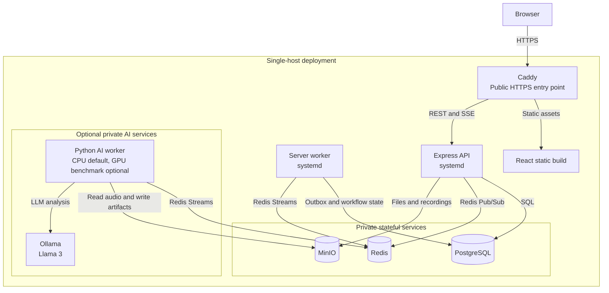

# Deployment Guidelines

This document is the operational guide for the current single-host deployment. It
supports demonstrations and small internal pilots, not a high-availability
production topology. The authoritative application configuration reference is
[`.env.example`](../.env.example).

## Architecture And Trust Boundaries

- Caddy is the only public entry point. It serves the React build and proxies
  `/api/*` and `/health*` to the Express API.
- The Express API and server worker run as separate systemd services.
- PostgreSQL, Redis, and MinIO run through the root Compose file on private
  loopback ports.
- When enabled, the Python `ai-worker` consumes Redis Streams and uses MinIO.
  Ollama provides Llama 3 analysis. Both remain private-only services.



Caddy is the public trust boundary. All other services are private to the host
or container network. PostgreSQL is the source of truth for user-visible
workflow state, Redis Streams transports AI jobs and results, and MinIO stores
recordings plus AI artifacts. The GPU profile is an optional benchmark path; the
CPU worker remains the currently verified deployment path.

Do not treat the root Compose file as an HA architecture. PostgreSQL, Redis, and
MinIO volumes are single-host state and require backups plus a tested restore
process.

## Host Bootstrap

Provision Node.js 22, npm, Git, Docker Engine with Compose, rsync, Caddy, and
systemd. Create a dedicated service account and install the supplied units:

```sh
sudo useradd --system --home /srv/meeting-mgnt --shell /usr/sbin/nologin meeting-mgnt
sudo cp deploy/meeting-mgnt-server.service /etc/systemd/system/
sudo cp deploy/meeting-mgnt-worker.service /etc/systemd/system/
sudo systemctl daemon-reload
sudo systemctl enable meeting-mgnt-server meeting-mgnt-worker
```

The deploy user must retain write access to `/srv/meeting-mgnt` for `git`, npm,
and `rsync`; do not assign exclusive ownership to a different service account.
Use a firewall to expose only Caddy's HTTP/HTTPS ports. Do not expose the API,
PostgreSQL, Redis, MinIO, FastAPI, or Ollama ports publicly.

Use a verified SSH host-key fingerprint for automated deployment. Do not rely on
an unverified `ssh-keyscan` result when preparing the host.

## Configuration And Secrets

Create `/srv/meeting-mgnt/.env` with mode `640` or stricter and make it readable
only by the application service account. Never copy development defaults or
placeholder credentials into production.

Required production settings include:

| Area           | Requirements                                                                                                         |
| -------------- | -------------------------------------------------------------------------------------------------------------------- |
| Runtime        | `NODE_ENV=production`, `TRUST_PROXY=true`, private `PORT`, same-origin `VITE_API_BASE_URL=/`                         |
| Authentication | Unique high-entropy `JWT_SECRET` and a deliberate `JWT_EXPIRES_IN`                                                   |
| Database       | Provisioned `DATABASE_URL`, PostgreSQL user/password/database, and required extensions                               |
| Redis          | Private authenticated endpoint where available; `maxmemory-policy noeviction` when AI Streams are enabled            |
| Object storage | Non-default MinIO credentials, all three buckets, and a browser-reachable HTTPS endpoint for presigned downloads     |
| Email          | Verified sender address and valid SMTP or Resend credentials                                                         |
| AI             | `AI_PIPELINE_ENABLED=true`, `AI_TRANSCRIPTION_PROVIDER=whisper`, `AI_ANALYSIS_PROVIDER=llm`, and no fixture override |

Rotate JWT, database, object-storage, email, and deployment credentials through
the approved secret-management process. Test each rotation outside an incident.

## Stateful Services

Before a release that includes migrations, take and verify a PostgreSQL backup.
Back up MinIO objects and configuration on a defined schedule, set a retention
period, and perform restore drills. Redis Streams support workflow recovery but
are not a replacement for a PostgreSQL or object-storage backup.

Start or update supporting services before application services:

```sh
cd /srv/meeting-mgnt
docker compose up -d postgres redis minio minio-init
docker compose ps
```

Verify MinIO initialization completed and all configured buckets exist before
allowing uploads or AI jobs.

## Release Procedure

1. Select the immutable commit that passed CI. Do not build the client from one
   commit and deploy server code from a later `main` commit.
2. Take the required backups and confirm their restore location and owner.
3. Update the repository, install production dependencies, and apply migrations.
4. Build the same-origin client bundle and deploy it to Caddy's configured
   `CLIENT_DIST` directory.
5. Restart the API and, when AI is enabled, the server worker.
6. Run liveness, readiness, browser, and workflow smoke checks before declaring
   the release complete.

```sh
cd /srv/meeting-mgnt
git fetch --prune origin
git checkout <verified-commit-sha>
npm ci --omit=dev --no-audit --no-fund
npm run migrate --workspace=server
sudo systemctl restart meeting-mgnt-server.service
sudo systemctl restart meeting-mgnt-worker.service
curl --fail http://127.0.0.1:3001/health/live
curl --fail http://127.0.0.1:3001/health/ready
```

`/health/live` only confirms the process is running. Require `/health/ready`
before accepting the release because it tests PostgreSQL, Redis, and MinIO
connectivity. If migration, readiness, or core browser checks fail, stop the
release and use the documented database/application rollback decision for that
version.

## AI Operations

AI requires three separate runtimes: the API, the server worker, and the Python
`ai-worker`. The server worker dispatches outbox events and consumes results;
the Python worker must be running before recordings can progress.

For an AI image or dependency update:

```sh
cd /srv/meeting-mgnt
docker compose --profile ai up -d --build ai-service ai-worker ollama
docker compose exec ollama ollama pull llama3
curl --fail http://127.0.0.1:8000/health
sudo systemctl restart meeting-mgnt-worker.service
```

The FastAPI health endpoint does not load Whisper, so it does not prove the
first transcription is warm. Keep `ai-service` port 8000 and Ollama port 11434
private. Use `docker compose logs ai-worker ollama` and the systemd journal when
diagnosing workflow delays.

## AI Capacity And Hardware Considerations

The CPU path is the only completed end-to-end benchmark. On the tested 26-minute
recording, CPU Whisper transcription took about 12 minutes and Llama 3 analysis
took about 6 minutes, for roughly 18 minutes end to end. Treat this as a
hardware-specific benchmark, not an SLA.

Use one AI worker for the initial CPU deployment: Whisper decoding is serialized
inside a worker and concurrent long recordings need explicit capacity testing.
An 8-vCPU/16-GiB-RAM host is a low-volume starting point; 16 vCPU/32 GiB is a
safer small-pilot starting point. Allocate persistent disk separately for the
Ollama model, Whisper cache, containers, and retained MinIO audio/artifacts.

The optional GPU profile targets a benchmark host, not the current production
deployment. It uses `WHISPER_DEVICE=cuda` and fails the worker at startup unless
PyTorch can access CUDA. A 12-GiB RTX 4070 Super is suitable for an initial
single-worker benchmark, but 8K Llama context and both models must be checked
for VRAM pressure. Do not claim GPU acceleration until the benchmark runbook has
been completed. See [GPU Benchmark Runbook](gpu-benchmark-runbook.md).

## Pre-Release Checklist

- PostgreSQL and MinIO backups have completed and a restore has been tested.
- Required secrets are present, non-default, and readable by the service only.
- The API, Redis, MinIO, AI, and database ports are private.
- Database migrations have been reviewed and applied once.
- `/health/live` and `/health/ready` return success.
- Login, dashboard, meeting upload/download, and one recording workflow have
  been smoke-tested when AI is enabled.
- AI logs show completion timings without logging transcript text or credentials.
- The deployed commit, migration version, configuration revision, and rollback
  decision are recorded in the release log.
