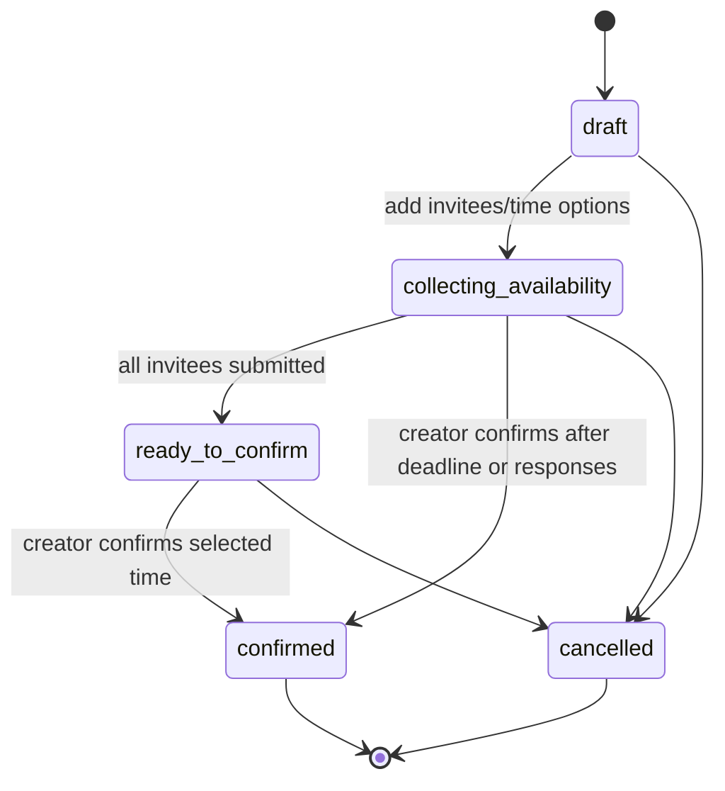
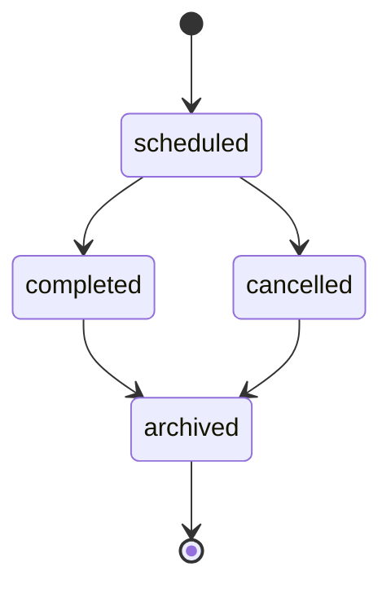
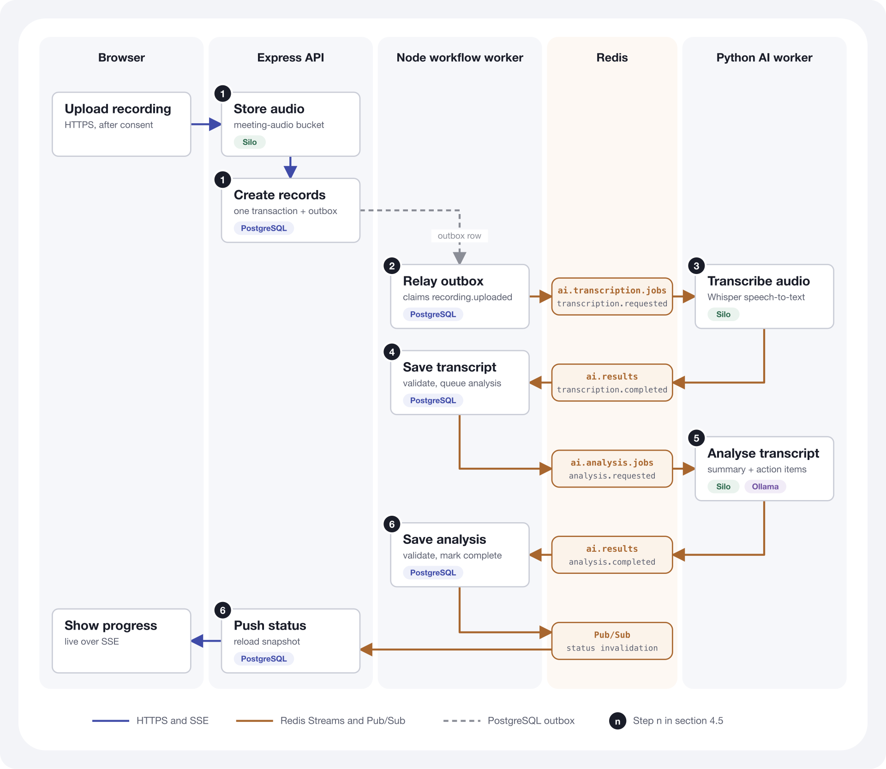
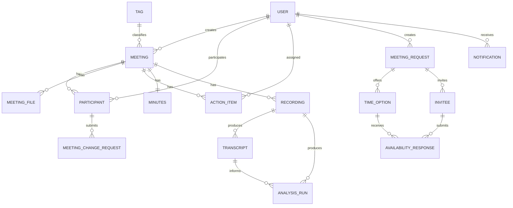

# DOST Meeting Management Technical Specification

Last updated: 2026-10-14

## 1. Purpose

DOST Meeting Management is a web application for scheduling meetings, collecting invitee
availability, confirming final meeting times, managing meeting materials and recordings,
maintaining minutes, tracking action items, and showing dashboard notifications.

This specification is written for client review. It describes the delivered system behavior,
architecture, data model, API, security requirements, and how the deployment scales. Installation
and operating procedures are covered in the separate Deployment Guide.

## 2. User Characteristics

| User type         | Characteristics                                                 | Main goals                                                                                                            | System access                                         |
| ----------------- | --------------------------------------------------------------- | --------------------------------------------------------------------------------------------------------------------- | ----------------------------------------------------- |
| Staff user        | Authenticated DOST staff member with an email/password account. | View dashboard, access assigned meetings, submit availability, manage assigned action items.                          | Authenticated web app and API access.                 |
| Meeting creator   | User who creates a meeting or meeting request.                  | Create meeting requests, add time options, invite participants, confirm meetings, manage meeting records.             | Full control of their created meetings and requests.  |
| Meeting organizer | Participant with an organizer role.                             | Help manage participants, files, recordings, and minutes for a meeting.                                               | Elevated meeting-scoped permissions.                  |
| Attendee          | Participant with an attendee role.                              | View meeting detail (action items read-only), access files/minutes, update the status of their assigned action items. | Meeting-scoped read/collaboration permissions.        |
| Administrator     | Staff user with the `admin` account role.                       | Create and manage user accounts and roles, view and manage all meetings.                                              | All meetings and user administration.                 |
| External invitee  | Person invited to a meeting request who has no account.         | Submit availability for the proposed times.                                                                           | Emailed invitation link only; no sign-in.             |
| IT administrator  | Client-side system or infrastructure administrator.             | Configure environments, operate deployments, manage capacity, validate service health.                                | Infrastructure and application administration access. |

The system supports general user profile fields such as role and department. Meeting-level
authorization is primarily based on meeting creator and participant role.

## 3. System Architecture

### 3.1 High-Level Architecture

Caddy is the public browser-facing entrypoint. The browser loads the React application from Caddy
and sends same-origin API requests back to Caddy. Caddy then forwards API, SSE, and health requests
to the private Express API service. The browser does not call the private API service directly.

The Express API and the Node workflow worker run as systemd services. PostgreSQL, Redis, and Silo
object storage run under Docker Compose, and the Python AI worker and Ollama run under the Compose
`ai` profile. Email is sent through an external SMTP or Resend account.

### 3.2 System Components

| Component            | Technology / approach                       | Client-facing responsibility                                                                 |
| -------------------- | ------------------------------------------- | -------------------------------------------------------------------------------------------- |
| Web application      | React single-page application               | Dashboard, meeting repository, meeting detail, scheduling, minutes, files, and action items. |
| API service          | Node.js and Express                         | Business rules, authorization, validation, workflow transitions, file orchestration, SSE.    |
| Node workflow worker | Node.js worker runtime                      | Dispatches durable workflow outbox events and persists AI result transitions.                |
| Python AI worker     | Python, Whisper, Redis Streams              | Transcribes recordings and generates structured summaries and proposed action items.         |
| Ollama               | Private local LLM runtime                   | Provides local structured analysis for completed transcripts.                                |
| Database             | PostgreSQL                                  | Authoritative meeting and workflow status, transcripts, analysis results, and outbox events. |
| Object storage       | Silo (S3-compatible, MinIO-compatible fork) | Meeting files, recordings, and generated transcript and analysis artifacts.                  |
| Redis                | Redis Streams and Pub/Sub                   | Delivers AI commands/results and broadcasts workflow-status invalidations.                   |
| Reverse proxy        | Caddy                                       | TLS termination, static web delivery, API routing, SSE, and browser-facing traffic control.  |
| Email                | External SMTP or Resend account             | Sends meeting invitations, confirmations, and calendar updates.                              |

### 3.3 Application Modules

| Module                         | Summary                                                                                                                   |
| ------------------------------ | ------------------------------------------------------------------------------------------------------------------------- |
| Authentication                 | Staff login, session validation, password change, authenticated API access.                                               |
| Dashboard                      | Upcoming meetings, pending meeting requests, availability requests, action items, notifications.                          |
| Meeting repository             | Searchable and filterable meeting list with meeting file visibility.                                                      |
| Meeting detail                 | Meeting metadata, participants, materials, minutes, recording, and action items.                                          |
| Scheduling requests            | Candidate time options, invitee availability, deadline handling, final confirmation.                                      |
| Participant management         | Add/remove participants and manage meeting-scoped participant roles.                                                      |
| Meeting change requests        | Attendees send the meeting owner a private request to change a meeting; the owner is notified and marks requests as read. |
| File management                | Upload, list, download, stream, and delete meeting materials.                                                             |
| Minutes management             | Meeting minutes record with editable content and publication fields.                                                      |
| Action items                   | Meeting-linked and user-linked action-item tracking.                                                                      |
| Notifications                  | In-app feed with read/unread and archive actions; email invitations and calendar updates.                                 |
| Recording-to-minutes workflow  | Durable recording, transcription, analysis, review, and status-update workflow.                                           |
| AI transcription and summaries | Whisper transcripts, structured AI summaries, and reviewable action-item suggestions.                                     |
| Administration and RBAC        | Centralized account and meeting-role permissions; administrators create and manage accounts.                              |

## 4. Core Workflows

### 4.1 Authentication

1. User submits email and password.
2. API validates credentials.
3. API returns an authenticated session token and user profile.
4. The web application uses the token for subsequent protected API calls.
5. The API rejects unauthenticated or unauthorized requests.

Self-registration is disabled by default (`SELF_REGISTRATION_ENABLED=false`). Administrators create
staff accounts, and the first administrator is created during host setup.

### 4.2 Meeting Request Scheduling

Important behavior:

- Meeting requests exist before a confirmed meeting is created.
- Invitees submit availability for offered time options. Invitees without an account respond through an
  emailed link that carries an invitation token, without signing in.
- The response deadline closes invitee submissions but does not automatically cancel the request.
- The creator may confirm a meeting after the deadline even when some invitees did not respond.
- Confirming creates the scheduled meeting and adds known invitee users as participants.

### 4.3 Meeting Lifecycle

Status transitions are forward-only. Archived meetings are treated as terminal records.

### 4.4 Files, Recordings, and Minutes

- Meeting materials are uploaded through the web application and stored in object storage.
- Meeting participants can list and download materials for meetings they can access.
- Organizers and creators can manage meeting materials and recordings.
- Download links are short-lived.
- Minutes are stored as a dedicated meeting resource.
- Uploading a recording requires the uploader to confirm participant consent and stores only the
  audio. Transcription and analysis start when the meeting creator or an organizer requests
  generation.
- Transcripts, AI summaries, decisions, and proposed action items are available for review before they
  are applied to meeting minutes.

### 4.5 Recording Analysis Workflow

Recording processing is asynchronous and uses PostgreSQL as the authoritative workflow state. The
numbered steps match the diagram:

1. A meeting creator or organizer uploads the recording after confirming participant consent. The API
   stores the audio in object storage and records the recording and the consent in PostgreSQL.
   Uploading does not start processing.
2. The creator or an organizer starts processing ("Process Recording" in the interface), which requires
   `AI_PIPELINE_ENABLED=true`. In one PostgreSQL transaction the API creates a processing transcript,
   a queued analysis run, and a `recording.generation_requested` workflow-outbox event.
3. The Node workflow worker relays the outbox event to the `ai.transcription.jobs` Redis Stream as a
   `transcription.requested` job.
4. The Python AI worker downloads the audio from object storage, runs Whisper, writes a transcript
   artifact to object storage, and publishes lifecycle/result events to the `ai.results` Redis Stream.
5. The Node workflow worker validates and persists the transcript, then creates and dispatches an
   `analysis.requested` outbox event to the `ai.analysis.jobs` Redis Stream.
6. The Python AI worker reads the transcript artifact, calls Ollama for a structured summary, key
   discussions, decisions, and proposed action items, then publishes the analysis result.
7. The Node workflow worker validates and persists the analysis result, then publishes Redis Pub/Sub
   invalidations. Connected clients receive refreshed PostgreSQL status snapshots over SSE.

Audio and transcript text are never placed in Redis. Redis carries commands, results, and status
invalidations only. Failed or duplicate deliveries are handled through retry settings and guarded
PostgreSQL workflow transitions.

## 5. Database Design

### 5.1 Entity Relationship Overview

### 5.2 Logical Data Model

| Entity                 | Purpose                                                                | Main relationships                                             |
| ---------------------- | ---------------------------------------------------------------------- | -------------------------------------------------------------- |
| User                   | Authenticated staff account and profile.                               | Creates meetings and requests; receives action items.          |
| Meeting                | Confirmed or scheduled meeting record.                                 | Has participants, files, minutes, recordings, action items.    |
| Participant            | Meeting membership and meeting-scoped role.                            | Links users to meetings.                                       |
| Meeting file           | Metadata for uploaded meeting materials.                               | Belongs to one meeting and one uploader.                       |
| Action item            | Task created from or attached to a meeting.                            | Belongs to one meeting; may be assigned to one user.           |
| Meeting request        | Scheduling poll before a meeting is confirmed.                         | Has invitees and candidate time options.                       |
| Time option            | Candidate date/time option for a meeting request.                      | Receives invitee availability responses.                       |
| Invitee                | Person invited to respond to a meeting request.                        | May link to an existing user account.                          |
| Availability response  | Invitee response for a candidate time option.                          | Belongs to one invitee and one time option.                    |
| Tag                    | Meeting repository classification.                                     | Classifies meetings.                                           |
| Recording              | Dedicated meeting recording metadata.                                  | Belongs to one meeting; may produce transcripts.               |
| Transcript             | Persisted Whisper transcript, segments, provenance, and status.        | Belongs to one recording and meeting.                          |
| Analysis run           | Generated summary, decisions, and reviewable action suggestions.       | Uses one transcript and may reference one recording.           |
| Workflow outbox        | Durable command awaiting Redis Stream dispatch.                        | Records recording and analysis workflow events.                |
| Meeting change request | Private message from an attendee asking the owner to change a meeting. | Belongs to one meeting participant; read by the meeting owner. |
| Minutes                | One meeting minutes record containing prepared meeting notes.          | Belongs to one meeting.                                        |
| Notification           | Persisted in-app notification shown in dashboard/topbar contexts.      | Belongs to one recipient user and may reference system events. |

### 5.3 Data Integrity Requirements

- Use stable unique identifiers for all primary records.
- Enforce meeting, participant, request, invitee, and recording relationships at the database level.
- Enforce valid status values for meetings, requests, minutes, transcripts, and action items.
- Enforce only one selected scheduling time option per meeting request.
- Enforce only one active dedicated recording per meeting.
- Maintain indexes for common user, meeting, status, date, search, and notification queries.

## 6. API Interface

All application APIs are exposed under the same browser-facing domain through the reverse proxy.
Application paths are prefixed with `/api` unless noted otherwise. Exact request/response schemas
should be confirmed during integration and acceptance testing.

The detailed API specification, including endpoint grouping, sample requests, path/query parameters,
and expected responses, is maintained in the Postman collection at
`docs/postman/dost-meeting-mgnt.postman_collection.json`.

### 6.1 Authentication, Session, and User Accounts

| Method | Path                | Resource              | Purpose                                                                      |
| ------ | ------------------- | --------------------- | ---------------------------------------------------------------------------- |
| POST   | `/auth/login`       | Authentication login  | Authenticate a user and issue a session.                                     |
| GET    | `/auth/me`          | Current user          | Return the current authenticated user.                                       |
| POST   | `/auth/register`    | Self-registration     | Create a staff account; returns 403 unless `SELF_REGISTRATION_ENABLED=true`. |
| PUT    | `/auth/me/password` | Current user password | Change the current user's password.                                          |
| GET    | `/users`            | User directory        | List users for assignment and participation.                                 |
| POST   | `/users`            | User accounts         | Create a user account (administrators).                                      |
| PUT    | `/users/:id`        | User account          | Update a user's profile or account role (administrators).                    |
| DELETE | `/users/:id`        | User account          | Delete a user account (administrators).                                      |

### 6.2 Meetings

| Method | Path                                                   | Resource                | Purpose                                                                    |
| ------ | ------------------------------------------------------ | ----------------------- | -------------------------------------------------------------------------- |
| POST   | `/meetings`                                            | Meetings                | Create a scheduled meeting.                                                |
| GET    | `/meetings`                                            | Meetings                | List accessible meetings with pagination, status/date filters, and search. |
| GET    | `/meetings/:id`                                        | Meeting detail          | Read one accessible meeting with participants and related records.         |
| PUT    | `/meetings/:id`                                        | Meeting detail          | Update meeting fields and enforce valid status transitions.                |
| DELETE | `/meetings/:id`                                        | Meeting detail          | Delete a meeting where the user has sufficient permission.                 |
| GET    | `/meetings/:meetingId/participants`                    | Meeting participants    | List participants.                                                         |
| POST   | `/meetings/:meetingId/participants`                    | Meeting participants    | Add participants by user and role.                                         |
| PATCH  | `/meetings/:meetingId/participants/:userId`            | Meeting participant     | Update a participant role.                                                 |
| DELETE | `/meetings/:meetingId/participants/:userId`            | Meeting participant     | Remove a participant while preserving organizer safeguards.                |
| POST   | `/meetings/:meetingId/change-requests`                 | Meeting change requests | Send the owner a change request (attendees).                               |
| GET    | `/meetings/:meetingId/change-requests`                 | Meeting change requests | List the meeting's change requests (meeting owner).                        |
| GET    | `/meetings/:meetingId/change-requests/:userId`         | Meeting change requests | List one participant's change requests (meeting owner).                    |
| PATCH  | `/meetings/:meetingId/change-requests/:requestId/read` | Meeting change request  | Mark a change request as read (meeting owner).                             |

### 6.3 Meeting Requests

| Method | Path                                                            | Resource               | Purpose                                                        |
| ------ | --------------------------------------------------------------- | ---------------------- | -------------------------------------------------------------- |
| POST   | `/meeting-requests`                                             | Meeting requests       | Create a scheduling request.                                   |
| GET    | `/meeting-requests/:requestId`                                  | Meeting request detail | Read request detail, time options, invitees, and status.       |
| PUT    | `/meeting-requests/:requestId`                                  | Meeting request        | Update request details.                                        |
| POST   | `/meeting-requests/:requestId/send-invitations`                 | Request invitations    | Email invitations to the invitees.                             |
| GET    | `/meeting-requests/:requestId/invitees/:inviteeId`              | Invitee request detail | Read invitee-specific request detail.                          |
| PUT    | `/meeting-requests/:requestId/time-options`                     | Request time options   | Replace candidate time options.                                |
| PUT    | `/meeting-requests/:requestId/invitees`                         | Request invitees       | Replace invitees.                                              |
| PUT    | `/meeting-requests/:requestId/invitees/:inviteeId/availability` | Invitee availability   | Submit availability responses.                                 |
| POST   | `/meeting-requests/:requestId/confirm`                          | Request confirmation   | Confirm selected time and create a meeting.                    |
| DELETE | `/meeting-requests/:requestId`                                  | Meeting request        | Cancel the request and linked meeting when applicable.         |
| GET    | `/public/invitations/:token`                                    | Public invitation      | Read an invitation from an emailed link; no sign-in required.  |
| PUT    | `/public/invitations/:token/availability`                       | Public invitation      | Submit availability from an emailed link; no sign-in required. |

### 6.4 Files, Recordings, Minutes, and Action Items

| Method | Path                                                             | Resource               | Purpose                                                      |
| ------ | ---------------------------------------------------------------- | ---------------------- | ------------------------------------------------------------ |
| POST   | `/meetings/:meetingId/files`                                     | Meeting files          | Upload a meeting material.                                   |
| GET    | `/meetings/:meetingId/files`                                     | Meeting files          | List meeting files.                                          |
| GET    | `/files/:id/download`                                            | File download          | Return an authorized download link.                          |
| GET    | `/files/:id/content`                                             | File content           | Stream authorized file content.                              |
| DELETE | `/files/:id`                                                     | File                   | Delete file metadata and object storage record.              |
| GET    | `/meetings/:meetingId/recording`                                 | Meeting recording      | Get the active recording and latest generation status.       |
| PUT    | `/meetings/:meetingId/recording`                                 | Meeting recording      | Upload or replace a dedicated recording.                     |
| DELETE | `/meetings/:meetingId/recording`                                 | Meeting recording      | Archive or remove the active recording.                      |
| GET    | `/meetings/:meetingId/recording/analysis`                        | Recording analysis     | Read the latest transcript analysis for review.              |
| POST   | `/meetings/:meetingId/recording/generate`                        | Generate minutes       | Start or retry transcription and analysis.                   |
| GET    | `/meetings/:meetingId/workflow/events`                           | Workflow status stream | Server-sent events with recording workflow status snapshots. |
| PATCH  | `/meetings/:meetingId/analysis-suggestions/:suggestionId`        | Action-item suggestion | Edit a proposed action item before review.                   |
| POST   | `/meetings/:meetingId/analysis-suggestions/:suggestionId/accept` | Action-item suggestion | Accept a proposed action item and create it.                 |
| POST   | `/meetings/:meetingId/analysis-suggestions/:suggestionId/reject` | Action-item suggestion | Reject a proposed action item.                               |
| GET    | `/meetings/:meetingId/minutes`                                   | Meeting minutes        | Read or initialize meeting minutes.                          |
| PUT    | `/meetings/:meetingId/minutes`                                   | Meeting minutes        | Update meeting minutes.                                      |
| PUT    | `/meetings/:meetingId/minutes/:minutesId`                        | Meeting minutes        | Update a specific minutes record.                            |
| POST   | `/meetings/:meetingId/minutes/apply-generated`                   | Meeting minutes        | Apply a reviewed AI analysis to the minutes.                 |
| GET    | `/meetings/:meetingId/action-items`                              | Meeting action items   | List meeting action items.                                   |
| POST   | `/meetings/:meetingId/action-items`                              | Meeting action items   | Create an action item.                                       |
| GET    | `/action-items`                                                  | User action items      | List current user's action items.                            |
| GET    | `/action-items/:id`                                              | Action item            | Read one action item.                                        |
| PUT    | `/action-items/:id`                                              | Action item            | Update action item content, assignee, status, or priority.   |
| DELETE | `/action-items/:id`                                              | Action item            | Delete an action item.                                       |

### 6.5 Dashboard, Notifications, Tags, and Health

Dashboard, notification, and tag paths use the `/api` prefix. Health paths are exposed without the
`/api` prefix so infrastructure can check service status directly.

| Method | Path                          | Resource             | Purpose                                      |
| ------ | ----------------------------- | -------------------- | -------------------------------------------- |
| GET    | `/dashboard`                  | Dashboard            | Return dashboard aggregate data.             |
| GET    | `/notifications/summary`      | Notification summary | Return latest topbar notification state.     |
| GET    | `/notifications`              | Notification feed    | Return paginated notifications.              |
| POST   | `/notifications/:id/read`     | Notification action  | Mark one notification as read.               |
| POST   | `/notifications/read`         | Notification action  | Mark selected notifications as read.         |
| POST   | `/notifications/read-all`     | Notification action  | Mark all notifications as read.              |
| POST   | `/notifications/:id/archive`  | Notification action  | Archive one notification.                    |
| POST   | `/notifications/archive-read` | Notification action  | Archive all read notifications.              |
| GET    | `/tags`                       | Tags                 | List meeting tags.                           |
| POST   | `/tags`                       | Tags                 | Create a meeting tag where authorized.       |
| GET    | `/health/live`                | Liveness health      | Confirm the application process is running.  |
| GET    | `/health/ready`               | Readiness health     | Confirm required dependencies are reachable. |
| GET    | `/health`                     | Readiness health     | Return readiness status and process uptime.  |

## 7. Security Requirements

### 7.1 Authentication and Session Security

- Require authenticated sessions for all non-public application functionality.
- Use strong production secrets managed by the deployment environment, not committed files.
- Configure session lifetime according to the client's risk profile.
- Store only hashed passwords.
- Never return password hashes, secret values, or infrastructure credentials in API responses.
- Keep self-registration disabled for staff-only deployments; administrators create accounts.

### 7.2 Authorization

- Enforce meeting access by creator or participant membership.
- Restrict participant management, file deletion, recording management, and minutes updates to the
  meeting creator or organizers.
- Restrict meeting request management to the request creator.
- Allow invitee-specific availability submission only for the relevant invitee or request creator.
- Prevent removal or demotion of the last organizer for a meeting.
- Allow only attendees to send meeting change requests, and only the meeting owner to read them.
- Apply account-level (`staff`, `admin`) and meeting-level role permissions from one central
  permission map; administrators have consistent access across meetings and user management.

### 7.3 Input Validation

- Validate all external input at the API boundary.
- Validate identifiers, dates, time ranges, status values, roles, priorities, and search parameters.
- Reject malformed or unsupported values early with consistent error responses.
- Sanitize and bound free-text search inputs.
- Apply upload size and file-type validation based on the target upload workflow.

### 7.4 Network and Proxy Security

- Keep the reverse proxy as the only public entrypoint.
- Keep the API service, database, Redis, and object storage on private network paths.
- Use HTTPS for browser traffic.
- Enable API rate limiting and proxy-aware client IP handling.
- Avoid exposing administrative consoles publicly unless protected by network and identity controls.

### 7.5 File and Object Storage Security

- Require meeting access before listing, uploading, streaming, or downloading meeting materials.
- Use short-lived download links where presigned access is required.
- Store object storage credentials securely in the deployment environment.
- Separate ordinary meeting files from recording/audio artifacts at the bucket or policy level.
- Treat recording uploads as a high-risk workflow: require uploader consent and enforce the upload size
  limit.

## 8. Deployment and Scalability

Installation, configuration, and operating procedures are in the separate Deployment Guide. This
section covers only how the current deployment scales.

### 8.1 Current Deployment

The delivered system runs on a single host (Deployment Guide, Option 1), as shown in Section 3.1.
This suits demonstrations and small pilots. It is not highly available: a host or disk failure
stops the service. No load test has been run, so no capacity figure is claimed.

### 8.2 Scalability by Component

| Component            | Can it scale today? | How it scales                                                                                                                                                                                                                                                                                              |
| -------------------- | ------------------- | ---------------------------------------------------------------------------------------------------------------------------------------------------------------------------------------------------------------------------------------------------------------------------------------------------------- |
| Express API          | Yes                 | Run more instances behind Caddy. Sessions are stateless JWTs and SSE status updates fan out through Redis Pub/Sub, so any instance can serve any client. Rate limiting is counted in each process's memory, so each instance applies its own limit; a shared Redis store gives one limit across instances. |
| Node workflow worker | Yes                 | Run more worker processes. Outbox rows are claimed with `FOR UPDATE SKIP LOCKED`, and AI results are read through a Redis Streams consumer group with a unique consumer name per process.                                                                                                                  |
| Python AI worker     | Yes                 | Add worker containers or hosts. Transcription and analysis jobs are shared through Redis Streams consumer groups, and jobs left by a stopped worker are reclaimed. Each worker runs one job at a time.                                                                                                     |
| Ollama               | Vertically          | Use more CPU cores or a GPU, or move Ollama to its own host through `OLLAMA_BASE_URL`.                                                                                                                                                                                                                     |
| PostgreSQL           | Vertically          | Runs as one Compose container. Scale the host up, or move to a managed or replicated PostgreSQL by changing `DATABASE_URL`.                                                                                                                                                                                |
| Redis                | Vertically          | Runs as one node. Use a managed or Sentinel-based Redis with the `noeviction` policy for high availability, set through `REDIS_URL` and, for the AI worker container, `AI_WORKER_REDIS_URL`.                                                                                                               |
| Object storage       | Vertically          | Runs as one Silo node. Any S3-compatible store, including managed object storage, can replace it through the `MINIO_*` settings and, for the AI worker container, the `AI_WORKER_MINIO_*` settings.                                                                                                        |

Recording and file uploads are buffered in API memory (up to 50 MB per request), so API memory should
grow with the number of concurrent uploads.

### 8.3 Scaling Path

1. Scale the single host up: more vCPU and RAM, or a GPU for Whisper and Ollama.
2. Move PostgreSQL and object storage to managed services and keep one application host
   (Deployment Guide, Option 2).
3. Run two or more application hosts behind a load balancer, with managed PostgreSQL, a managed
   Redis-compatible cache, managed object storage, and a separate AI host (Deployment Guide, Option 3).
   Move rate limiting to the shared Redis store so that one limit applies across hosts.

## 9. Testing and Validation

| Scope                    | Validation expectation                                                                   |
| ------------------------ | ---------------------------------------------------------------------------------------- |
| Functional testing       | Login, dashboard, meeting creation, scheduling requests, meeting detail, files, minutes. |
| API testing              | Authentication, authorization, validation errors, pagination, status transitions.        |
| Database testing         | Migration application, data integrity constraints, relationship behavior.                |
| File testing             | Upload, download, stream, delete, size limits, unauthorized access rejection.            |
| Security testing         | Authenticated route protection, meeting-scoped permissions, rate limiting.               |
| Deployment smoke testing | Liveness/readiness health, login, dashboard, core meeting workflow, file access.         |

Readiness health should fail when required dependencies are unavailable. Liveness health should only
confirm that the application process is running.
